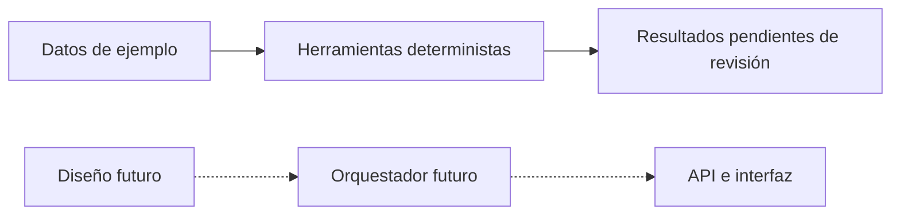

# Veltri Tecnologic

Sistema previsto para cotizar PCs en soles, validar compatibilidad y stock,
conciliar pagos y registrar pedidos con revisión humana.

## Estado y problema
FASES 1, 2, 3, 4, 5 y 6 completadas: datos sintéticos y herramientas deterministas para evitar referencias
rotas, montos inválidos y ventas de productos agotados. Las herramientas operan solo en demostración; los flujos integrados siguen pendientes.
La fábrica permite MockLLM y un conector real configurado; la verificación no llama a la red.

## Arquitectura y agentes A1 a A8
Diseño futuro en docs/arquitectura.md: ventas D1 (A1–A3), técnico D2 (A4),
inventario D3 (A5), pedidos y pagos D4 (A6–A8). Los agentes individuales ya se
implementaron en fase 6. La generación RAG, el grafo, la API y la interfaz
siguen pendientes de integración.



## HITL y casos CP-1 a CP-7
Stock agotado, pago discordante, incompatibilidad y exceso de presupuesto exigen
revisión humana. Los casos dorados describen comportamiento futuro; no se afirma
que esos siete flujos pasen. Se validan las piezas deterministas de stock, presupuesto, pago e idempotencia;
los escenarios integrados siguen pendientes.

## Instalación en Windows
Python 3.12 o superior (verificado con 3.14.4) y Git:
```powershell
python -m venv .venv
.\.venv\Scripts\python -m pip install -r requirements-fase6.txt
.\.venv\Scripts\Activate.ps1
python scripts/verificar.py
git init
python scripts/instalar_hooks.py
```
Si PowerShell impide activar, usar directamente `.\.venv\Scripts\python`.
requirements-dev.txt conserva la lista completa de la plantilla; la verificación actual usa
pytest, ruff, Pydantic, ChromaDB, filelock, dotenv y google-genai.
Las pruebas usan MockLLM o transporte simulado, sin consultas reales.
El hook instalado protege commits, no impide editar archivos.
No se instaló settings.json ni configuración MCP. La detección automática de
Rules/Workflows/Skills por el IDE no está comprobada: se leyeron como guías.

## Estructura
`data/`: catálogo, relaciones y políticas; `docs/datos.md`: campos y supuestos;
`tests/test_datos.py`: integridad; `scripts/`: verificadores y protección;
`.agents/`: guías instaladas; `claude/`: referencia conservada;
`src/tools/`: herramientas locales; `src/schemas/`: contratos tipados; el resto de `src/`, `frontend/` y `evals/`
conservan el esqueleto y escenarios de fases futuras.

## Uso de IA
Codex asistió en la preparación, datos sintéticos, documentación y pruebas.
El equipo debe revisar la entrega y responde por su uso; no se declara revisión
humana ya realizada ni uso de otros asistentes no comprobado.

## Aviso
Precios, stock, fichas y políticas de ejemplo NO son datos reales de la tienda.
Las decisiones propuestas en data/politicas.md requieren aprobación. No usar
este catálogo para vender o prometer compatibilidad de modelos comerciales.

## Avance FASE 2
Herramientas deterministas en src/tools/ y pruebas en tests/test_herramientas.py:
catálogo, stock, compatibilidad, cotización, armado por presupuesto, comparación
de importes y borradores idempotentes de demostración. Contratos y límites en
docs/herramientas.md. En ese estado aún no había API ni agentes ejecutables. Las cotizaciones no se
aprueban con fichas sintéticas; los pagos siguen no conciliados sin evidencia.
No se añadieron dependencias: el entorno de verificación de fase 1 sigue vigente.

## Avance FASE 3
Contratos estrictos Pydantic, incluido ConsultaResponse 1.0-demo, en src/schemas/.
Documentación en docs/esquemas.md y JSON Schema en docs/contratos/. La validación
rechaza tipos incorrectos, campos extra, totales incoherentes y revisión ocultada.
Al cerrar fase 3 no había endpoints, generación con LLM ni agentes. Regenerar contratos con
`python scripts/exportar_esquemas.py`. Dependencias mínimas actuales en
requirements-fase3.txt; las listas de fases anteriores se conservan.

## Avance FASE 4
Ingesta y recuperación local en ChromaDB con tenant obligatorio y vectores léxicos
sin modelos. Se indexan únicamente las tres fuentes sintéticas de data/, con citas
y hashes de versión. Detalles y límites en docs/conocimiento.md.
```powershell
python -m src.knowledge.ingesta --tenant veltri_tecnologic_pe
```
El índice chroma_db/ es local y está excluido de Git. La recuperación no autoriza
ventas ni reemplaza el stock de las herramientas. Aún no hay RAG generativo.

## Avance FASE 5
Compuerta tipada y bandeja de revisión local en src/core/decision.py y
src/core/hitl.py, con umbrales protegidos. Los bloqueos de negocio tienen
prioridad sobre puntuaciones sintéticas; ninguna resolución ejecuta una venta.
Contratos y límites en docs/decision_hitl.md. Sin nuevas dependencias.
`python -m pytest tests/test_decision_hitl.py -q` verifica esta fase.
La bandeja no autentica revisores ni persiste entre reinicios; no hay grafo ni API.

## Avance FASE 6
Ocho agentes independientes con BaseAgent, prompts y planes tipados. Configuración
y fábrica única get_llm, MockLLM programado y conector Gemini con JSON Schema.
A1 clasifica intención; A2 arma; A3 cotiza; A4 valida; A5 consulta stock; A6 compara
pagos; A7 crea borradores; A8 consulta borradores del mismo tenant. No hay
confirmaciones comerciales, grafo ni API. Documentación en docs/agentes.md y
diagramas por agente en docs/agentes/. Los precios y stock siguen siendo ejemplos.
