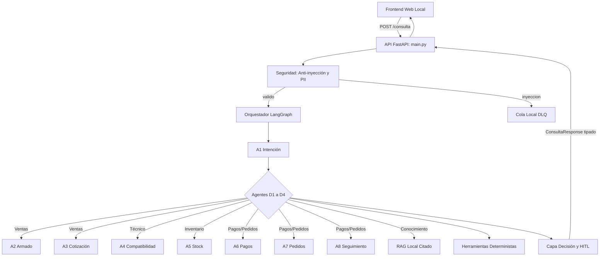

# Veltri Tecnologic

Sistema previsto para cotizar PCs en soles, validar compatibilidad y stock,
comparar importes y registrar borradores con revisión humana.

## Estado y problema
FASES 1 a 10 completadas: datos sintéticos, herramientas deterministas, contratos estrictos,
conocimiento RAG, compuerta HITL, ocho agentes tipados, orquestador LangGraph, API FastAPI,
interfaz web local en frontend/ con consola comercial, motor de memoria conversacional y
catálogo visual interactivo de hardware con 84 componentes sintéticos verificados.
El endpoint POST /consulta expone el orquestador bajo el contrato único ConsultaResponse,
GET /catalogo provee el inventario clasificado y la raíz sirve la interfaz web local.
Las demostraciones locales de LCEL, HITL nativo y Deep Agents se ejecutan por separado con MockLLM. La [arquitectura](docs/arquitectura.md) documenta las demos de las semanas 10 y 11, la observabilidad y la recuperación de evidencias históricas.

## Arquitectura y agentes A1 a A8
Arquitectura por capas implementada en `src/`: orquestador LangGraph (`src/graph/`),
capa de decisión y compuerta HITL (`src/core/`), ocho agentes tipados (`src/agents/`),
almacén de conocimiento RAG (`src/knowledge/`), herramientas deterministas (`src/tools/`),
fachada API FastAPI (`src/api/main.py`) e interfaz web local (`frontend/`).

- **D1 Ventas:** A1 Interpretación de intención, A2 Armado de configuración, A3 Cotización formal.
- **D2 Técnico:** A4 Validación de compatibilidad técnica, TDP, sockets y cuello de botella.
- **D3 Inventario:** A5 Verificación de stock disponible por SKU en almacén.
- **D4 Pedidos y Pagos:** A6 Comparación de importes, A7 Registro de borradores idempotentes, A8 Seguimiento de pedidos.



## HITL y casos CP-1 a CP-7
Stock agotado, pago discordante, incompatibilidad de socket y exceso de presupuesto exigen
revisión humana obligatoria (HITL). Las probabilidades o confianza alta del LLM nunca conceden
autorización. Los siete casos dorados (`evals/casos_dorados.json`) están integrados y verificados
mediante pruebas de flujo (`tests/test_flujo.py`) y de API (`tests/test_api.py`); esto no acredita cumplimiento comercial completo,
además de contar con botones de prueba inmediata en la interfaz web:
- **CP-1:** Cotización gaming sintética dentro del presupuesto.
- **CP-2:** Inyección de prompt bloqueada y registrada en DLQ.
- **CP-3:** Ryzen 5 5500 sin stock; revisión y alternativas.
- **CP-4:** Presupuesto insuficiente para la configuración solicitada.
- **CP-5:** Pago discrepante; revisión humana, sin conciliación bancaria real.
- **CP-6:** Borradores idempotentes mediante SHA-256.
- **CP-7:** Armador determinista por rangos de presupuesto.


## Instalación y operación local

Perfil nativo con **CPython 3.14 x64**, navegador y Git para trabajar con el repositorio.
Los comandos usan el intérprete del entorno virtual sin activación.

**Windows (PowerShell)**

```powershell
py -3.14 scripts/veltri_local.py instalar
.\.venv\Scripts\python.exe scripts/veltri_local.py comprobar
.\.venv\Scripts\python.exe scripts/veltri_local.py iniciar
```

**Linux**

```sh
python3.14 scripts/veltri_local.py instalar
.venv/bin/python scripts/veltri_local.py comprobar
.venv/bin/python scripts/veltri_local.py iniciar
```

Abre [Veltri en el navegador local](http://127.0.0.1:8765/). El comando de inicio reserva
loopback y arranca un solo proceso con MockLLM, sin credenciales ni configuración `.env`.
Para detenerlo usa **Ctrl+C** en su terminal. Desde otro terminal, usa el mismo intérprete y
ejecuta `scripts/veltri_local.py estado` o `scripts/veltri_local.py detener`.

El catálogo y el índice RAG quedan en disco. El arranque inicial crea el índice de demostración
para el tenant `veltri` en `chroma_db/`. Al actualizar el corpus o añadir un tenant, detén el
servidor y ejecuta `scripts/veltri_local.py indexar --tenant IDENTIFICADOR` con el mismo
intérprete. Los borradores, revisiones y métricas del proceso se reinician deliberadamente.
En el navegador, se conserva la preferencia de tema.

Para desarrollar y ejecutar las pruebas, añade `--desarrollo` al comando de instalación.
Luego ejecuta `scripts/verificar.py` e instala el hook con `scripts/instalar_hooks.py`.
Consulta los límites operativos y la propuesta académica en la [arquitectura](docs/arquitectura.md).

## Estructura

| Ruta | Contenido |
|---|---|
| `AGENTS.md` | Invariantes y reglas de desarrollo |
| `src/` | API, grafo, agentes, contratos, herramientas, RAG y demos académicas |
| `frontend/` | Consola web local |
| `data/` | Catálogo, compatibilidad y políticas sintéticas |
| `evals/` | Casos dorados CP-1 a CP-7 y línea base protegida |
| `scripts/` | Verificación, protección, exportación y demos |
| `tests/` | Pruebas unitarias y de integración |
| `docs/` | Arquitectura, Deep Agents, BPMN y registro operativo de LangSmith |
| `.github/workflows/` | Verificación continua en `main` |

## Uso de IA
Codex asistió en la preparación, datos sintéticos, documentación y pruebas.
El equipo debe revisar la entrega y responde por su uso; no se declara revisión
humana ya realizada ni uso de otros asistentes no comprobado.

## Aviso
Precios, stock, fichas y políticas de ejemplo NO son datos reales de la tienda.
Las decisiones propuestas en data/politicas.md requieren aprobación. No usar
este catálogo para vender o prometer compatibilidad de modelos comerciales.
