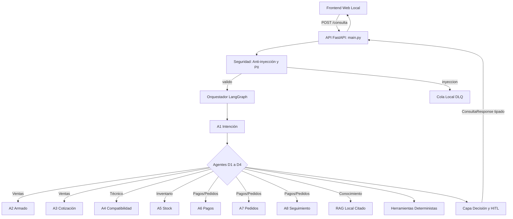

# Veltri Tecnologic

Sistema previsto para cotizar PCs en soles, validar compatibilidad y stock,
conciliar pagos y registrar pedidos con revisión humana.

## Estado y problema
FASES 1 a 10 completadas: datos sintéticos, herramientas deterministas, contratos estrictos,
conocimiento RAG, compuerta HITL, ocho agentes tipados, orquestador LangGraph, API FastAPI,
interfaz web local en frontend/ con consola comercial, motor de memoria conversacional y
catálogo visual interactivo de hardware con 84 componentes sintéticos verificados.
El endpoint POST /consulta expone el orquestador bajo el contrato único ConsultaResponse,
GET /catalogo provee el inventario clasificado y sirve la interfaz web estáticamente en la raíz sin dependencias CDN ni emojis.
Semana 10 incluye LCEL, HITL nativo y Deep Agents académicos reales en `src/academic/`, separados del flujo comercial. El Word actual tiene 17 páginas y el expediente conserva 464 pruebas aprobadas. Siguen pendientes capturas auténticas y la acreditación visual de LangSmith.
Consulta [el índice de documentación](docs/README.md) para distinguir estado actual y registros históricos.
La fábrica permite MockLLM y un conector real configurado; la verificación no llama a la red.

## Arquitectura y agentes A1 a A8
Arquitectura por capas implementada en `src/`: orquestador LangGraph (`src/graph/`),
capa de decisión y compuerta HITL (`src/core/`), ocho agentes tipados (`src/agents/`),
almacén de conocimiento RAG (`src/knowledge/`), herramientas deterministas (`src/tools/`),
fachada API FastAPI (`src/api/main.py`) e interfaz web local (`frontend/`).

- **D1 Ventas:** A1 Interpretación de intención, A2 Armado de configuración, A3 Cotización formal.
- **D2 Técnico:** A4 Validación de compatibilidad técnica, TDP, sockets y cuello de botella.
- **D3 Inventario:** A5 Verificación de stock disponible por SKU en almacén.
- **D4 Pedidos y Pagos:** A6 Conciliación de comprobantes de pago, A7 Registro de borradores idempotentes, A8 Seguimiento de pedidos.



## HITL y casos CP-1 a CP-7
Stock agotado, pago discordante, incompatibilidad de socket y exceso de presupuesto exigen
revisión humana obligatoria (HITL). Las probabilidades o confianza alta del LLM nunca conceden
autorización. Los siete casos dorados (`evals/casos_dorados.json`) están integrados y verificados
mediante pruebas de flujo (`tests/test_flujo.py`) y de API (`tests/test_api.py`); esto no acredita cumplimiento comercial completo,
además de contar con botones de prueba inmediata en la interfaz web:
- **CP-1:** Cotización gaming sintética dentro del presupuesto.
- **CP-2:** Inyección de prompt bloqueada y registrada en DLQ.
- **CP-3:** Ryzen 5 5500 sin stock; revisión y alternativas.
- **CP-4:** Presupuesto insuficiente para la configuración solicitada.
- **CP-5:** Pago discrepante; revisión humana, sin conciliación bancaria real.
- **CP-6:** Borradores idempotentes mediante SHA-256.
- **CP-7:** Armador determinista por rangos de presupuesto.


## Instalación en Windows
Perfil de instalación reproducido: **CPython 3.14, Windows x64** y Git. No se certifican aquí otros intérpretes o plataformas:
```powershell
python -m venv .venv
.\.venv\Scripts\python -m pip install -r requirements-dev.txt
.\.venv\Scripts\Activate.ps1
python scripts/verificar.py
git init
python scripts/instalar_hooks.py
uvicorn src.api.main:app --reload
```
La aplicación web queda disponible localmente en `http://localhost:8000`.
Si PowerShell impide activar el entorno, usar directamente `.\.venv\Scripts\python`.
`requirements.txt` fija las dependencias directas y transitivas de la aplicación, LCEL, LangGraph, Deep Agents y LangSmith.
`requirements-dev.txt` añade pruebas, Ruff y las bibliotecas del generador Word.
`requirements-academico.txt` es únicamente un alias compatible con instrucciones académicas anteriores.
Los siete manifiestos por fase se retiraron después de instalar estos requisitos desde cero sin red y aprobar las 464 pruebas.
Los resultados y las instrucciones de recuperación están en [el resumen de mantenimiento](docs/mantenimiento.md).
Las pruebas de lógica usan MockLLM o transporte simulado, garantizando ejecución sin conexión a red ni gasto de cuota.
El hook instalado protege commits contra ediciones de archivos críticos, no impide editar archivos en local.

## Estructura
`data/`: catálogo, relaciones y políticas; `docs/`: documentación de arquitectura, datos, herramientas, esquemas, interfaz y entrega académica;
`tests/`: pruebas unitarias e integradas (464 pruebas); `scripts/`: verificadores y protección;
`.agents/`: reglas, workflows y skills vigentes;
`src/`: núcleo, herramientas, contratos tipados, conocimiento RAG, agentes A1-A8, orquestador LangGraph y API FastAPI;
`frontend/`: interfaz web local SPA (HTML, CSS y JS sin dependencias externas ni CDN);
`evals/`: casos dorados CP-1 a CP-7 y línea base.

## Uso de IA
Codex asistió en la preparación, datos sintéticos, documentación y pruebas.
El equipo debe revisar la entrega y responde por su uso; no se declara revisión
humana ya realizada ni uso de otros asistentes no comprobado.

## Aviso
Precios, stock, fichas y políticas de ejemplo NO son datos reales de la tienda.
Las decisiones propuestas en data/politicas.md requieren aprobación. No usar
este catálogo para vender o prometer compatibilidad de modelos comerciales.
