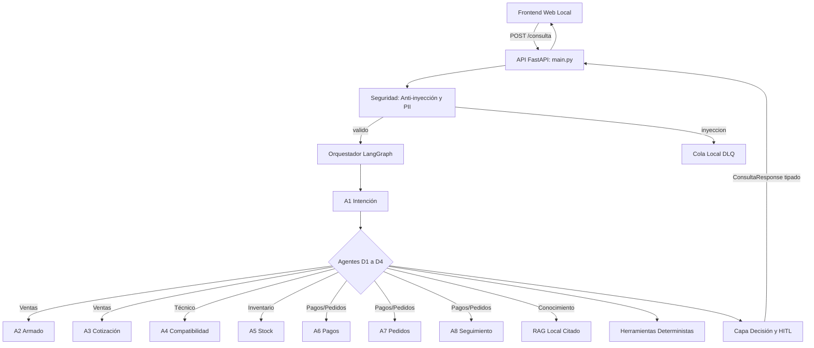

# Veltri Tecnologic

Sistema previsto para cotizar PCs en soles, validar compatibilidad y stock,
conciliar pagos y registrar pedidos con revisión humana.

## Estado y problema
FASES 1 a 9 completadas: datos sintéticos, herramientas deterministas, contratos estrictos,
conocimiento RAG, compuerta HITL, ocho agentes tipados, orquestador LangGraph, API FastAPI
e interfaz web local en frontend/.
El endpoint POST /consulta expone el orquestador bajo el contrato único ConsultaResponse y
sirve la interfaz web estáticamente en la raíz sin dependencias CDN ni emojis.
Solo queda pendiente la demo final y verificación de preflight para entrega.
La fábrica permite MockLLM y un conector real configurado; la verificación no llama a la red.

## Arquitectura y agentes A1 a A8
Arquitectura por capas implementada en `src/`: orquestador LangGraph (`src/graph/`),
capa de decisión y compuerta HITL (`src/core/`), ocho agentes tipados (`src/agents/`),
almacén de conocimiento RAG (`src/knowledge/`), herramientas deterministas (`src/tools/`),
fachada API FastAPI (`src/api/main.py`) e interfaz web local (`frontend/`).

- **D1 Ventas:** A1 Interpretación de intención, A2 Armado de configuración, A3 Cotización formal.
- **D2 Técnico:** A4 Validación de compatibilidad técnica, TDP, sockets y cuello de botella.
- **D3 Inventario:** A5 Verificación de stock disponible por SKU en almacén.
- **D4 Pedidos y Pagos:** A6 Conciliación de comprobantes de pago, A7 Registro de borradores idempotentes, A8 Seguimiento de pedidos.



## HITL y casos CP-1 a CP-7
Stock agotado, pago discordante, incompatibilidad de socket y exceso de presupuesto exigen
revisión humana obligatoria (HITL). Las probabilidades o confianza alta del LLM nunca conceden
autorización. Los siete casos dorados (`evals/casos_dorados.json`) están integrados y verificados
al 100% de extremo a extremo en pruebas de flujo (`tests/test_flujo.py`) y de API (`tests/test_api.py`),
además de contar con botones de prueba inmediata en la interfaz web:
- **CP-1:** Oficina básica con presupuesto holgado (aprobado automáticamente).
- **CP-2:** Gaming gama media AM5 con tarjeta dedicada (aprobado automáticamente).
- **CP-3:** Incompatibilidad técnica de socket LGA1700 vs placa AM5 (rechazado / HITL técnico).
- **CP-4:** Stock insuficiente de procesador crítico (derivado a HITL de inventario).
- **CP-5:** Presupuesto insuficiente para la gama solicitada (derivado a HITL comercial).
- **CP-6:** Conciliación de pago bancario válido con código de operación (aprobado).
- **CP-7:** Pago discordante por monto inferior al total de cotización (derivado a HITL financiero).

## Instalación en Windows
Python 3.12 o superior (verificado con 3.14.4) y Git:
```powershell
python -m venv .venv
.\.venv\Scripts\python -m pip install -r requirements-fase9.txt
.\.venv\Scripts\Activate.ps1
python scripts/verificar.py
git init
python scripts/instalar_hooks.py
uvicorn src.api.main:app --reload
```
La aplicación web queda disponible localmente en `http://localhost:8000`.
Si PowerShell impide activar el entorno, usar directamente `.\.venv\Scripts\python`.
`requirements-dev.txt` conserva la lista completa de la plantilla; la verificación actual usa
pytest, ruff, Pydantic, ChromaDB, filelock, dotenv, google-genai, langgraph, langsmith, fastapi, httpx y uvicorn.
Las pruebas de lógica usan MockLLM o transporte simulado, garantizando ejecución sin conexión a red ni gasto de cuota.
El hook instalado protege commits contra ediciones de archivos críticos, no impide editar archivos en local.

## Estructura
`data/`: catálogo, relaciones y políticas; `docs/`: documentación de arquitectura, datos, herramientas, esquemas, interfaz y guion;
`tests/`: pruebas unitarias e integradas (386 pruebas); `scripts/`: verificadores y protección;
`.agents/`: guías instaladas; `claude/`: referencia conservada;
`src/`: núcleo, herramientas, contratos tipados, conocimiento RAG, agentes A1-A8, orquestador LangGraph y API FastAPI;
`frontend/`: interfaz web local SPA (HTML, CSS y JS sin dependencias externas ni CDN);
`evals/`: casos dorados CP-1 a CP-7 y línea base.

## Uso de IA
Codex asistió en la preparación, datos sintéticos, documentación y pruebas.
El equipo debe revisar la entrega y responde por su uso; no se declara revisión
humana ya realizada ni uso de otros asistentes no comprobado.

## Aviso
Precios, stock, fichas y políticas de ejemplo NO son datos reales de la tienda.
Las decisiones propuestas en data/politicas.md requieren aprobación. No usar
este catálogo para vender o prometer compatibilidad de modelos comerciales.

## Avance FASE 2
Herramientas deterministas en src/tools/ y pruebas en tests/test_herramientas.py:
catálogo, stock, compatibilidad, cotización, armado por presupuesto, comparación
de importes y borradores idempotentes de demostración. Contratos y límites en
docs/herramientas.md. En ese estado aún no había API ni agentes ejecutables. Las cotizaciones no se
aprueban con fichas sintéticas; los pagos siguen no conciliados sin evidencia.
No se añadieron dependencias: el entorno de verificación de fase 1 sigue vigente.

## Avance FASE 3
Contratos estrictos Pydantic, incluido ConsultaResponse 1.0-demo, en src/schemas/.
Documentación en docs/esquemas.md y JSON Schema en docs/contratos/. La validación
rechaza tipos incorrectos, campos extra, totales incoherentes y revisión ocultada.
Al cerrar fase 3 no había endpoints, generación con LLM ni agentes. Regenerar contratos con
`python scripts/exportar_esquemas.py`. Dependencias mínimas actuales en
requirements-fase3.txt; las listas de fases anteriores se conservan.

## Avance FASE 4
Ingesta y recuperación local en ChromaDB con tenant obligatorio y vectores léxicos
sin modelos. Se indexan únicamente las tres fuentes sintéticas de data/, con citas
y hashes de versión. Detalles y límites en docs/conocimiento.md.
```powershell
python -m src.knowledge.ingesta --tenant veltri_tecnologic_pe
```
El índice chroma_db/ es local y está excluido de Git. La recuperación no autoriza
ventas ni reemplaza el stock de las herramientas. Aún no hay RAG generativo.

## Avance FASE 5
Compuerta tipada y bandeja de revisión local en src/core/decision.py y
src/core/hitl.py, con umbrales protegidos. Los bloqueos de negocio tienen
prioridad sobre puntuaciones sintéticas; ninguna resolución ejecuta una venta.
Contratos y límites en docs/decision_hitl.md. Sin nuevas dependencias.
`python -m pytest tests/test_decision_hitl.py -q` verifica esta fase.
La bandeja no autentica revisores ni persiste entre reinicios; no hay grafo ni API.

## Avance FASE 6
Ocho agentes independientes con BaseAgent, prompts y planes tipados. Configuración
y fábrica única get_llm, MockLLM programado y conector Gemini con JSON Schema.
A1 clasifica intención; A2 arma; A3 cotiza; A4 valida; A5 consulta stock; A6 compara
pagos; A7 crea borradores; A8 consulta borradores del mismo tenant. No hay
confirmaciones comerciales, grafo ni API. Documentación en docs/agentes.md y
diagramas por agente en docs/agentes/. Los precios y stock siguen siendo ejemplos.

## Avance FASE 7
Orquestador LangGraph acotado en src/graph/ (state.py, nodes.py, workflow.py), seguridad
previa y DLQ local en src/core/dlq.py, contratos de flujo en src/schemas/flujo.py y
pruebas integradas en tests/test_flujo.py. A1 clasifica la intención fuera del grafo;
el StateGraph conecta los siete agentes de dominio sin guardar texto libre en su estado,
sin checkpointer y con trazas desactivadas. Los mensajes bloqueados registran un evento
técnico mínimo en DLQ. Decisiones pendientes y limitaciones explícitas fuerzan revisión
humana en la BandejaRevision del tenant sin aprobar negocio. Los casos dorados CP-1 a CP-7
se validan de extremo a extremo con MockLLM. Sin API ni interfaz en esta fase.

## Avance FASE 8
API FastAPI en src/api/main.py y pruebas en tests/test_api.py. El endpoint POST /consulta
recibe SolicitudAPI (formato plano o anidado) y responde estrictamente con el contrato
ConsultaResponse 1.0-demo. Toda excepción HTTP o de validación (422, 404, 500) devuelve
siempre un JSON estructurado tipado sin filtrar trazas ni datos privados. La aplicación
desactiva documentación externa (docs_url=None, redoc_url=None) eliminando cualquier
dependencia de CDN. Los siete casos dorados CP-1 a CP-7 se validan sobre el endpoint
HTTP con TestClient sin conexión a red. Iniciar servidor con `uvicorn src.api.main:app --reload`.

## Avance FASE 9
Interfaz web local (SPA) en frontend/ con Consola Comercial, Supervisión Humana (HITL) y
Trazas de Telemetría. Diseñada sin dependencias CDN, sin emojis (iconos SVG vectoriales locales)
y con cumplimiento WCAG AA. Soporta botones de prueba inmediata para los casos dorados CP-1 a CP-7,
proformas estructuradas en Soles (S/) y supervisión interactiva con aprobación/rechazo en la
compuerta HITL. Documentación completa en docs/interfaz.md. Servir localmente con
`uvicorn src.api.main:app --reload` y acceder en `http://localhost:8000`.


