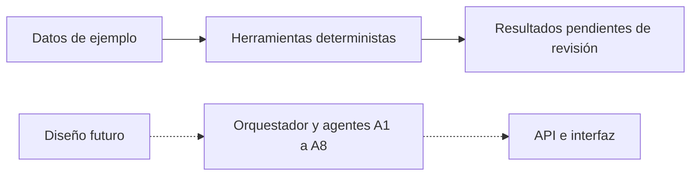

# Veltri Tecnologic

Sistema previsto para cotizar PCs en soles, validar compatibilidad y stock,
conciliar pagos y registrar pedidos con revisión humana.

## Estado y problema
FASES 1, 2 y 3 completadas: datos sintéticos y herramientas deterministas para evitar referencias
rotas, montos inválidos y ventas de productos agotados. Las herramientas operan solo en demostración; los flujos integrados siguen pendientes.
La plantilla conserva su acceso al modelo sin uso.

## Arquitectura y agentes A1 a A8
Diseño futuro en docs/arquitectura.md: ventas D1 (A1–A3), técnico D2 (A4),
inventario D3 (A5), pedidos y pagos D4 (A6–A8). No hay agentes ejecutables,
RAG, grafo, API ni interfaz funcional. Las carpetas correspondientes son esqueletos.



## HITL y casos CP-1 a CP-7
Stock agotado, pago discordante, incompatibilidad y exceso de presupuesto exigen
revisión humana. Los casos dorados describen comportamiento futuro; no se afirma
que esos siete flujos pasen. Se validan las piezas deterministas de stock, presupuesto, pago e idempotencia;
los escenarios integrados siguen pendientes.

## Instalación en Windows
Python 3.12 o superior (verificado con 3.14.4) y Git:
```powershell
python -m venv .venv
.\.venv\Scripts\python -m pip install -r requirements-fase3.txt
.\.venv\Scripts\Activate.ps1
python scripts/verificar.py
git init
python scripts/instalar_hooks.py
```
Si PowerShell impide activar, usar directamente `.\.venv\Scripts\python`.
requirements-dev.txt conserva la lista completa de la plantilla; la verificación actual usa
pytest, ruff y Pydantic para contratos, sin instalar agentes ni llamar al modelo.
El hook instalado protege commits, no impide editar archivos.
No se instaló settings.json ni configuración MCP. La detección automática de
Rules/Workflows/Skills por el IDE no está comprobada: se leyeron como guías.

## Estructura
`data/`: catálogo, relaciones y políticas; `docs/datos.md`: campos y supuestos;
`tests/test_datos.py`: integridad; `scripts/`: verificadores y protección;
`.agents/`: guías instaladas; `claude/`: referencia conservada;
`src/tools/`: herramientas locales; `src/schemas/`: contratos tipados; el resto de `src/`, `frontend/` y `evals/`
conservan el esqueleto y escenarios de fases futuras.

## Uso de IA
Codex asistió en la preparación, datos sintéticos, documentación y pruebas.
El equipo debe revisar la entrega y responde por su uso; no se declara revisión
humana ya realizada ni uso de otros asistentes no comprobado.

## Aviso
Precios, stock, fichas y políticas de ejemplo NO son datos reales de la tienda.
Las decisiones propuestas en data/politicas.md requieren aprobación. No usar
este catálogo para vender o prometer compatibilidad de modelos comerciales.

## Avance FASE 2
Herramientas deterministas en src/tools/ y pruebas en tests/test_herramientas.py:
catálogo, stock, compatibilidad, cotización, armado por presupuesto, comparación
de importes y borradores idempotentes de demostración. Contratos y límites en
docs/herramientas.md. No hay API ni agentes ejecutables. Las cotizaciones no se
aprueban con fichas sintéticas; los pagos siguen no conciliados sin evidencia.
No se añadieron dependencias: el entorno de verificación de fase 1 sigue vigente.

## Avance FASE 3
Contratos estrictos Pydantic, incluido ConsultaResponse 1.0-demo, en src/schemas/.
Documentación en docs/esquemas.md y JSON Schema en docs/contratos/. La validación
rechaza tipos incorrectos, campos extra, totales incoherentes y revisión ocultada.
No hay endpoints, RAG ni agentes. Regenerar contratos con
`python scripts/exportar_esquemas.py`. Dependencias mínimas actuales en
requirements-fase3.txt; las listas de fases anteriores se conservan.
