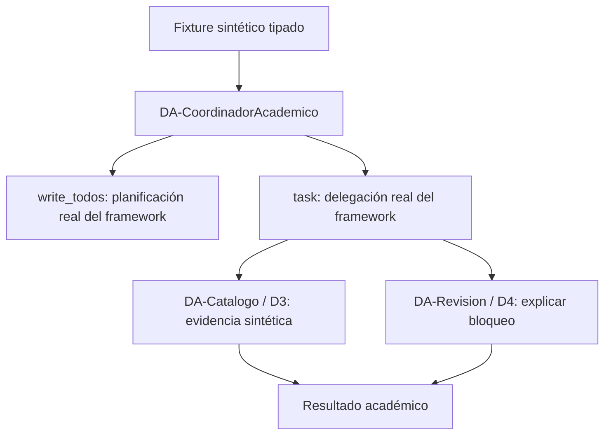

# Deep Agents académicos: contrato visual aprobado

31 de octubre de 2026. Demo aislada; no participa en ventas ni pagos.
Nombres y responsabilidades aprobados por el usuario.

El grafo académico generado por create_deep_agent invoca estos subagentes.
Se usa un adaptador de MockLLM con llamadas a herramientas programadas;
no se demuestra razonamiento autónomo ni memoria persistente.
La separación académica sustituye deliberadamente la integración comercial
de los pasos 4–5 de agente-nuevo, conforme a la autorización del usuario.
