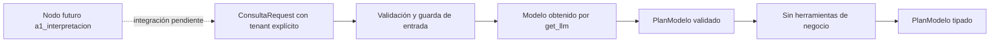

# A1_INTERPRETACION — D1

Responsabilidad propuesta: Interpretar intención en campos tipados. No confirma ventas ni despachos.

Contrato visual previo al código. El nodo mencionado NO se implementa en FASE 6.
La generación de un plan no autoriza operaciones comerciales. Datos y cálculos
siguen en tools/; cada agente hereda BaseAgent y tiene prompt propio. Se prueban
caso válido, límite y fallo con MockLLM. Las salidas del modelo no pueden cambiar
el tenant, las cantidades, precios, stock, evidencia ni el estado de un pago.

A1 solo propone intención; no extrae ni convierte presupuestos o cantidades.
Los otros agentes requieren parámetros tipados explícitos del llamador.
