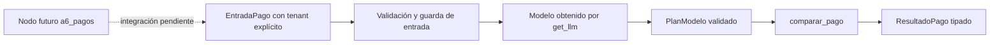

# A6_PAGOS — D4

Responsabilidad propuesta: Comparar importes sin acreditar pago. No confirma ventas ni despachos.

Contrato visual previo al código. El nodo mencionado NO se implementa en FASE 6.
La generación de un plan no autoriza operaciones comerciales. Datos y cálculos
siguen en tools/; cada agente hereda BaseAgent y tiene prompt propio. Se prueban
caso válido, límite y fallo con MockLLM. Las salidas del modelo no pueden cambiar
el tenant, las cantidades, precios, stock, evidencia ni el estado de un pago.
