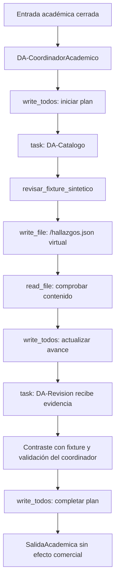

# Semana 11 · Deep Agents y prompts por rol

Demostración académica independiente del flujo comercial y de la demo de semana 10.



## Pilares y evidencias esperadas

- Planificación: tres llamadas a `write_todos`, con avance y cierre comprobados.
- Delegación: dos llamadas `task` a los roles existentes, sin delegación recursiva programada.
- Memoria: `write_file` y `read_file` del framework, archivo virtual retenido en el estado.
  El contenido procede de la respuesta de la herramienta sintética del especialista y se verifica
  antes de enviarlo al segundo rol. El coordinador compara los resultados de los dos especialistas.
- Instrucciones: prompts por rol con alcance cerrado, reglas de no intervención comercial,
  uso de evidencia, restricción de delegación y criterio de detención. La prueba de integración
  comprueba que los tres prompts llegan al modelo simulado.

Los tres roles usan la [estructura de doce bloques](../arquitectura.md#arquitectura-de-prompts).
El adaptador de semana 11 restringe las herramientas que puede emitir cada rol. El coordinador
envía el hallazgo de memoria como un objeto JSON `datos_no_confiables` separado de la instrucción,
y el resultado final se valida como `SalidaAcademica`. El estado virtual dura una ejecución.
Los [controles de autonomía](../arquitectura.md#controles-de-autonomía) comparten el presupuesto
entre el coordinador y los especialistas. La demo emite contadores locales y, si se interrumpe,
devuelve un motivo y la evidencia parcial validada. Las respuestas programadas comprueban la
integración del framework y los controles de despacho. La comprensión del modelo y el costo en
tokens requieren evaluación posterior.

## Validación local

Con el entorno virtual activado y las dependencias fijadas de Veltri:

```sh
python -m pytest -q tests/test_memoria_semana11.py tests/test_deep_agents_semana11.py
python -m pytest -q tests/test_prompts_semana11.py tests/test_llm.py tests/test_autonomia_semana11.py
python -m src.academic.deep_agents_semana11
python scripts/verificar.py
```

Usar MockLLM con las trazas externas desactivadas.
