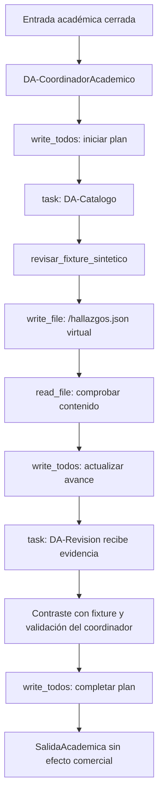

# Semana 11 · Fase 2: cuatro pilares de Deep Agents

Propuesta de implementación incremental sobre `e4abe288549d9eed8c6b786a1095951a756e1346`.
No reemplaza la demostración original de semana 10 ni conecta agentes al flujo comercial.
No agrega agentes, dependencias, endpoints ni contratos de intercambio.



## Pilares y evidencias esperadas

- Planificación: tres llamadas a `write_todos`, con avance y cierre comprobados.
- Delegación: dos llamadas `task` a los roles existentes, sin delegación recursiva programada.
- Memoria: `write_file` y `read_file` del framework, archivo virtual retenido en el estado.
  El contenido procede de la respuesta de la herramienta sintética del especialista y se verifica
  antes de enviarlo al segundo rol. El coordinador compara los resultados de los dos especialistas.
- Instrucciones: prompts por rol con alcance cerrado, reglas de no intervención comercial,
  uso de evidencia, restricción de delegación y criterio de detención.

La demostración conserva la fábrica única de modelos y reutiliza `AdaptadorMock`. Las respuestas
programadas prueban el cableado de las herramientas, no comprensión ni autonomía de un LLM real.
El estado virtual dura una ejecución; no acredita memoria entre procesos o sesiones. El límite
explícito de 40 pasos del grafo es una decisión provisional para esta demo (no es un presupuesto
real de tokens ni una política completa de autonomía). El endurecimiento general de los prompts
(12 bloques) y los límites operativos completos quedan para las siguientes fases.

## Validación pendiente en la raíz real del repositorio

Con el entorno virtual existente y las dependencias fijadas de Veltri:

```powershell
.\.venv\Scripts\python -m pytest -q tests/test_memoria_semana11.py tests/test_deep_agents_semana11.py
.\.venv\Scripts\python -m src.academic.deep_agents_semana11
.\.venv\Scripts\python scripts/verificar.py
```

No ejecutar con modelos remotos ni activar trazas externas. No presentar una prueba de integración
como aprobada hasta ejecutarla en el entorno real. Conservar las evidencias originales de semana 10.
