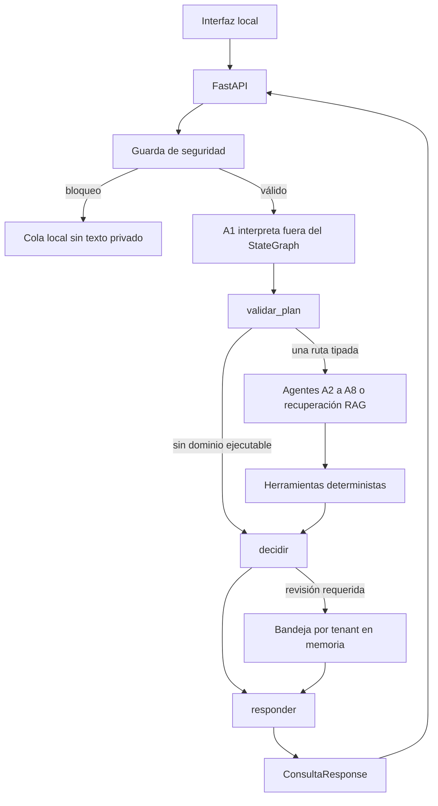
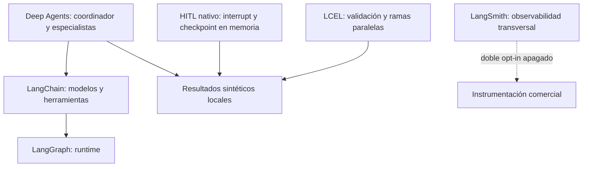

# Arquitectura actual de Veltri Tecnologic

## Flujo comercial

FastAPI sirve la interfaz local y expone POST /consulta y GET /catalogo. El sistema valida la entrada antes del modelo y de LangGraph. Los cálculos y las reglas de compatibilidad están en herramientas deterministas; el modelo se obtiene exclusivamente con get_llm().

El dibujo es una vista de componentes. El StateGraph compilado tiene 11 nodos operativos, 13 vértices con START/END y 20 aristas. El grafo exacto, las rutas y sus límites están en [grafo.md](grafo.md). A1 y la seguridad no cuentan como nodos del grafo.

## Responsabilidades y datos

- D1: A1 interpreta, A2 arma por presupuesto y A3 cotiza.
- D2: A4 valida compatibilidad; D3: A5 consulta inventario.
- D4: A6 compara importes, A7 registra borradores y A8 consulta su estado.
- `src/tools/` calcula precios en céntimos, stock, compatibilidad y hashes idempotentes. Los pagos no se acreditan con un proveedor externo.
- `src/schemas/` valida contratos; `src/core/decision.py` aplica invariantes y umbrales protegidos.
- `src/knowledge/` recupera solo catálogo, compatibilidad y políticas sintéticos, con tenant y citas explícitos. `chroma_db/` es almacenamiento persistente y no se limpia como residuo.
- `src/core/hitl.py` conserva una bandeja local; resolverla no reanuda el grafo ni confirma operaciones comerciales.

La identidad de tenant requiere autorización de producción; el aislamiento por claves no equivale por sí solo a autenticación. No hay aprobación comercial real ni conciliación bancaria. Precios y existencias son ejemplos.

## Demostraciones académicas separadas

`src/academic/` demuestra LCEL, HITL nativo y Deep Agents reales con respuestas programadas de MockLLM. No reemplaza A1–A8 ni se expone por HTTP. Los checkpoints académicos no sobreviven al proceso y las decisiones de demo no conceden permisos comerciales.

LangSmith usa metadatos permitidos y cuerpos vacíos. Los dos opt-in están apagados; la traza existente sigue sin acreditación visual. Guía única: [observabilidad.md](observabilidad.md).

## Mantenimiento y presentación

Contratos y herramientas: [esquemas](esquemas.md), [herramientas](herramientas.md), [RAG](conocimiento.md). API e interfaz: [api.md](api.md), [interfaz.md](interfaz.md).
El [índice de entrega](README.md) reúne el Word corregido y evidencias originales. BPMN TO-BE tiene compatibilidad parcial: su secuencia A2 → A4 → A5 → A3 no equivale al selector de una rama del grafo. No se modificó el BPMN para ocultar diferencias.
