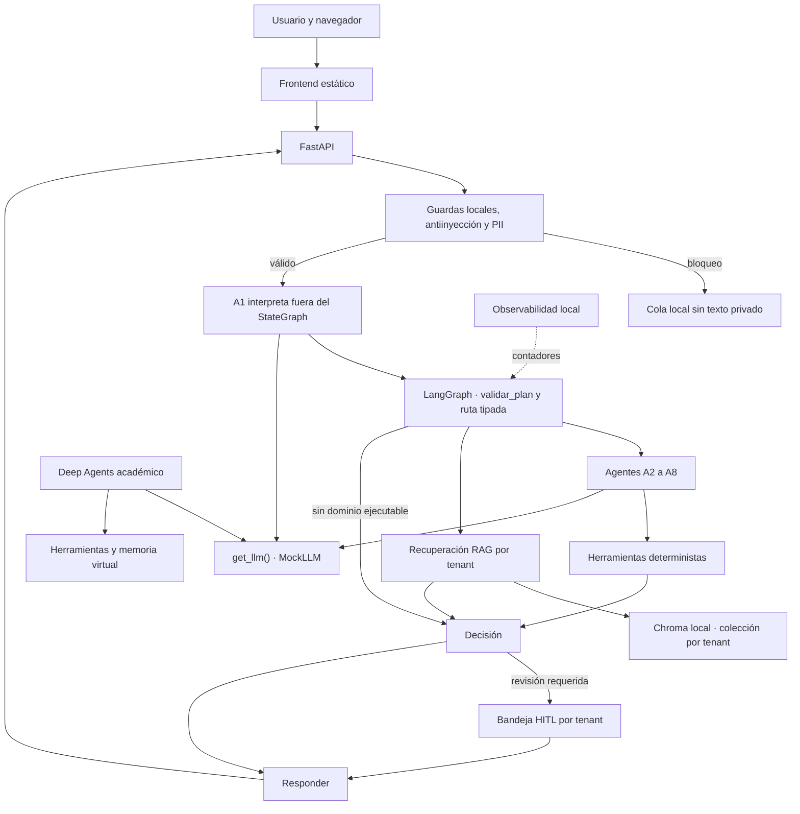
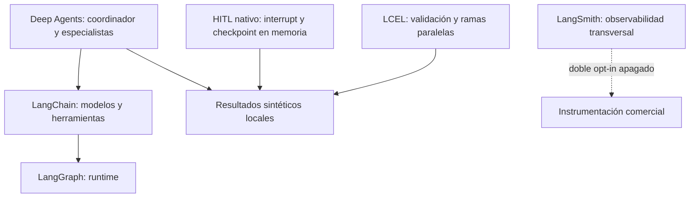
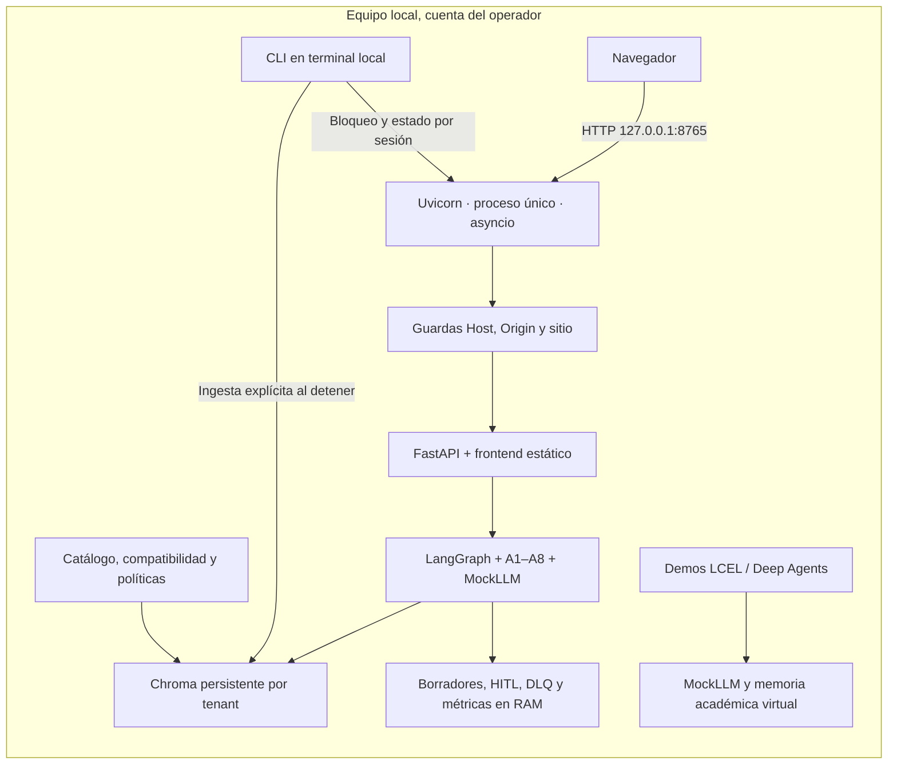
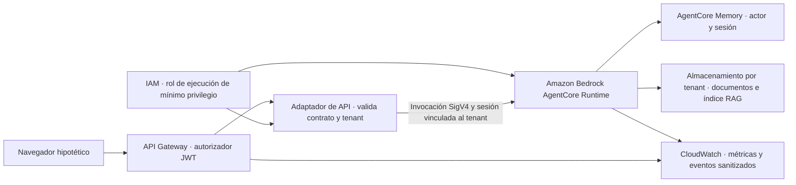
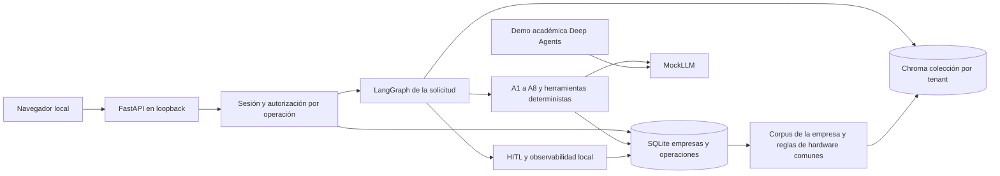

# Arquitectura actual de Veltri Tecnologic

## Flujo comercial

FastAPI sirve la interfaz local y expone POST /consulta y GET /catalogo. El sistema valida la entrada antes del modelo y de LangGraph. Los cálculos y las reglas de compatibilidad están en herramientas deterministas; el modelo se obtiene exclusivamente con get_llm().



El dibujo es una vista de componentes. El StateGraph compilado tiene 11 nodos operativos, 13 vértices con START/END y 20 aristas. El grafo exacto puede inspeccionarse en `src/graph/workflow.py` y en el JSON de la [demo académica](#verificación-y-herramientas-de-mantenimiento); las rutas seleccionan un único dominio. A1 y la seguridad no cuentan como nodos del grafo.

## Responsabilidades y datos

| Agente y dominio | Entrada | Herramienta y resultado tipado |
|---|---|---|
| A1 Interpretación, D1 | `ConsultaRequest` | Propone la intención en `PlanModelo`, dentro de `SalidaAgente[None]`. Opera antes del grafo y sin herramientas de negocio. |
| A2 Armado, D1 | `EntradaArmado` | `armar` busca dentro del rango explícito y devuelve `ResultadoArmado`. |
| A3 Cotización, D1 | `EntradaCotizacion` | `cotizar` evalúa la selección explícita y devuelve `ResultadoCotizacion`. |
| A4 Compatibilidad, D2 | `EntradaSeleccion` | `validar_configuracion` devuelve `ResultadoTecnico`. |
| A5 Inventario, D3 | `EntradaSeleccion` | `comprobar_stock` y `alternativas` producen `ResultadoInventario`. |
| A6 Pagos, D4 | `EntradaPago` | `comparar_pago` compara importes y devuelve `ResultadoPago`. |
| A7 Pedidos, D4 | `EntradaPedido` | El registro por tenant guarda un borrador idempotente, con confirmación explícita, y devuelve `ResultadoPedido`. |
| A8 Seguimiento, D4 | `EntradaSeguimiento` | El mismo registro consulta un borrador del tenant y devuelve `EstadoBorrador` si existe. |

A1–A8 heredan de `BaseAgent` y devuelven `SalidaAgente` tipada. Cada agente usa su prompt y recibe datos validados. A1 propone la intención. Los parámetros comerciales proceden de la entrada tipada del llamador. La salida del modelo no puede cambiar el tenant, cantidades, precios, stock, evidencia o estado de pago.

- `src/tools/` calcula precios en céntimos, stock, compatibilidad y hashes idempotentes. Los pagos no se acreditan con un proveedor externo.
- `src/schemas/` valida contratos; `src/core/decision.py` aplica invariantes y umbrales protegidos.
- `src/knowledge/` recupera solo catálogo, compatibilidad y políticas sintéticos, con tenant y citas explícitos. `chroma_db/` es almacenamiento persistente y no se limpia como residuo.
- `src/core/hitl.py` conserva una bandeja local; resolverla no reanuda el grafo ni confirma operaciones comerciales.

La identidad de tenant requiere autorización de producción; el aislamiento por claves no equivale por sí solo a autenticación. No hay aprobación comercial real ni conciliación bancaria. Precios y existencias son ejemplos.

## Demostraciones académicas separadas



`src/academic/` demuestra LCEL, HITL nativo y Deep Agents reales con respuestas programadas de MockLLM. No reemplaza A1–A8 ni se expone por HTTP. Los checkpoints académicos no sobreviven al proceso y las decisiones de demo no conceden permisos comerciales.

En la demo de semana 10, `create_deep_agent` conecta al coordinador con `write_todos` y `task`. Los especialistas DA-Catalogo (D3) y DA-Revision (D4) trabajan con evidencia sintética. La fase 2 de semana 11 añade lectura y escritura en el estado virtual del grafo y prompts específicos por rol.

Los BPMN [AS-IS](bpmn_as_is.bpmn) y [TO-BE](bpmn_to_be.bpmn) documentan el proceso. El TO-BE encadena A2 → A4 → A5 → A3, mientras que el grafo comercial selecciona un único dominio por consulta.

## Contratos y datos

`src/schemas/` contiene los modelos Pydantic estrictos; `python scripts/exportar_esquemas.py` genera los 35 JSON Schema de intercambio en `docs/contratos/`. La API y los tests consumen los modelos Python. Los modelos rechazan campos extra y coerciones de bool/float/string a enteros. Los validadores comprueban relaciones entre campos que JSON Schema por sí solo no garantiza. Revalidar después de transformar diccionarios: `frozen=True` no congela profundamente listas y mapas.

`ConsultaResponse` versión `1.0-demo` utiliza estados completado, revision_humana, bloqueado y error. Conserva intención, mensaje, motivos, fuentes, flags HITL/proforma/aprobación y resultado opcional acorde al dominio. Error/bloqueo no deben incluir resultados comerciales. `ErrorValidacion` publica códigos y campos permitidos; no excepciones crudas. Ocultar entradas en repr de Pydantic no sanea logs ni model_dump.

`data/catalogo.json` contiene 84 SKUs sintéticos: sku, nombre, categoría, precio_centimos positivo, stock entero no negativo y especificaciones por categoría. PEN usa 100 céntimos por sol. Las unidades técnicas son W, mm, GB y MT/s. Un kit RAM cuenta como una unidad del catálogo. No hay mediciones ni datos reales de tienda; CPU-AMD-5500 tiene stock cero.

`compatibilidad.json` declara sockets, chipsets, RAM, refrigeración, montaje, interfaz SSD y conectores. Las relaciones CPU/placa requieren verificar BIOS y fabricante. El margen de potencia propuesto usa reserva de 100 W y 25 %, con redondeo entero; no certifica transitorios ni rendimiento. `politicas.md` diferencia propuestas de reglas definidas. No se inventan porcentajes de cuello de botella ni FPS.

## Herramientas y configuración

`Catalogo` devuelve copias y valida identidad, moneda, precio y stock. `comprobar_stock` informa faltantes; `alternativas` propone misma categoría/plataforma sin reservar ni aprobar un reemplazo. `validar_configuracion` exige una unidad de ocho categorías, incluida GPU y refrigeración, y comprueba socket, chipset, RAM, SSD, conectores y montaje. Ausencia de conflictos no acredita soporte real de fabricante.

`cotizar` calcula líneas y total en céntimos, stock, validación técnica y bloqueos; no añade IGV, montaje ni envío. `armar` busca una selección compatible dentro de límites inclusivos: con máximo elige el mayor total admisible; sin máximo, el menor que cumple el mínimo. Es una regla de demo, no optimización de rendimiento. Empates por SKU; sin solución devuelve cotización nula y mínimo de catálogo si existe, no mínimo del mercado.

`comparar_pago` compara importes sin convertir monedas: siempre no_conciliado. Los borradores usan SHA-256 de cliente|productos|cantidad|canal, SKUs ordenados, arrays JSON compactos y sin timestamps. Alias demo_ y tenant explícitos; A7/A8 comparten registro en memoria. No hay confirmación, reserva, cobro o despacho.

`get_llm()` es la única fábrica. Configuración del proceso prevalece sobre `.env`; USE_MOCK_LLM=1 por defecto, proveedor gemini. El modo real requiere modelo y clave locales; la fachada comercial lo retiene pendiente de calibración. MockLLM consume fixtures tipados sin inferencia ni fallback inventado. El conector Gemini usa JSON Schema, store=False y no streaming; su compatibilidad se prueba con transporte simulado, no con una cuenta externa.

## Arquitectura de prompts

`src/core/prompts.py` compone doce bloques en orden fijo. Centraliza la jerarquía de confianza,
el manejo de entradas no confiables y la privacidad. `src/agents/prompts.py` aplica las reglas de
planificación comercial. Cada agente define su misión, contexto, herramientas que ejecuta el
código, proceso, límites y condiciones de revisión. A1 incluye ejemplos de clasificación ambigua
y A6 ejemplifica el tratamiento de importes iguales y discrepantes.

Los agentes comerciales emiten un único `PlanModelo` con `accion`, `p` y `c`. Los agentes A2–A8
validan la acción de su dominio antes de ejecutar herramientas deterministas. LangGraph conserva
el control de la revisión humana. El conector Gemini coloca el prompt en `system_instruction` y
los datos en un objeto JSON aparte. Sigue usando el contrato Pydantic y se verifica con transporte
simulado. La guarda previa al modelo continúa activa.

En la [demo académica de semana 11](agentes/deep-agents-semana11.md), los tres roles reciben los
doce bloques como instrucciones de sistema. El adaptador admite solo las herramientas programadas
para cada rol y separa el hallazgo delegado como datos estructurados. La salida
`SalidaAcademica` mantiene la revisión requerida y ausencia de efecto comercial.

## Decisión y revisión

SolicitudDecision exige opción, p/c finitos en [0,1], origen prueba_no_calibrada y evidencia discriminada del dominio. La compuerta revalida y calcula bloqueos/hash. Un bloqueo fuerza revisión cualquiera sea p. Sin bloqueo, p >= TAU_AUTO propone ejecutar, TAU_REV <= p < TAU_AUTO propone revisión y p < TAU_REV escala. Los umbrales solo se leen del archivo protegido; c no introduce otro umbral. Puntajes son fixtures, no probabilidades calibradas.

ResultadoDecision registra motivos, fuentes, huella y accion_ejecutada=false. BandejaRevision recalcula al encolar; huella y tenant identifican revisión idempotente. Devuelve copias. Estados pendiente/escalada y finales aprobada_demo/rechazada/correccion_solicitada. Aprobar_demo no admite bloqueos ni escalados y nunca ejecuta negocio. Misma resolución repetida es idempotente; otra resolución final se rechaza. Corregir exige nueva evaluación, no borrar evidencia. Revisor demo_ no autentica una persona. Persistencia y auditoría duraderas están pendientes.

## Recuperación documental

`src/knowledge/` lee solo catálogo, compatibilidad y políticas. Fragmenta por SKU, relación o bloque y conserva fuente/hash. Vectorización léxica SHA-256 a 256 dimensiones, sin embeddings remotos; colisiones y cobertura limitada son posibles. Chroma usa colección por hash del tenant, filtro tenant/snapshot y bloqueo local filelock. No equivale a autenticación multiusuario.

La ingesta valida antes de escribir, publica snapshot nuevo tras completar lotes y conserva el anterior si falla. Reingesta idéntica es idempotente; limpia obsoletos solo del tenant correspondiente. No hay transacción entre fuente e índice. `Almacen.buscar` devuelve hasta 20 candidatos con citas/hash/distancia; SKU exacto tiene prioridad y sin coincidencia devuelve vacío. Distancia no es confianza. Revalidar precios/stock con las herramientas porque el índice puede quedar antiguo.

No indexar mensajes, pedidos, pagos, claves o datos personales. La guarda por patrones es limitada, no anonimización exhaustiva. La ingesta y las consultas requieren tenant explícito. Comando de reconstrucción: `python -m src.knowledge.ingesta --tenant IDENTIFICADOR`; usar `--ruta` nueva para pruebas sin tocar almacenamiento persistente.

## API e interfaz local

`src/api/main.py` expone POST /consulta con SolicitudAPI plana o anidada y respuesta ConsultaResponse. GET /catalogo entrega inventario; `/` sirve `frontend/index.html`. La guarda antiinyección/PII precede al modelo/grafo; DLQ conserva evento técnico sin eco del mensaje. Validación 422, ruta 404 y fallo interno 500 usan errores tipados sin trazas privadas.

La SPA usa HTML, CSS y JavaScript locales: tokens.css y styles.css para presentación, icons.js para SVG, api.js para peticiones y app.js para conversación/catálogo. No hay CDN ni fuentes remotas. La UI muestra ejemplos y proforma visual, pero no prueba aprobación técnica ni conciliación bancaria. Los objetivos de accesibilidad o el desglose de IGV visible no se presentan como certificaciones de cumplimiento; las diferencias comerciales con BPMN siguen pendientes.

Comandos de instalación y servidor están en el README principal; `python scripts/verificar.py` verifica calidad, estructura, dependencias, pruebas y secretos. Los casos CP-1 a CP-7 tienen pruebas de herramientas, flujo y API; la línea base sigue vacía y protegida. El CP-1 requiere revisión por evidencia sintética, no debe afirmarse como venta automáticamente aprobada.

## Extensión académica de semana 11 (fase 2)

La demostración `src/academic/deep_agents_semana11.py` conserva los roles académicos existentes. El coordinador planifica, delega a Catálogo, escribe y lee `/hallazgos.json` en el estado virtual y entrega el hallazgo a Revisión para contrastarlo. La demo se ejecuta al margen de la API comercial. Véase el [diagrama y las pruebas de integración](agentes/deep-agents-semana11.md). El estado dura una ejecución y el modelo sigue siendo simulado.


## Controles de autonomía

`LimitesAutonomia` valida una configuración inmutable por perfil. Los llamadores de confianza
pueden pasar `limites=` a `Orquestador` o `ejecutar_semana11`. El mensaje, los argumentos de
herramienta y el estado del grafo carecen de acceso a esta configuración.

| Límite | Comercial | Académico |
|---|---:|---:|
| Pasos operativos totales | 4 | 32 |
| Llamadas al modelo | 2 | 14 |
| Despachos de herramientas | 91 | 12 |
| Niveles de delegación | 0 | 1 |
| Plazo de ejecución | 10 s | 10 s |
| Presupuesto de tokens | 8.192 | 32.000 |
| Salida máxima por llamada | 128 | 128 |

El DAG comercial usa como máximo cuatro nodos y un plan de A1 más un plan de dominio.
El techo de herramientas permite una consulta de stock y hasta 90 búsquedas de alternativas,
el máximo de elementos del contrato de selección. La demo normal usa 21 pasos, 12 llamadas
al modelo y 9 herramientas. Sus límites dejan margen sin habilitar un tercer especialista.
Los 128 tokens de salida cubren planes JSON breves o llamadas programadas. Ambos grafos retienen
el tope nativo de recursión. El contador común mide nodos comerciales y pasos académicos de
modelo o herramienta, incluidos los de los especialistas.

El presupuesto se comparte por ejecución y reserva entrada y salida antes de cada inferencia.
MockLLM calcula unidades simuladas a partir de bytes UTF-8 de mensajes y fixtures. Gemini carga
el uso informado, incluidos tokens adicionales si están disponibles, y conserva una estimación
conservadora cuando faltan métricas. El conector aplica el máximo de salida, limita el timeout
al tiempo restante y desactiva reintentos. El proveedor conserva el control del cómputo en curso.
El plazo local se comprueba en cada frontera operativa y durante la búsqueda de armado. Acota
la espera por el bloqueo de Chroma. El tiempo observado puede superar el plazo si una llamada
síncrona o nativa ya iniciada tarda en devolver el control.

El adaptador académico restringe herramientas por rol antes del despacho y valida el destino,
la descripción delegada y la ruta virtual. Solo admite los dos especialistas, una vez cada uno,
y `/hallazgos.json`. Los resultados se revalidan antes de reutilizarlos. Una interrupción
académica devuelve evidencia, plan y memoria parciales validados durante la ejecución.
La fachada comercial conserva la última salida tipada del grafo y deriva el corte a la bandeja
del tenant sin nuevas llamadas al modelo ni a herramientas de negocio.

Los contadores y motivos cerrados de las últimas 256 ejecuciones se conservan en memoria
y pueden registrarse en el logger local `veltri.recursos`. Incluyen tiempo y revisión, sin
prompts, identificadores, datos personales ni resultados de negocio. Son métricas para
análisis posterior; no constituyen medición de costo de un proveedor.

## Observabilidad segura

`src/core/observabilidad.py` y `src/core/diagnostico_http.py` implementan la instrumentación y el transporte. La configuración predeterminada mantiene la instrumentación apagada. No existe un control HTTP para activarla.

- La instrumentación exige `VELTRI_TRACING_ENABLED=1` y `VELTRI_TRACING_SYNTHETIC_ONLY=1`. Un envío externo requiere también `VELTRI_TRACING_ALLOW_EXTERNAL=1`, MockLLM, la validación del destino oficial, una clave local y el proyecto `veltri-semana10-demo`.
- Mantén `LANGSMITH_TRACING` y `LANGCHAIN_TRACING_V2` en `false`. Solo se permiten UUID aleatorios, nombres cerrados, parentesco, tiempos y metadatos sintéticos constantes. Los inputs y outputs están vacíos.
- El transporte conserva el primer fallo y bloquea llamadas posteriores, redirecciones y reintentos. Registra método, ruta saneada, estado, categoría, correlación sintética y etapa.
- `python scripts/demo_observabilidad.py` ejecuta el modo local sin envío. El lanzador remoto `scripts/langsmith_segundo_intento.py` está protegido por un [registro de un solo uso](evidencias/semana10-fase43/ejecucion-unica.json) ya consumido. Consérvalo en su ruta y nunca lo reinicies. El registro se conserva por integridad histórica. La operación vigente usa exclusivamente instrumentos locales y transportes simulados.
- El primer intento histórico recibió HTTP 400. El segundo registró nueve POST y nueve PATCH con HTTP 202 y se detuvo al recibir HTTP 403 en la lectura. La persistencia, el identificador y el árbol remotos siguen sin verificar.

## Verificación y herramientas de mantenimiento

- `python scripts/verificar.py` verifica sintaxis, referencias e imports estáticos, dependencias, Ruff, pytest y secretos. El tipado con `--mypy` es opcional. Los imports dinámicos se comprueban con pruebas de ejecución.
- `python scripts/instalar_hooks.py` instala el hook de protección de archivos críticos y escaneo de secretos. `python scripts/escanear_secretos.py` también se puede ejecutar por separado.
- `python scripts/demo_academica.py` ejecuta las demos de semana 10 con MockLLM y emite, entre otros resultados, el JSON del grafo comercial. Usa un directorio temporal por defecto. Si se indica `--salida`, la ruta debe ser nueva.
- La demo de semana 11 se ejecuta con `python -m src.academic.deep_agents_semana11`. Las demos y la verificación local emplean fixtures y transporte simulado.

## Especificaciones y trazabilidad SDD

La especificación normativa de esta fase es la aceptación observable de cada fila.
El flujo de cambio es definir el requisito y su criterio, diseñar el cambio en el componente
responsable, dividirlo en tareas de contrato, implementación y pruebas, ejecutar primero las
pruebas relacionadas y luego `python scripts/verificar.py`. Cierra la tarea cuando el criterio
y sus pruebas coincidan. Los diez invariantes de `AGENTS.md` tienen prioridad.

La columna **Pruebas** identifica evidencia mínima por requisito mediante identificadores pytest.
Los demás casos de cada módulo ejercitan el mismo ámbito, incluidos errores, fronteras y entradas
parametrizadas. **Resultado** indica cómo se decide en cada revisión: `pytest` exige que las
pruebas enlazadas se recolecten y que la suite integral finalice sin fallos ni omisiones.
Las brechas se registran debajo de la matriz con el alcance que aún falta acreditar.

| ID | Requisito | Especificación de aceptación | Componente | Código | Pruebas | Resultado |
|---|---|---|---|---|---|---|
| A1 | Interpretar intención | Clasifica en PlanModelo; desconocida es explícita y faltantes no se infieren | Interpretación, D1 | `src/agents/d1_ventas/a1_interpretacion.py::A1Interpretacion` | `tests/test_agentes.py::test_a1_desconocida_es_tipo_explicito`, `tests/test_flujo.py::test_modelo_no_puede_inventar_parametros_ni_tenant` | pytest |
| A2 | Armar por rango | La cotización es determinista y queda dentro del rango, o informa que no hay solución | Armado, D1 | `src/agents/d1_ventas/a2_armado.py::A2Armado`, `src/tools/armador.py::armar` | `tests/test_herramientas.py::test_cp7_rangos_sin_promesas_imposibles`, `tests/test_agentes.py::test_a2_limite_insuficiente_no_inventa_pc`, `tests/test_flujo.py::test_cp4_rtx_insuficiente_no_genera_proforma`, `tests/test_api.py::test_cp1_cotizacion_gaming_valida` | pytest |
| A3 | Cotizar la selección | Suma cantidades y precios del catálogo en céntimos; bloquea el exceso de presupuesto | Cotización, D1 | `src/agents/d1_ventas/a3_cotizacion.py::A3Cotizacion` | `tests/test_agentes.py::test_a3_total_exactamente_de_herramienta_y_bloqueo_presupuesto` | pytest |
| A4 | Validar compatibilidad | Un socket incompatible impide aprobación aunque el puntaje sea alto | Compatibilidad, D2 | `src/agents/d2_tecnico/a4_compatibilidad.py::A4Compatibilidad` | `tests/test_agentes.py::test_a4_no_aprueba_socket_incompatible`, `tests/test_flujo.py::test_socket_incompatible_no_lo_autoriza_p_alta` | pytest |
| A5 | Consultar existencias | Reporta SKU faltante, fuente, alternativas y revisión; con stock la consulta se completa | Inventario, D3 | `src/agents/d3_inventario/a5_inventario.py::A5Inventario` | `tests/test_agentes.py::test_a5_cp3_fuente_sku_alternativas_y_revision`, `tests/test_flujo.py::test_stock_disponible_completa_consulta_sin_autorizar_venta` | pytest |
| A6 | Comparar pagos | Importes iguales o discrepantes permanecen sin conciliar | Pagos, D4 | `src/agents/d4_pedidos/a6_pagos.py::A6Pagos`, `src/tools/pagos.py::comparar_pago` | `tests/test_herramientas.py::test_pago_nunca_se_acredita_solo_por_importe`, `tests/test_flujo.py::test_cp5_comparacion_no_acredita_pago` | pytest |
| A7 | Crear borrador idempotente | Exige confirmación tipada; repetir la clave SHA-256 mantiene un borrador | Pedidos, D4 | `src/agents/d4_pedidos/a7_pedidos.py::A7Pedidos`, `src/tools/registro.py::RegistroPorTenant` | `tests/test_agentes.py::test_a7_exige_confirmacion_tipada`, `tests/test_api.py::test_cp6_pedido_idempotente_sha256` | pytest |
| A8 | Consultar borrador | Recupera por clave y tenant; un tenant ajeno no recupera el borrador | Seguimiento, D4 | `src/agents/d4_pedidos/a8_seguimiento.py::A8Seguimiento` | `tests/test_agentes.py::test_a7_a8_idempotencia_y_aislamiento`, `tests/test_flujo.py::test_cp6_pedido_idempotente_y_seguimiento_aislado` | pytest |
| DA-COORD | Planificar y coordinar | Actualiza el plan, delega a Catálogo y luego a Revisión y emite SalidaAcademica sin efecto comercial | DA-CoordinadorAcademico | `src/academic/deep_agents_semana11.py::AdaptadorMemoria` | `tests/test_deep_agents_semana11.py::test_cuatro_pilares_en_framework_real` | pytest |
| DA-CAT | Leer fixture sintético | La auditoría registra una consulta exitosa al fixture por el rol de Catálogo | DA-Catalogo | `src/academic/deep_agents_semana11.py::_especialista`, `src/tools/evidencia_academica.py::revisar_fixture_sintetico` | `tests/test_deep_agents_semana11.py::test_cuatro_pilares_en_framework_real` | pytest |
| DA-REV | Contrastar el hallazgo | Recibe JSON separado de las instrucciones, consulta el fixture y deja revisión requerida | DA-Revision | `src/academic/deep_agents_semana11.py::AdaptadorEvidencia` | `tests/test_deep_agents_semana11.py::test_cuatro_pilares_en_framework_real` | pytest |
| DA-MEM | Verificar memoria virtual | Escribe y lee el artefacto durante la ejecución; rechaza adulteraciones y aísla ejecuciones | Memoria Deep Agents | `src/academic/memoria_semana11.py::verificar_lectura`, `src/academic/memoria_semana11.py::verificar_archivo` | `tests/test_memoria_semana11.py::test_lectura_debe_contener_evidencia`, `tests/test_memoria_semana11.py::test_rechaza_claves_duplicadas_en_evidencia`, `tests/test_deep_agents_semana11.py::test_dos_ejecuciones_sin_colision_de_archivos` | pytest |
| DA-CTRL | Restringir herramientas y delegación | Rechaza rutas, destinos, argumentos y herramientas ajenos al rol antes de ejecutar | Middleware académico | `src/academic/controles_semana11.py::ControlesHerramientas` | `tests/test_autonomia_semana11.py::test_middleware_rechaza_llamadas_antes_del_despacho`, `tests/test_prompts_semana11.py::test_el_adaptador_rechaza_herramienta_fuera_del_rol` | pytest |
| DA-LEG | Preservar demostraciones previas | LCEL, HITL nativo y Deep Agents de semana 10 se ejecutan con fixtures; la CLI conserva los originales | Demos de semana 10 | `src/academic/lcel.py::crear_pipeline`, `src/academic/hitl.py::crear_grafo`, `scripts/demo_academica.py::ejecutar_demo` | `tests/test_academico.py::test_lcel_composicion_real`, `tests/test_academico.py::test_hitl_interrupcion_y_reanudacion`, `tests/test_academico.py::test_deepagents_plan_y_delegacion`, `tests/test_scripts_cli.py::test_demo_cli_real_sin_alterar_evidencia` | pytest |
| GRAFO | Orquestar un solo dominio | El grafo real conserva el DAG tipado, sin memoria persistente ni rutas entre dominios | LangGraph comercial | `src/graph/workflow.py::crear_grafo`, `src/graph/nodes.py::validar_plan` | `tests/test_trazabilidad_sdd.py::test_grafo_comercial_conserva_la_topologia_especificada`, `tests/test_flujo.py::test_intencion_desconocida_no_se_enruta_por_texto`, `tests/test_flujo.py::test_grafo_sin_mensaje_checkpointer_ni_envio_de_trazas` | pytest |
| PROMPTS | Aplicar doce bloques separados de los datos | Los 11 roles conservan los bloques; el transporte simulado separa el sistema de los datos y la demo recibe sus instrucciones | Sistema de prompts | `src/core/prompts.py::componer_prompt`, `src/agents/prompts.py::prompt_plan` | `tests/test_prompts_semana11.py::test_prompts_comerciales`, `tests/test_prompts_semana11.py::test_prompts_academicos`, `tests/test_llm.py::test_conector_real_con_sdk_y_transporte_simulado`, `tests/test_deep_agents_semana11.py::test_cuatro_pilares_en_framework_real` | pytest |
| AUT-LIM | Acotar pasos, llamadas y delegación | Los topes cortan antes del siguiente despacho; una delegación cíclica o un reinicio se rechazan | Presupuesto compartido | `src/core/autonomia.py::Presupuesto`, `src/core/autonomia.py::controlar_ejecucion` | `tests/test_autonomia_semana11.py::test_cortes_reales_en_el_grafo`, `tests/test_autonomia_semana11.py::test_delegacion_comparte_presupuesto_y_detecta_ciclos`, `tests/test_autonomia_semana11.py::test_el_subagente_no_puede_reiniciar_el_presupuesto` | pytest |
| AUT-TOK | Reservar y liquidar tokens | Se limita salida y se separan contadores simulados, estimados y reportados por el transporte de prueba | Fábrica y presupuesto | `src/core/llm.py::GeminiLLM`, `src/core/autonomia.py::Presupuesto` | `tests/test_autonomia_semana11.py::test_llamada_real_solo_simulada_reserva_y_cuenta_uso`, `tests/test_autonomia_semana11.py::test_salida_fuera_de_presupuesto_corta_sin_entregar_el_plan` | pytest |
| AUT-TIME | Aplicar plazo cooperativo | Con reloj simulado vencido se impiden nuevas inferencias y herramientas | Presupuesto temporal | `src/core/autonomia.py::Presupuesto.segundos_restantes`, `src/tools/armador.py::armar` | `tests/test_autonomia_semana11.py::test_plazo_con_reloj_simulado` | pytest |
| AUT-HITL | Cortar con evidencia parcial | Conserva memoria verificada o la salida tipada disponible, informa motivo y deriva a revisión cuando corresponde | Orquestadores | `src/graph/workflow.py::Orquestador._interrumpir`, `src/academic/deep_agents_semana11.py::_parcial` | `tests/test_autonomia_semana11.py::test_conserva_solo_evidencia_validada_y_no_llama_despues_del_corte`, `tests/test_autonomia_semana11.py::test_flujo_comercial_escala_en_el_tenant_y_conserva_el_resultado_si_existe`, `tests/test_api.py::test_limite_de_tokens_respeta_el_contrato_y_no_activa_el_fallback` | pytest |
| RAG | Recuperar citas del corpus local | Requiere tenant; excluye registros ajenos, fuentes arbitrarias y resultados sin coincidencia | Vectorización e índice Chroma | `src/knowledge/documentos.py::construir_documentos`, `src/knowledge/almacen.py::Almacen.buscar`, `src/graph/nodes.py::recuperar` | `tests/test_conocimiento.py::test_ingesta_y_busqueda_sin_red`, `tests/test_conocimiento.py::test_tenant_obligatorio_en_todas_las_operaciones`, `tests/test_conocimiento.py::test_filtro_metadata_excluye_registro_ajeno_en_coleccion`, `tests/test_flujo.py::test_rag_informativo_cita_tenant_y_no_genera_respuesta_sin_fuente` | pytest |
| SEC-INPUT | Bloquear inyección y PII reconocibles | La entrada conocida se bloquea antes del modelo y el grafo; la DLQ evita el eco de datos | Guarda y DLQ | `src/core/seguridad.py::validar_entrada_modelo`, `src/graph/workflow.py::Orquestador.consultar` | `tests/test_flujo.py::test_cp2_bloqueo_previo_sin_grafo_modelo_o_datos_personales`, `tests/test_api.py::test_cp2_datos_personales_bloqueados`, `tests/test_autonomia_semana11.py::test_instruccion_de_reinicio_del_presupuesto_se_bloquea_antes_de_inferir` | pytest |
| SEC-DATOS | Proteger datos y secretos | Ingesta y trazas prueban rechazo o ausencia de datos canario; se enmascaran secretos detectados | Privacidad y auditoría | `scripts/escanear_secretos.py::escanear`, `src/core/observabilidad.py::span`, `src/core/diagnostico_http.py::TransporteDiagnostico` | `tests/test_conocimiento.py::test_rechaza_pii_sin_exponer_valor`, `tests/test_observabilidad.py::test_payload_sdk_final_sin_entorno_ni_canarios`, `tests/test_diagnostico_http.py::test_ruta_query_y_destino_no_filtran`, `tests/test_escaner_secretos.py::test_detecta_token_langsmith_sin_revelarlo`, `tests/test_invariantes.py::test_gitignore_protege_env` | pytest |
| HITL | Aplicar invariantes sobre el puntaje | Stock, socket, presupuesto y pago fuerzan revisión y la bandeja impide autoaprobación o acceso ajeno | Compuerta y bandeja | `src/core/decision.py::decide`, `src/core/hitl.py::BandejaRevision` | `tests/test_decision_hitl.py::test_stock_agotado_siempre_exige_revision`, `tests/test_decision_hitl.py::test_socket_incompatible_con_probabilidad_alta`, `tests/test_decision_hitl.py::test_presupuesto_excedido_no_lo_autoriza_el_puntaje`, `tests/test_decision_hitl.py::test_pago_no_conciliado_aunque_coincida`, `tests/test_decision_hitl.py::test_resolver_no_puede_actuar_sobre_otro_tenant` | pytest |
| API | Mantener contratos estructurados | POST /consulta entrega ConsultaResponse incluso en errores; el esquema rechaza combinaciones incoherentes | FastAPI y Pydantic | `src/api/main.py::crear_app`, `src/schemas/consulta.py::ConsultaResponse` | `tests/test_api.py::test_formato_anidado_consulta`, `tests/test_api.py::test_error_validacion_json_malformado_retorna_422`, `tests/test_api.py::test_fallo_interno_retorna_500_con_consulta_response`, `tests/test_esquemas.py::test_sobre_no_oculta_revision_fuentes_o_intencion` | pytest |
| CAT | Mantener catálogo y consulta libre local | Los SKUs y referencias técnicas son válidos y GET /catalogo lista los productos | Datos y herramienta de consulta | `src/tools/catalogo.py::Catalogo`, `src/tools/consulta_comercial.py::atender_consulta_comercial` | `tests/test_datos.py::test_identificadores_y_cobertura`, `tests/test_datos.py::test_referencias_cpu_placa_completas_sin_duplicados`, `tests/test_consulta_comercial.py::test_api_catalogo_endpoint`, `tests/test_consulta_comercial.py::test_api_consulta_libre_cotizacion_3500_arma_pc` | pytest |
| REC | Acotar trabajo y medir recursos locales | Se cuentan pasos, modelos, herramientas, delegaciones, tiempo y revisiones sin guardar prompts; se retienen hasta 256 muestras | Presupuesto y observabilidad | `src/core/autonomia.py::Presupuesto.metricas`, `src/core/observabilidad.py::recursos_recientes` | `tests/test_autonomia_semana11.py::test_demo_normal_registra_recursos_sin_datos_ni_tokens_reales`, `tests/test_trazabilidad_sdd.py::test_ventana_de_recursos_acotada_y_aislada` | pytest |
| LOCAL | Operar con fixtures y sin servicios externos | El mock es predeterminado, el orquestador bloquea el modelo remoto, las trazas no conectan por defecto y los adaptadores históricos se prueban simulados | Configuración y operación | `src/config.py::cargar_configuracion`, `src/core/llm.py::get_llm`, `scripts/langsmith_segundo_intento.py::lanzar` | `tests/test_invariantes.py::test_solo_core_llm_instancia_modelos`, `tests/test_llm.py::test_configuracion_mock_por_defecto_y_entorno_prevalece`, `tests/test_flujo.py::test_modo_real_no_hace_consultas_sin_calibracion`, `tests/test_observabilidad.py::test_activada_sin_permiso_externo_no_construye_cliente`, `tests/test_langsmith_lanzador.py::test_falta_confirmacion_no_consume_ni_conecta` | pytest |
| SDD | Mantener trazabilidad verificable | Todos los IDs obligatorios enlazan símbolos válidos y casos recolectados; el verificador exige ejecución sin omitidos | Verificación local y CI | `scripts/verificar.py::comprobar_estructura`, `scripts/verificar.py::_ejecutar_pytest` | `tests/test_trazabilidad_sdd.py::test_matriz_cubre_requisitos_componentes_y_pruebas`, `tests/test_verificador.py::test_import_eliminado_detectado_sin_ejecutar`, `tests/test_verificador.py::test_pytest_rechaza_resultado_omitido` | pytest |
| EVAL | Ejecutar la muestra de semana 11 | Cuarenta casos distribuidos 24/10/6. La comparación conserva criterios y rechaza retrocesos fuera de tolerancia | Evaluación determinista | `scripts/evaluar_semana11.py::evaluar`, `scripts/evaluar_semana11.py::comparar_resultados` | `tests/test_trazabilidad_sdd.py::test_matriz_de_40_casos_cubre_agentes_y_requisitos_vigentes`, `tests/test_trazabilidad_sdd.py::test_informe_de_evaluacion_identifica_fallo_y_omision`, `tests/test_trazabilidad_sdd.py::test_comparacion_rechaza_regresiones_por_categoria` | pytest |
| MEDICION | Medir rendimiento de una carga local acotada | Reporta tamaño de muestra, p50 y p95 por rango, CPU, RSS, bytes y concurrencia | Benchmark local Linux | `scripts/medir_semana11.py::medir_local`, `scripts/medir_semana11.py::resumen` | `tests/test_trazabilidad_sdd.py::test_resumen_de_medicion_documenta_rango_p95_sin_interpolar` | pytest |
| ENTREGA | Preparar dos iteraciones para revisión | Ambas iteraciones registran tres elementos pendientes de revisión humana y enlazan los requisitos siguientes | Cierre SDD y evidencias | `scripts/verificar.py::_ejecutar_pytest` | `tests/test_trazabilidad_sdd.py::test_entrega_contiene_dos_iteraciones_y_revision_humana_pendiente` | pytest |
| LOCAL-INST | Instalar un entorno nativo verificable | Instala manifiestos fijados en venv 3.14, preserva directorios ajenos y verifica MockLLM y dependencias | CLI local | `scripts/veltri_local.py::instalar`, `scripts/veltri_local.py::comprobar` | `tests/test_despliegue_local.py::test_instalador_preserva_destino_ajeno`, `tests/test_despliegue_local.py::test_comprobar_valida_dependencias_y_fuerza_perfil_local` | pytest |
| LOCAL-CICLO | Operar una instancia por directorio | Detecta puerto ocupado y proceso duplicado, responde en loopback y permite parada, liberación y reinicio | Supervisor Uvicorn | `scripts/veltri_local.py::iniciar`, `scripts/veltri_local.py::detener`, `scripts/veltri_local.py::estado_local` | `tests/test_despliegue_local.py::test_despliegue_rechaza_origen_ajeno_y_procesos_duplicados`, `tests/test_despliegue_local.py::test_despliegue_reinicia_y_conserva_indice_sin_conservar_borradores` | pytest |
| LOCAL-DATOS | Preservar índice sin arrastrar datos de sesión | El tenant indexado conserva recuperación tras reinicio, uno ajeno no recupera su borrador y el borrador anterior se pierde | Chroma y registro en memoria | `scripts/veltri_local.py::indexar`, `src/knowledge/almacen.py::Almacen`, `src/tools/registro.py::RegistroPorTenant` | `tests/test_despliegue_local.py::test_despliegue_reinicia_y_conserva_indice_sin_conservar_borradores` | pytest |
| LOCAL-RED | Restringir tráfico y validar concurrencia local | Host u origen ajeno recibe 403 tipado, DNS y egreso Python externo se deniegan y peticiones mixtas mantienen su intención | Guardas de despliegue | `scripts/veltri_local.py::proteger_http`, `scripts/veltri_local.py::_proteger_red` | `tests/test_despliegue_local.py::test_bloqueo_de_egreso_permite_loopback_y_rechaza_dns_externo`, `tests/test_despliegue_local.py::test_despliegue_rechaza_origen_ajeno_y_procesos_duplicados` | pytest |
| ECO-COST | Clasificar costos en PEN y calcular TCO de dos procesos | Valida moneda, unidades, periodos y partidas únicas. Separa labor, soporte, inversión y acumulados de 36 meses | Modelo económico independiente | `src/economia.py::Costo`, `src/economia.py::calcular` | `tests/test_economia.py::test_tco_36_meses_separa_labor_soporte_inversion_y_compartidos`, `tests/test_economia.py::test_rechaza_moneda_distinta_costos_duplicados_y_periodos_ambiguos` | pytest |
| ECO-FLUJO | Valorar tiempo realizable y calcular retornos | Conserva flujos negativos, aplica ROI y VAN, interpola payback y contempla inversión cero | Flujos incrementales | `src/economia.py::roi`, `src/economia.py::van`, `src/economia.py::payback` | `tests/test_economia.py::test_beneficios_flujos_y_roi_no_cuentan_dos_veces_el_ahorro_laboral`, `tests/test_economia.py::test_van_descuenta_flujos_anuales_y_mantiene_inversion_inmediata`, `tests/test_economia.py::test_payback_usa_acumulacion_mensual_con_flujos_negativos_e_interpolacion`, `tests/test_economia.py::test_inversion_y_denominador_cero_no_generan_indicadores_falsos` | pytest |
| ECO-SENS | Evaluar escenarios, quiebres y sensibilidad | Compara perfiles independientes, cambia siete supuestos y valida los vecinos del equilibrio discreto | Escenarios en PEN | `src/economia.py::sensibilidad`, `src/economia.py::punto_equilibrio`, `src/economia.py::generar_informe` | `tests/test_economia.py::test_escenarios_independientes_y_sensibilidad_no_fuerzan_viabilidad`, `tests/test_economia.py::test_equilibrio_discreto_van_y_operacion_con_validacion_de_vecinos` | pytest |
| ECO-REP | Reproducir el análisis sin servicios externos | Rechaza tiempo, volumen o tasas inválidos. La CLI emite JSON con resultados en PEN | Perfil y CLI económica | `src/economia.py::Supuestos`, `src/economia.py::main` | `tests/test_economia.py::test_rechaza_unidades_y_entradas_invalidas`, `tests/test_economia.py::test_modulo_local_publica_resultados_reutilizables_en_json` | pytest |
| MULTI-ORG | Administrar empresas | Alta, edición, inactivación y persistencia | SQLite | `src/plataforma.py::Plataforma.guardar_empresa` | `tests/test_plataforma.py::test_registro_edicion_y_persistencia` | pytest |
| MULTI-AUTH | Resolver identidad y permisos | Rechaza sesión, rol, origen o tenant no autorizado | Autorización | `src/api/empresas.py::autorizar` | `tests/test_plataforma.py::test_sesion_permisos_y_tenant_no_falsificable` | pytest |
| MULTI-CAT | Cotizar e indexar fuentes propias | Mismo SKU con precio y stock independientes, incluso bajo concurrencia y tras editar | Catálogo y Chroma | `src/plataforma.py::Plataforma.contexto` | `tests/test_plataforma.py::test_mismo_sku_cotizaciones_rag_y_solicitudes_concurrentes`, `tests/test_plataforma.py::test_dominios_restantes_con_catalogo_y_bandeja_autorizados` | pytest |
| MULTI-OPS | Aislar borradores, historial y HITL | Idempotencia, persistencia y permisos de revisión por empresa | Operaciones | `src/plataforma.py::Operaciones` | `tests/test_plataforma.py::test_pedidos_y_revisiones_privados_y_persistentes` | pytest |
| MULTI-LOCAL | Arrancar la plataforma protegida | Interfaz disponible y datos comerciales autenticados tras reiniciar | Launcher y carga | `scripts/veltri_local.py::_servir` | `tests/test_despliegue_local.py::test_arranque_multiempresa_predeterminado_sin_catalogo_anonimo` | pytest |
| MULTI-ECO | Proyectar cuatro escalas | Separa costos compartidos, individuales e incrementales, y calcula retorno en PEN | Economía | `src/economia.py::calcular_multiempresa` | `tests/test_economia.py::test_costos_multiempresa_compartidos_escalonados_y_sensibilidad` | pytest |

### Brechas y discrepancias

| Referencia | Estado y evidencia |
|---|---|
| CP-1 / A2–A4 | La expectativa histórica de aprobación técnica contradice el alcance actual. La cotización sintética dentro del presupuesto exige HITL por evidencia de fabricante pendiente. La prueba HTTP verifica ese comportamiento y los datos históricos conservan su expectativa original. |
| CP-4 / A2 | El mínimo que puede informar la demo procede del catálogo sintético. El mínimo del mercado queda fuera del alcance probado. |
| CP-6 / A7 | La solicitud histórica menciona despacho. La prueba acredita idempotencia de un borrador, con confirmación explícita y revisión. El despacho queda fuera del alcance. |
| GRAFO / BPMN TO-BE | El BPMN compone varios dominios en secuencia. El DAG vigente ejecuta como máximo uno por ruta; el TO-BE sigue como propuesta. |
| AUT-TIME, REC | Se verifica el límite cooperativo y el registro de contadores. Preempción de código nativo, objetivos de CPU/RAM/disco y benchmarks reproducibles quedan sin acreditar. |
| RAG, SEC-INPUT, PROMPTS | Se verifica partición por tenant, patrones conocidos y prompts con MockLLM. Autenticación, detección exhaustiva de PII y resistencia comparativa de modelos se mantienen fuera de esta fase. |
| HITL, LOCAL | La bandeja comercial es en memoria. Los adaptadores externos y el registro de LangSmith se conservan como legado; la operación prevista es local. |

## Evaluación reproducible de la semana 11

[Conjunto ejecutable](../evals/semana11.json). Contiene 24 casos representativos, 10 límite y 6
adversarios. Cada caso declara entrada, alcance SDD, conducta y aceptación observables. El
programa usa las pruebas de pytest como oráculos deterministas y añade a cada fila el resultado
efectivo y la clasificación del fallo. Un nodo ausente, un error de infraestructura, una omisión
o una aserción fallida impiden contabilizar esa fila como aprobada. R23 ejecuta las once
instancias de prompts. CP‑1 a CP‑7 se operacionalizan mediante pruebas de los contratos actuales.
R02 ejerce una entrada representativa de CP‑7. Los demás rangos permanecen cubiertos por
la suite integral enlazada desde A2.

```sh
python scripts/evaluar_semana11.py
python scripts/medir_semana11.py
```

Para comparar resultados, extraer `git archive 7284feb` en un directorio temporal separado
y pasar su ruta con `python scripts/evaluar_semana11.py --referencia RUTA`. Se usa la misma
matriz y el mismo intérprete. Los índices de aprobación admiten como máximo −2 puntos
porcentuales por categoría y en el total, con cero retrocesos de seguridad o invariantes.
El cierre de esta fase exige además los 40 casos aprobados.

| Perfil | Referencia `7284feb` | Intervención | Variación |
|---|---:|---:|---:|
| Representativos R01–R24 | 24/24 | 24/24 | 0 pp |
| Límite L01–L10 | 10/10 | 10/10 | 0 pp |
| Adversarios A01–A06 | 6/6 | 6/6 | 0 pp |
| Total | 40/40 | 40/40 | 0 pp |

Se conservan los doce bloques en los once roles. Los prompts renderizados medían 1.711 caracteres
en `391dee6`, 16.101 en `16c78bc` y 14.650 en `7284feb` y en esta intervención. La comparación
conductual mide criterios deterministas con MockLLM. La calidad semántica, resistencia adversaria
de un modelo real y consumo efectivo de tokens de proveedor quedan pendientes.

### Rendimiento local medido

Medición en el entorno de ejecución de Codex, Linux x86‑64, CPython 3.14.10,
Intel Xeon Platinum 8573C, tres CPU visibles y cuota de dos CPU, con 8 GiB de límite
de memoria del contenedor. El benchmark usa MockLLM, deshabilita trazas y bloquea
conexiones IPv4/IPv6 del socket de Python. El índice Chroma se crea en un directorio temporal.

Cinco procesos nuevos midieron arranque hasta importar la aplicación ASGI. La latencia HTTP
se midió en proceso con TestClient (un calentamiento y 40 consultas de stock por modalidad,
una secuencial y otra con cuatro trabajadores). Se usaron dos tenants y dos SKUs, uno disponible
y uno agotado. Cada operación RAG busca un marcador propio y otro ajeno. Se repiten las
modalidades de 40 pares. Se cronometraron 20 ejecuciones por agente comercial y cinco
ejecuciones académicas completas, con un calentamiento por ruta. P95 usa rango más próximo. Con cinco muestras equivale al máximo observado. CPU es tiempo de proceso (los hijos de arranque
se contabilizan aparte), RSS es el pico del proceso y almacenamiento se mide en bytes del
corpus e índice, con tamaños lógicos y asignados disponibles en la salida JSON.

| Medición local | Muestras | P50 | P95 | Objetivo propuesto para esta carga |
|---|---:|---:|---:|---:|
| Arranque en proceso nuevo | 5 | 1.753,47 ms | 2.020,82 ms | ≤ 4.000 ms p95 |
| HTTP stock secuencial | 40 | 4,74 ms | 6,34 ms | ≤ 100 ms p95 |
| HTTP stock, 4 trabajadores | 40 | 17,31 ms | 26,02 ms | ≤ 200 ms p95 |
| RAG, pares secuenciales | 40 | 11,56 ms | 14,57 ms | — |
| RAG, pares con 4 trabajadores | 40 | 18,43 ms | 119,21 ms | ≤ 250 ms p95 |
| Deep Agents, recorrido completo | 5 | 462,04 ms | 640,23 ms | — |

El proceso consumió 12,33 s de CPU y registró 215,82 MiB de RSS pico (objetivo ≤ 400 MiB).
Los cinco procesos de arranque consumieron juntos 9,43 s de CPU. El corpus ocupa 45.970 bytes.
El índice de dos tenants con 167 fragmentos cada uno ocupó 2.322.760 bytes lógicos y
2.306.048 bytes asignados (objetivo lógico ≤ 16 MiB). Se observaron cero cruces de datos en
80 comprobaciones ajenas RAG. Se cumplieron los siete objetivos propuestos. El p95 concurrente
de RAG aumentó frente al secuencial. La primera corrida también mostró una cola más larga.
La carga pequeña y la contención de bloqueo/cuota ameritan medición adicional antes de estimar
capacidad. HTTP midió aproximadamente 207 consultas/s secuenciales y 206 concurrentes en este
perfil. Esta prueba mantiene la misma ruta de stock y deja pendientes cargas mixtas HTTP.

El p95 por agente fue de 0,164 ms para A1, 267,184 ms para A2, 0,780 ms para A3, 0,380 ms para
A4, 0,230 ms para A5, 0,099 ms para A6, 0,317 ms para A7 y 0,263 ms para A8. Cada agente emitió
una llamada a MockLLM. Se observaron cero llamadas a herramientas
en A1 y una en A2–A8 en las entradas elegidas. Por especialista académico, las delegaciones
incluyendo su subgrafo tuvieron p95 de 17,759 ms (Catálogo) y 17,359 ms (Revisión). El recorrido
completo incluye al coordinador. En HTTP se registraron dos llamadas al modelo y una o dos
herramientas según stock, con 744 unidades simuladas por consulta. El recorrido académico
registró 12 modelos, 9 herramientas, 2 delegaciones y 23.974 unidades simuladas. Los tiempos
son mediciones reales de esta ejecución. Las unidades derivan de fixtures y no se facturaron.

Estos resultados excluyen dependencias instaladas, cachés, navegador, inicialización de un
servidor con socket público, carga sostenida y equipos del usuario. Son objetivos de una
carga local acotada. La fase conserva la posibilidad de repetir la medición y no extrapola
capacidad de producción, costo ni mejoras entre versiones a partir de una muestra pequeña.

## Dos iteraciones SDD para revisión humana

Las constituciones, especificaciones y planes siguientes son borradores retrospectivos preparados
para revisión. Describen el alcance y las evidencias disponibles al cierre técnico de la semana 11.
La aprobación y la identidad de cada revisor quedan pendientes.

### Iteración 1 · Automatización comercial

**Organización y proceso.** Veltri Tecnologic representa una organización de atención y venta
de equipos de cómputo en soles. Clientes, personal de ventas, inventario y revisión humana son
actores del escenario sintético. Los BPMN [AS-IS](bpmn_as_is.bpmn) y [TO-BE](bpmn_to_be.bpmn) se
conservan como contexto de proceso. El TO-BE propone una secuencia de dominios que el DAG actual
no ejecuta como una sola transacción.

| Elemento | Borrador preparado | Estado |
|---|---|---|
| Constitución | Reducir trabajo manual de consulta, configuración y cotización utilizando catálogo sintético y reglas deterministas. Alcance en A1–A8, API local y borradores. La aprobación comercial real, ventas, cobros y despachos quedan excluidos. Responsabilidades propuestas para el equipo técnico y las funciones de ventas, inventario y revisión. | Pendiente de revisión humana |
| Especificaciones | A1–A8, GRAFO, API, CAT, HITL, SEC-INPUT y SEC-DATOS. Criterios de aceptación y referencias en la matriz SDD. | Pendiente de revisión humana |
| Plan de trabajo | Revisar BPMN y contratos, cerrar datos y herramientas, integrar agentes, validar rutas y compuerta, comprobar API y casos dorados, y revisar resultados y discrepancias con el equipo. Secuencia documentada retrospectivamente y preparada para validación. | Pendiente de revisión humana |

**Tareas ejecutadas y evidencia.** Agentes tipados, cálculos en herramientas, rutas LangGraph,
consultas HTTP, borradores idempotentes y revisión humana local. La matriz enlaza a las pruebas
existentes y la evaluación cubre R01–R14, R20, R22, L01–L05 y L10. La coincidencia entre las
expectativas comerciales históricas y el alcance sintético se revisa en CP‑1, CP‑4 y CP‑6.

### Iteración 2 · Deep Agents y escalabilidad

**Roles y arquitectura.** DA-CoordinadorAcademico planifica y delega. DA-Catalogo recupera el
fixture y DA-Revision contrasta el hallazgo. La memoria es virtual y dura una ejecución. RAG
y las revisiones comerciales usan tenant explícito. La operación local con dos tenants se midió
con carga acotada y proporciona evidencia de aislamiento, con capacidad productiva aún pendiente.

| Elemento | Borrador preparado | Estado |
|---|---|---|
| Constitución | Demostrar los cuatro pilares, el presupuesto compartido y el aislamiento local. Alcance en fixtures académicos, controles por rol y medición de recursos. Responsabilidades propuestas para el equipo técnico y el revisor académico. | Pendiente de revisión humana |
| Especificaciones | DA-COORD, DA-CAT, DA-REV, DA-MEM, DA-CTRL, DA-LEG, PROMPTS, AUT-LIM, AUT-TOK, AUT-TIME, AUT-HITL, RAG, REC, EVAL y MEDICION. La matriz define contratos, criterios y oráculos. | Pendiente de revisión humana |
| Plan de trabajo | Revisar roles y herramientas. Probar planificación, delegación y memoria. Comprobar prompts y límites. Evaluar seguridad, aislamiento y recursos. Revisar los resultados con el equipo. Secuencia documentada retrospectivamente. | Pendiente de revisión humana |

**Tareas ejecutadas y evidencia.** Deep Agents y LCEL se ejecutan en las demos locales. Las
instrucciones, presupuesto, permisos y caminos de revisión se prueban con fixtures. R15–R19,
R21, R23–R24, L06–L09 y A01–A06 aportan evidencia funcional y de seguridad. La medición aporta
evidencia de recursos para esta carga local.

### Cumplimiento académico hasta la semana 11

| Tema | Estado acreditado | Límite |
|---|---|---|
| LangChain y LCEL | Pipeline ejecutada y validada en semana 10 y R17. | Fixture sintético. |
| LangGraph y arquitectura multiagente | DAG comercial y demo real del framework probados, R15 y R20. | Ruta comercial única por solicitud. |
| Deep Agents y cuatro pilares | Herramientas reales del framework, secuencia y memoria verificadas, R15–R16. | Decisiones y respuestas de modelo programadas. |
| Prompts avanzados | Once roles, doce bloques e instrucciones recibidas, R15 y R23. | Comparación semántica con modelo real pendiente. |
| Seguridad y privacidad | Permisos, patrones conocidos y aislamiento probados, R19 y A01–A06. | Autenticación productiva y resistencia exhaustiva pendientes. |
| Observabilidad local e HITL | Contadores, cortes y revisión de la demo probados, R18, R21, L06–L08. HITL nativo probado en semana 10. | Bandeja comercial en memoria y plazo cooperativo. |
| SDD, evaluación y regresiones | Matriz ejecutable, 40 casos y comparación contra el commit de referencia. | Seis borradores de revisión humana pendientes. |

### Trazabilidad de las semanas siguientes

| Semana | Requisitos pendientes | Insumos disponibles |
|---|---|---|
| Semana 12 | Despliegue local, instalación reproducible, diagramas y propuesta académica de AWS. | Entregados en la [sección de despliegue](#despliegue-nativo-local-de-la-semana-12). La validación en Windows 10 y 11 de escritorio queda pendiente. |
| Semana 13 | TCO, ROI, payback, VAN, sensibilidad y escenarios en PEN. | Entregados en la [evaluación económica](#evaluación-económica-reproducible-de-la-semana-13). Los supuestos y la materialización del ahorro quedan pendientes de revisión humana. |
| Semana 14 | Revisión humana de ambas iteraciones SDD, validación final, demostración funcional y enlace del video de la aplicación. | Borradores retrospectivos, BPMN, matriz, demos y evidencia ejecutable de semana 11. |

## Despliegue nativo local de la semana 12

### Auditoría y plan SDD

| Fase | Hallazgo y tarea | Criterio y vínculo |
|---|---|---|
| 1 · Auditoría | La API por defecto arrancaba sin el índice de la CLI de ingesta. `--reload` añade un supervisor y carece de un comando propio de estado. El middleware CORS genérico permitía orígenes amplios. `TENANT_ID` y `CHROMA_DIR` del ejemplo no configuraban el servidor. | Usar el perfil CPython 3.14 x64, fijar la dependencia transitiva `uvloop` ya instalada en Linux y reservar la configuración de producción para el lanzador. LOCAL-INST, LOCAL-RED. |
| 2 · Instalación | Un único comando crea un venv y aplica el manifiesto fijado. El servidor navega en una sola URL y abre el índice persistente de Chroma. | Instalación limpia, `pip check`, interfaz y consultas RAG con datos recuperables tras el reinicio. LOCAL-INST, LOCAL-DATOS. |
| 3 · Automatización | Un proceso Uvicorn en primer plano. Bloqueo exclusivo por directorio de datos y reserva real del socket. Estado escrito tras quedar disponible y solicitud de parada asociada a la sesión. | Puerto y directorio en conflicto se rechazan. Parada y reinicio liberan el socket y el bloqueo. LOCAL-CICLO. |
| 4 · Arquitectura | Se documentan flujo, despliegue nativo y correspondencia teórica de AWS. | Mantener explícitas las fronteras y la revisión humana pendiente. ENTREGA. |
| 5 · Verificación | Ejercitar HTTP real, navegador, persistencia, concurrencia, guardas y métricas comparables. | Pruebas locales, ejecución de Windows en CI y mediciones reproducibles separadas por método. LOCAL-CICLO, LOCAL-DATOS, LOCAL-RED, MEDICION. |

El lanzador fija MockLLM y desactiva trazas y credenciales externas en el proceso. La
instalación admite el manifiesto de ejecución o `--desarrollo` para pytest y Ruff.
La instalación inicial usa el índice de paquetes configurado o un repositorio de ruedas
local mediante las opciones estándar de pip. La aplicación ejecutada funciona sin paquetes
descargados en tiempo de ejecución. La versión de código admite Python 3.12 o posterior
según `AGENTS.md`. El perfil de instalación con ruedas fijadas se valida en CPython 3.14.

### Arquitectura del proceso y datos



El socket queda limitado a IPv4 loopback y no se aceptan cabeceras de proxy. El lanzador
restringe Host, Origin y navegaciones entre sitios. El bloqueo de conexiones, DNS y envíos
a destinos externos cubre los eventos de auditoría de sockets de Python. Las bibliotecas
nativas quedan sujetas a la red del sistema. Chroma se abre con telemetría anónima apagada.
La escucha en loopback y la partición por tenant acotan el acceso para la demo. La identidad
del tenant procede del cliente y este perfil carece de autenticación de producción.

`chroma_db/` conserva el índice y los snapshots según tenant. La primera ejecución
indexa `veltri` si su colección está vacía, y las siguientes abren la misma colección.
`indexar --tenant ID` usa el directorio configurado y exige detener el servidor que lo
posee. Copiar o recuperar ese directorio debe hacerse con el servidor detenido. El catálogo
fuente reside en `data/`. Borradores, bandeja HITL, DLQ, contadores y memoria académica tienen
vida de proceso o ejecución. La UI conserva la preferencia de tema en el navegador.
Los marcadores del lanzador son metadatos operativos. Tras una salida abrupta, el bloqueo
del sistema se libera y el siguiente arranque descarta el estado previo.

Los comandos definitivos están en el [README](../README.md). Para escoger otra escucha usa
`iniciar --puerto 8877`. Al usar `--datos RUTA`, colócalo antes del subcomando y reutiliza
la misma ruta con `iniciar`, `estado`, `detener` e `indexar`. Una solicitud de parada cambia
`should_exit` en Uvicorn y aplica un plazo de apagado de 10 s para las tareas en curso.
El cierre ordinario libera el puerto y limpia el estado. Una operación nativa bloqueada
puede retrasar la entrega de control al bucle de eventos.

### Compatibilidad y dimensionamiento

| Perfil | Evidencia o estimación |
|---|---|
| Linux x64 | Instalación limpia con CPython 3.14.10 y pruebas reales. |
| Windows x64 | Instalación y pruebas en el runner Windows de GitHub Actions. El resultado corresponde a su Windows Server. |
| Windows 10 y 11 x64 | CPython 3.14 admite Windows 10 y posteriores. El perfil es compatible en principio y queda pendiente su validación en ambos escritorios. [Documentación de Python](https://docs.python.org/3.14/using/windows.html) |
| Mínimo orientativo para equipo con navegador | 2 CPU lógicas, 4 GiB de RAM total y 3 GiB de disco libre para venv, índice y espacio de instalación. |
| Recomendado para pruebas y consultas concurrentes | 4 CPU lógicas, 8 GiB de RAM total y 5 GiB libres. La cantidad de tenants y documentos determina el crecimiento del índice. |

La instalación nativa evita un contenedor adicional. Docker queda como opción académica
para aislar el entorno y combinar un volumen persistente con publicación en loopback.
Su daemon, imágenes y, en Windows, el entorno de virtualización pueden aumentar los
recursos necesarios. La entrega usa el perfil nativo y deja los recursos de Docker sin medir.

### Mediciones y evidencia de operación

Las mediciones se ejecutaron en Codex Linux x64, CPython 3.14.10, con tres CPU visibles,
cuota de dos CPU y límite de 8 GiB. Se repitió el benchmark de semana 11 con cinco procesos
de arranque por importación, 40 solicitudes por modalidad HTTP y RAG, 20 ejecuciones por
agente y cinco recorridos académicos. En una medición distinta, el modo
`--despliegue` midió otro escenario con un inicio de índice vacío y cinco reinicios del
servidor real, seguido de 40 peticiones HTTP secuenciales y 40 con cuatro trabajadores.

| Medición | Referencia semana 11 | Semana 12 con el mismo método |
|---|---:|---:|
| Arranque por importación, p95 | 2.020,82 ms | 1.594,23 ms |
| RSS pico del benchmark | 215,82 MiB | 230,93 MiB |
| Recorrido Deep Agents, p95 | 640,23 ms | 602,00 ms |
| HTTP stock secuencial / cuatro trabajadores, p95 | 6,34 / 26,02 ms | 6,06 / 27,23 ms |
| Tokens reales de proveedor | 0 | 0 |

Se observaron 12,06 s de CPU en el proceso del benchmark, 8,24 s en sus cinco hijos
de arranque y 2.326.856 bytes lógicos en el índice de dos tenants, con cero lecturas
cruzadas. Deep Agents recorrió 21 pasos con 12 llamadas al modelo, 9 herramientas y
23.974 unidades simuladas. Son dos ejecuciones de muestras pequeñas en entornos de igual
perfil. Las diferencias observadas incluyen variación del entorno y no aíslan un efecto
causal del despliegue.

El servidor real estuvo listo en **1.659,33 ms** al crear el índice. En los cinco
reinicios con índice persistente, el p95 fue **1.591,13 ms**. Por loopback real se
midieron **5,61 ms** y **24,24 ms** p95 en las modalidades secuencial y concurrente,
respectivamente. El servidor alcanzó **171,27 MiB de RSS pico**. Los procesos
hijos de los seis ciclos de arranque, carga y parada acumularon **12,47 s de CPU**.
El índice de un tenant ocupó **1.247.396 bytes lógicos** y el entorno de desarrollo
instalado ocupó **730.230.443 bytes lógicos**. Estas cifras excluyen navegador, archivos
de caché ajenos al venv y costos de instalación, electricidad o personal.

Chromium sin interfaz gráfica ejecutó el inicializador del frontend y leyó el catálogo
por HTTP real. Una traza de syscalls del servidor durante esa comprobación registró
cero intentos de conexión o envío a destinos externos. La suite de despliegue ejecuta
apertura de interfaz y API, tráfico concurrente mixto, rechazo de orígenes ajenos,
cierre y reinicio, persistencia del índice y pérdida deliberada de borradores.

```sh
python scripts/medir_semana11.py
python scripts/medir_semana11.py --despliegue
python -m pytest -q tests/test_despliegue_local.py
```

Las mediciones de CPU, RSS y disco se conservan como insumos para la semana 13.
Los volúmenes operativos, precios de energía y costos de trabajo siguen pendientes de revisión.

### AWS como propuesta académica



| Componente de Veltri | Correspondencia propuesta |
|---|---|
| FastAPI en loopback y guarda de entrada | API Gateway autenticaría la solicitud y un adaptador preservaría `ConsultaResponse`. El adaptador derivaría la pertenencia del tenant de la identidad verificada y validaría cada acción. [Autorizadores JWT](https://docs.aws.amazon.com/apigateway/latest/developerguide/http-api-jwt-authorizer.html) |
| LangGraph y agentes académicos en proceso | AgentCore Runtime alojaría cómputo por sesión. Se vincularía cada sesión al tenant y al actor autorizados. La microVM aísla la sesión y el control de pertenencia se aplica también en almacenamiento. [Aislamiento de Runtime](https://docs.aws.amazon.com/bedrock-agentcore/latest/devguide/runtime-sessions.html) |
| Memoria virtual académica | AgentCore Memory podría conservar contexto autorizado mediante actor, sesión y namespaces. La retención y el acceso requerirían políticas específicas. [Organización de memoria](https://docs.aws.amazon.com/bedrock-agentcore/latest/devguide/memory-organization.html) |
| Corpus y Chroma | Un almacén de documentos como S3 y un índice persistente aparte aplicarían particiones y filtros explícitos por tenant. IAM autorizaría invocación y acceso a recursos con privilegios mínimos. Las claves y filtros se validarían antes de consultar. [Seguridad de Runtime e IAM](https://docs.aws.amazon.com/bedrock-agentcore/latest/devguide/runtime-security-best-practices.html) |
| Métricas y bandeja local | CloudWatch recibiría contadores y motivos técnicos sanitizados. HITL seguiría como compuerta separada y requeriría un registro autorizado. [Observabilidad de AgentCore](https://docs.aws.amazon.com/bedrock-agentcore/latest/devguide/observability.html) |

El diagrama describe un diseño teórico. La integración, costos, disponibilidad regional
y controles de identidad requerirían validación en otro alcance. La ejecución de esta semana
usa únicamente la arquitectura local y no aprovisiona recursos de AWS.

## Evaluación económica reproducible de la semana 13

**Alcance.** Dos perfiles independientes en soles peruanos. El académico usa recursos
existentes y MockLLM, con cero consultas comerciales y cero ingresos imputados. El empresarial
proyecta un piloto local hipotético en una tienda de informática. Todos sus precios, volúmenes,
tiempos, tasas y capacidades son supuestos de trabajo pendientes de revisión humana.
Los resultados empresariales describen una proyección sin gasto, venta ni ahorro realizado.

| Fase SDD | Diseño y tarea ejecutada | Criterio |
|---|---|---|
| 1 · Costos | Clasificar cada partida por alcance, momento, origen y unidad. | Separar costos compartidos, atribuibles e imputados. ECO-COST. |
| 2 · TCO | Valorizar labor por consulta y mantener una cuenta separada de soporte e inversión. | Acumular 36 meses sin duplicar labor o supervisión. ECO-COST. |
| 3 · Beneficios | Comparar los minutos de trabajo activo en el alcance común de los BPMN. | Separar tiempo liberado, realización monetaria y capacidad. ECO-FLUJO. |
| 4 · Retorno | Construir flujos incrementales y calcular ROI y payback. | Aceptar flujos negativos, distinguir costo cero y corte a 36 meses. ECO-FLUJO. |
| 5 · VAN y sensibilidad | Descontar los años 0–3 y variar un supuesto a la vez. | Reproducir tres escenarios y validar los vecinos del punto de equilibrio. ECO-SENS. |
| 6 · Integración y verificación | Publicar un módulo sin dependencias de la aplicación que valide el perfil y emita JSON. | Resultados en PEN, pruebas locales y CI. ECO-REP. |

### Costos y evidencia

La única cifra monetaria operativa con evidencia directa en este alcance es **S/ 0 de proveedor
externo** durante las pruebas de MockLLM. Los registros verifican cero tokens de proveedor y el
proyecto no contrató servicios adicionales. No hay facturas, nóminas ni partes de horas que
permitan acreditar los demás costos históricos. Las partidas estimadas combinan cantidades y
precios unitarios supuestos. Las partidas de oportunidad valorizan recursos existentes.

| Partida | Clase y tratamiento | Académico | Empresa base |
|---|---|---:|---:|
| Desarrollo e implementación | Inicial, oportunidad académica y directo empresarial | S/ 1.000,00 | S/ 3.520,00 |
| Instalación y configuración | Inicial, horas separadas de desarrollo | S/ 100,00 | S/ 336,00 |
| Capacitación | Inicial, tiempo de familiarización | S/ 40,00 | S/ 288,00 |
| Compra de equipamiento adicional | Directo inicial, medio para copias | S/ 0,00 | S/ 300,00 |
| Seguridad inicial | Directo inicial, aceptación separada | Incluida en alcance académico | S/ 240,00 |
| Transición o interrupción inicial | Oculto inicial, tiempo fuera de formación | S/ 0,00 | S/ 96,00 |
| Uso de equipo existente | Oportunidad compartida mensual | S/ 6,00 | S/ 20,00 |
| Internet existente | Indirecto compartido mensual | S/ 10,00 | S/ 40,00 |
| Consumo base común asignado | Directo compartido mensual | S/ 0,00 | S/ 10,00 |
| Electricidad incremental | Estimado directo mensual | S/ 4,25 | S/ 10,20 |
| Mantenimiento | Horas mensuales de soporte | S/ 50,00 | S/ 180,00 |
| Actualizaciones | Horas mensuales separadas de mantenimiento | S/ 25,00 | S/ 60,00 |
| Seguridad operativa | Horas mensuales separadas de soporte | S/ 25,00 | S/ 60,00 |
| Almacenamiento y copias | Indirecto mensual, gestión y uso | S/ 2,00 | S/ 10,00 |
| Interrupciones o coordinación | Oculto o indirecto mensual, fuera de atención | S/ 20,00 | S/ 12,00 |
| Supervisión humana | Imputada en horas TO-BE según frecuencia HITL | Sin volumen comercial | S/ 201,60/mes dentro de la mano de obra |
| Licencias de pago y servicios externos | Cero bajo el alcance local, con licencias por revisar para uso empresarial | S/ 0,00 | S/ 0,00 supuesto |

La electricidad incremental usa 50 W durante 100 h/mes y 60 W durante 200 h/mes,
respectivamente, a S/ 0,85/kWh. Potencia, horas y tarifa son supuestos ilustrativos.
El escenario no conoce el consumo de un equipo del usuario ni una tarifa contratada.
Los recursos de la semana 12 sirven para dimensionar el piloto con equipo local.
El arranque p95 de 1,59 s, RSS de 171,27 MiB, HTTP de 5,61 ms y 24,24 ms p95, y
Deep Agents de 602 ms p95 corresponden al benchmark. Estas mediciones no cuantifican
la duración de atención comercial, la potencia eléctrica ni la frecuencia de errores.
El proveedor permanece en cero. [Mediciones de la semana 12](#mediciones-y-evidencia-de-operación)

### AS-IS frente a TO-BE y beneficios

| Alcance común del modelo | AS-IS de referencia | TO-BE del piloto |
|---|---|---|
| Interpretación de la consulta | Asesor clasifica y confirma presupuesto. | A1 propone intención tipada y el asesor verifica los datos. |
| Preparación de cotización | Busca precios y compone la cotización manualmente. | A2/A3 y herramientas devuelven una propuesta sintética para revisión. |
| Compatibilidad y stock | Técnico y almacén verifican fichas y existencias. | A4/A5 contrastan reglas y catálogo local. Queda trabajo humano para revisar hallazgos y fuentes. |
| Cierre de atención, excepciones y errores | Asesor comunica resultado y corrige discrepancias. | Se incluye comunicación, reproceso residual y tiempo de HITL cuando corresponda. |
| Pasos del BPMN fuera de valoración | Pagos, despacho, ensamble y registro final permanecen fuera del alcance común. | A6 y A7 demuestran comparaciones y borradores. No se les asignan beneficios por conciliación, cobro, venta, despacho ni ensamble. |

Los [BPMN AS-IS](bpmn_as_is.bpmn) y [TO-BE](bpmn_to_be.bpmn) son mapas de referencia.
El TO-BE propone encadenar dominios y contempla IGV, conciliación y registro.
El piloto vigente selecciona una ruta por consulta y la hipótesis modela tareas asistidas
de los dominios comprobados. Los tiempos siguientes son minutos activos de una atención
elegible, con el traspaso humano incluido. La duración total de cola y espera queda sin
medir.

| Supuesto mensual o por consulta | Pesimista | Base | Optimista |
|---|---:|---:|---:|
| Consultas elegibles al mes | 120 | 240 | 360 |
| Rutina AS-IS / TO-BE, minutos | 20 / 11 | 20 / 8 | 20 / 7 |
| HITL TO-BE | 60% | 35% | 25% |
| Reproceso AS-IS / TO-BE | 12% / 10% | 12% / 6% | 12% / 4% |
| Costo de una hora activa | S/ 20,00 | S/ 24,00 | S/ 28,00 |
| Realización monetaria del tiempo liberado | 35% | 60% | 80% |
| Inversión / operación específica TO-BE, factor | 1,20 / 1,25 | 1 / 1 | 1 / 1 |

Todos los escenarios asignan 6 minutos adicionales a cada revisión y 12 minutos a cada
incidente de reproceso. La rutina excluye esos dos bloques. En el base, los 20 minutos
manuales ilustrativos se reparten entre recepción (3), cotización (9), compatibilidad (4),
inventario (3) y comunicación (1). Los 8 minutos asistidos reservan 2, 2, 2, 1 y 1 minutos,
respectivamente. Incluyendo revisión y reproceso, el tiempo esperado es 21,44 frente a
10,82 minutos. El reproceso explica **S/ 69,12 al mes** del beneficio bruto base. La menor
tarea repetitiva ya se refleja en los minutos de rutina ahorrados.

El caso base libera **42,48 horas/mes**, con un valor bruto de **S/ 1.019,52/mes**,
**S/ 12.234,24/año** y **S/ 36.702,72 en 36 meses**. La capacidad teórica
equivale a **235 consultas adicionales/mes** al tiempo asistido supuesto, siempre que la
capacidad se reasigne y exista demanda. El modelo no añade ingresos por esa capacidad
porque se trata de las mismas horas que originan el beneficio. La realización monetaria
del 60% exige evidencia futura, por ejemplo horas extra evitables o contratación evitada.
La reducción de costos de caja es condicional a esa materialización.

### TCO a 36 meses

TCO económico = inversión del proceso + 36 × (soporte mensual + labor mensual).
La labor se valoriza con minutos esperados × volumen × costo por hora / 60. Se excluyen
inflación, impuestos, financiación y valor residual. Se mantiene una carga estable.
Las partidas compartidas se contabilizan una vez en cada alternativa y se cancelan
en su diferencia incremental.

| Proceso | Inversión | Operación mensual | Operación anual | Acum. año 1 | Acum. año 2 | TCO año 3 |
|---|---:|---:|---:|---:|---:|---:|
| Académico AS-IS | S/ 0,00 | S/ 16,00 | S/ 192,00 | S/ 192,00 | S/ 384,00 | S/ 576,00 |
| Académico TO-BE | S/ 1.140,00 | S/ 142,25 | S/ 1.707,00 | S/ 2.847,00 | S/ 4.554,00 | S/ 6.261,00 |
| Empresa base AS-IS | S/ 0,00 | S/ 2.128,24 | S/ 25.538,88 | S/ 25.538,88 | S/ 51.077,76 | S/ 76.616,64 |
| Empresa base TO-BE | S/ 4.780,00 | S/ 1.440,92 | S/ 17.291,04 | S/ 22.071,04 | S/ 39.362,08 | S/ 56.653,12 |

El TCO empresarial pesimista aumenta de **S/ 33.393,60** en AS-IS a **S/ 45.957,00**
en TO-BE. En el optimista cambia de **S/ 132.189,12** a **S/ 73.570,24**. Cada par
comparte el volumen de su propio escenario.

En empresa base, AS-IS incorpora S/ 2.058,24 de labor y S/ 70,00 de soporte mensual.
TO-BE incorpora S/ 1.038,72 de labor y S/ 402,20 de soporte mensual. La diferencia de
**S/ 19.963,52** en TCO a 36 meses valoriza todo el tiempo liberado. El cálculo de retorno
usa solo la proporción realizable de ese valor.

### Flujos, ROI, payback y VAN

El flujo incremental incluye solo el beneficio realizable menos el soporte adicional.
La inversión incremental se imputa en el año 0. El ROI divide el beneficio realizable
menos los costos incrementales por esos costos y multiplica por 100. El año 1 y el
acumulado incluyen la inversión. El régimen estable anual incluye operación de 12 meses.
Con denominador cero o negativo el ROI queda sin definir. El payback usa el acumulado
mensual, con interpolación dentro del mes de cruce y resultado no definido cuando
no hay inversión incremental. El VAN descuenta flujos de cierre anual a 12% configurable.

| Escenario | Bruto económico / mes | Realizable / mes | Neto operativo / mes | Neto 36 meses | VAN |
|---|---:|---:|---:|---:|---:|
| Académico | S/ 0,00 | S/ 0,00 | −S/ 126,25 | −S/ 5.685,00 | −S/ 4.778,77 |
| Empresarial pesimista | S/ 225,60 | S/ 78,96 | −S/ 336,29 | −S/ 17.842,44 | −S/ 15.428,54 |
| Empresarial base | S/ 1.019,52 | S/ 611,71 | S/ 279,51 | S/ 5.282,43 | S/ 3.276,09 |
| Empresarial optimista | S/ 2.093,28 | S/ 1.674,62 | S/ 1.342,42 | S/ 43.547,26 | S/ 33.911,31 |

| Escenario | Año 0 | Año 1 | Año 2 | Año 3 | ROI año 1 | ROI estable | ROI 36 meses | Payback |
|---|---:|---:|---:|---:|---:|---:|---:|---|
| Académico | −S/ 1.140,00 | −S/ 1.515,00 | −S/ 1.515,00 | −S/ 1.515,00 | −100,00% | −100,00% | −100,00% | Sin recuperación en 36 meses |
| Pesimista | −S/ 5.736,00 | −S/ 4.035,48 | −S/ 4.035,48 | −S/ 4.035,48 | −91,16% | −80,98% | −86,26% | Sin recuperación en 36 meses |
| Base | −S/ 4.780,00 | S/ 3.354,14 | S/ 3.354,14 | S/ 3.354,14 | −16,27% | 84,14% | 31,56% | 17,10 meses |
| Optimista | −S/ 4.780,00 | S/ 16.109,09 | S/ 16.109,09 | S/ 16.109,09 | 129,23% | 404,10% | 260,15% | 3,56 meses |

El ahorro realizable base es **S/ 7.340,54/año**. El neto anual estable es **S/ 3.354,14**.
Al incluir la inversión, el año 1 termina con **−S/ 1.425,86 acumulados**.
Los importes se presentan redondeados a céntimos. Los cálculos usan Decimal y
retienen precisión antes de redondear.

### Sensibilidad y decisión condicionada

Cada fila cambia una variable de la base y mantiene las demás. Las variantes de volumen,
minutos, personal y costos cambian ±20%. La tasa cambia ±4 puntos porcentuales y la
proporción HITL cambia ±10 puntos porcentuales.

| Variable | Valor inferior → VAN | Valor superior → VAN |
|---|---:|---:|
| Volumen mensual | 192 → −S/ 250,06 | 288 → S/ 6.802,24 |
| Minutos ahorrados de rutina | 9,6 → −S/ 708,26 | 14,4 → S/ 7.260,44 |
| Costo por hora | S/ 19,20 → −S/ 250,06 | S/ 28,80 → S/ 6.802,24 |
| Operación incremental mensual | S/ 265,76 → S/ 5.191,02 | S/ 398,64 → S/ 1.361,16 |
| Inversión incremental | S/ 3.824,00 → S/ 4.232,09 | S/ 5.736,00 → S/ 2.320,09 |
| Tasa de descuento | 8% → S/ 3.863,95 | 16% → S/ 2.753,04 |
| Consultas con HITL | 25% → S/ 4.272,18 | 45% → S/ 2.280,00 |

A volumen creciente y beneficio unitario positivo, el punto de equilibrio divide el costo
fijo equivalente por el beneficio realizable por consulta y redondea al entero superior.
La base requiere **131 consultas/mes** para cubrir operación, **183** para recuperar el
costo no descontado en 36 meses y **196** para un VAN no negativo al 12%. En las
hipótesis pesimista y optimista el umbral de VAN es **934** y **108**, respectivamente.
A 240 consultas/mes y con el resto de la base fijo, el umbral de realización es
aproximadamente **48,85%** del tiempo valorizado. El ROI positivo a 36 meses con 192 consultas
coexiste con VAN negativo porque el descuento cambia el criterio de decisión.

Para sustentar un piloto real quedan pendientes una muestra de atenciones y tiempos activos,
demanda elegible, reprocesos y revisiones, costo laboral completo, consumo en kWh, facturas
y cotizaciones, licencias de uso empresarial y evidencia de que el tiempo se materializa
en menor gasto. Los umbrales se recalcularán con esos datos. Las seis revisiones humanas
de las dos iteraciones SDD permanecen pendientes.

### Reproducción y entrega de datos

```sh
python -m src.economia
python -m src.economia --supuestos evals/economia_semana13.json > resultado-economia.json
python -m pytest -q tests/test_economia.py
```

El perfil versionado contiene cada cantidad, unidad, alcance, periodo, origen y
justificación. La salida JSON contiene todas las partidas, TCO por año, flujos anuales
y acumulados mensuales, sensibilidad y métricas de retorno. Los decimales se serializan
como texto para conservar exactitud y los indicadores sin definición como `null`.
El cálculo es local, usa la biblioteca estándar de Python y se mantiene fuera de la API
y de los agentes comerciales.

## Evolución multiempresa posterior a la semana 13

Veltri comparte FastAPI, A1–A8, herramientas y MockLLM entre comercios del sector informático.
El alcance incluye venta de computadoras, componentes y accesorios, y armado personalizado.
Cada negocio administra sus datos y decisiones. Pagos, pedidos y revisiones siguen siendo simulaciones.

### Constitución, especificaciones y plan para revisión

La ampliación mantiene una instalación local y permite a cada negocio atender consultas con
su catálogo y sus políticas. La administración general controla las altas y el estado de las
empresas. Cada administrador gestiona su catálogo y sus miembros y cada operador revisa los
casos asignados a su ámbito. La entrada de datos reales y la operación comercial quedan fuera
del prototipo. Esta ampliación se documentó después de las dos iteraciones originales.
Sus seis revisiones siguen pendientes. La constitución, las especificaciones y el plan
actualizados también quedan disponibles para revisión humana.

El archivo [BPMN multiempresa](bpmn_multiempresa.bpmn) contiene los dos modelos vigentes. El AS-IS representa
la atención manual de cada empresa como hipótesis de trabajo. El TO-BE agrega autenticación,
selección autorizada, consulta y revisión. Los BPMN [AS-IS original](bpmn_as_is.bpmn) y
[TO-BE original](bpmn_to_be.bpmn) conservan el alcance histórico de una tienda.

| Tarea | Diseño y condición de aceptación | Requisito |
|---|---|---|
| Particionar y sembrar | SQLite con claves por empresa. Veltri conserva sus fichas. Andina y Pacífico tienen surtidos, precios, stock y políticas sintéticos distintos. | MULTI-ORG, MULTI-CAT |
| Resolver identidad y permisos | Cada petición valida cookie, rol y empresa activa, incluidos accesos retirados. | MULTI-AUTH |
| Integrar el grafo | Servicios de catálogo, RAG, borradores y bandeja ligados al tenant. El grafo comparte código y tiene estado por solicitud. | MULTI-CAT, MULTI-OPS |
| Integrar web y despliegue | Selector, administración, historial y limpieza de estado al cambiar. Launcher protegido de forma predeterminada. | MULTI-LOCAL |
| Medir y proyectar | Carga acotada de 1, 5, 10 y 20 empresas y costos separados con supuestos declarados. | MULTI-LOCAL, MULTI-ECO |



| Perfil | Facultades |
|---|---|
| General | Crear, editar, activar y desactivar empresas. Acceder a empresas activas como gestor. |
| Administrador de empresa | Editar configuración, catálogo, precio, stock y miembros de su empresa activa. |
| Operador | Consultar catálogo, historial y métricas de su empresa y resolver revisiones simuladas. |
| Cliente | Consultar catálogo y chat, crear borradores de demostración y consultar sus propios registros. |

Las sesiones usan una cookie HttpOnly y SameSite Strict con expiración de ocho horas.
SQLite guarda el hash del token y contraseñas derivadas con PBKDF2-HMAC-SHA256, sal individual
y 600 000 iteraciones. El acceso limita a doce intentos fallidos por minuto y una
derivación concurrente por proceso. El launcher comprueba Host y Origin y bloquea egreso no local de
sockets Python. Las respuestas dinámicas impiden el almacenamiento en caché HTTP.
Las fichas, políticas e identificadores deben usar datos sintéticos y públicos.
Se guardan resultados tipados y hasta 100 eventos recientes se muestran en el historial junto
con conteos acumulados. El texto de chat, correos, DNI y comprobantes quedan fuera del historial.
La marca admite dos colores, iniciales o un PNG local de hasta 256 × 256 y 32 KiB.
En el alta de productos se verifican las fichas para las categorías que entienden A2 y A4.
Los pares CPU y placa nuevos siguen pendientes de validación cuando las reglas comunes
de hardware carecen de evidencia.

El selector indica el ámbito mediante `X-Veltri-Tenant` por petición. Esto permite operar
varias pestañas sin que compartan un tenant activo mutable. El servidor verifica sesión,
membresía, rol y estado, y exige consistencia con el contrato de consulta.
El navegador aborta peticiones pendientes y limpia chat, contexto, catálogo, historial,
propuesta y JSON al cambiar de empresa. Una operación ya concluida puede permanecer en el
historial de la empresa de origen.

Las revisiones de catálogo y políticas se sincronizan con Chroma antes de la siguiente consulta.
La indexación lee los datos de SQLite y comparte las reglas sintéticas de hardware.
Las citas retienen los nombres lógicos de fuentes originales. SQLite serializa las escrituras.
El almacenamiento se ubica en `<datos>/plataforma/comercial.sqlite3` y
`<datos>/plataforma/rag/`. El modo explícito `iniciar --demo-legada` sirve solo fixtures
históricos desde otro espacio. Para respaldar los datos, copia el directorio con el servidor detenido.
La frontera de seguridad presupone un sistema operativo local confiable.

La propuesta AWS sigue siendo académica. API Gateway resolvería la identidad y AgentCore
Runtime recibiría el ámbito autorizado. IAM restringiría los accesos. AgentCore Memory
requeriría claves y permisos por empresa. El almacenamiento comercial y el índice
necesitarían particiones autorizadas y CloudWatch métricas sin mensajes ni datos privados.
SQLite local no se replica a AWS y no se aprovisionaron servicios.

### Carga local reproducible

`python scripts/medir_semana11.py --multiempresa` ejecuta un proceso por escenario en
Linux x86-64, CPython 3.14.10, tres CPU lógicas visibles en Codex Cloud. Siembra un SKU
y una política diferenciados por empresa. Una petición fría por empresa inicializa Chroma.
Luego ejecuta 60 operaciones secuenciales y 60 con cuatro trabajadores por escenario,
alternando catálogo, cotización y RAG por ASGI en memoria. Cada operación verifica datos
del tenant. Se mide CPU del proceso, RSS pico de todo el proceso y bytes lógicos locales.
El p95 usa el rango más próximo. El caso frío de una sola empresa tiene una observación.

| Empresas | CPU concurrente s | RSS pico MiB | SQLite y Chroma MiB | ASGI secuencial p95 ms | ASGI concurrente p95 ms | Primera consulta p95 ms |
|---:|---:|---:|---:|---:|---:|---:|
| 1 | 0,928 | 161,17 | 0,88 | 29,08 | 195,24 | 150,03 |
| 5 | 0,907 | 177,48 | 2,96 | 26,39 | 97,99 | 196,38 |
| 10 | 0,947 | 194,46 | 5,59 | 26,66 | 117,05 | 187,57 |
| 20 | 1,052 | 223,65 | 10,69 | 25,04 | 124,44 | 238,98 |

Cero resultados fuera de ámbito observados y cero tokens de proveedor. Se contabilizaron
47.039 a 54.620 unidades simuladas y 121 a 140 llamadas al modelo por proceso.
Esta prueba mide una carga sintética corta, con una ficha por empresa, sin red HTTP
ni carga de producción. No estima la capacidad de equipos ajenos ni la máxima
cantidad de empresas. El arranque y la parada de Uvicorn se ejercitan aparte.

### Proyección económica por escala

`python -m src.economia --multiempresa` reutiliza los tiempos y el volumen hipotéticos de
la semana 13 por empresa. El perfil económico original conserva sus propios resultados.
El caso base asigna S/ 4.200 iniciales y S/ 180 mensuales a la plataforma, S/ 450 y S/ 55
por empresa y S/ 300 y S/ 45 por cada bloque adicional de hasta cinco empresas.
Son supuestos académicos pendientes de revisión. El trabajo humano se calcula por volumen
y el ahorro realizable entra una vez en el flujo incremental. No se valorizan cobros,
pedidos simulados ni un incremento de ventas.

| Empresas | TCO AS-IS a 36 meses | TCO TO-BE a 36 meses | ROI a 36 meses | Payback meses | VAN al 12% | Equilibrio VAN consultas/mes por empresa |
|---:|---:|---:|---:|---:|---:|---:|
| 1 | S/ 76.616,64 | S/ 53.023,92 | 67,98 % | 12,34 | S/ 6.207,58 | 156 |
| 5 | S/ 383.083,20 | S/ 222.399,60 | 382,30 % | 2,48 | S/ 68.589,74 | 54 |
| 10 | S/ 766.166,40 | S/ 436.039,20 | 496,79 % | 1,68 | S/ 144.970,45 | 43 |
| 20 | S/ 1.532.332,80 | S/ 863.318,40 | 577,17 % | 1,30 | S/ 297.731,87 | 38 |

El ahorro realizable del escenario base es S/ 611,71 al mes por empresa.
Con 25 % menos volumen, el VAN baja a S/ 1.799,90 para una empresa y S/ 209.578,13 para
veinte. Con 45 % de revisión humana baja a S/ 5.211,50 y S/ 277.810,12, respectivamente.
El comando incluye sensibilidades de volumen, revisión, soporte, inversión y descuento.
La proyección supone empresas homogéneas y comparte costos de plataforma.

## Archivo histórico de la semana 10

Los 42 archivos originales de entrega y evidencias están versionados en el commit [0cb71a7](https://github.com/alessandrorr1007-debug/veltri/tree/0cb71a796b151c01bf1f6b081f124af610575c71/docs). El archivo conserva el Word, el generador, las figuras, la procedencia y los registros de pruebas y ejecución. El registro operativo de LangSmith también permanece en el árbol activo.

Con Git y el historial disponible, exporta los originales a un ZIP separado del árbol activo:

```sh
git archive --format=zip --output=veltri-semana10.zip 0cb71a796b151c01bf1f6b081f124af610575c71 docs/entrega-semana10 docs/evidencias
```

Para reproducir el Word, extrae una copia completa de ese commit a otro directorio y usa allí sus dependencias fijadas y su generador. Conserva el informe original por separado.
