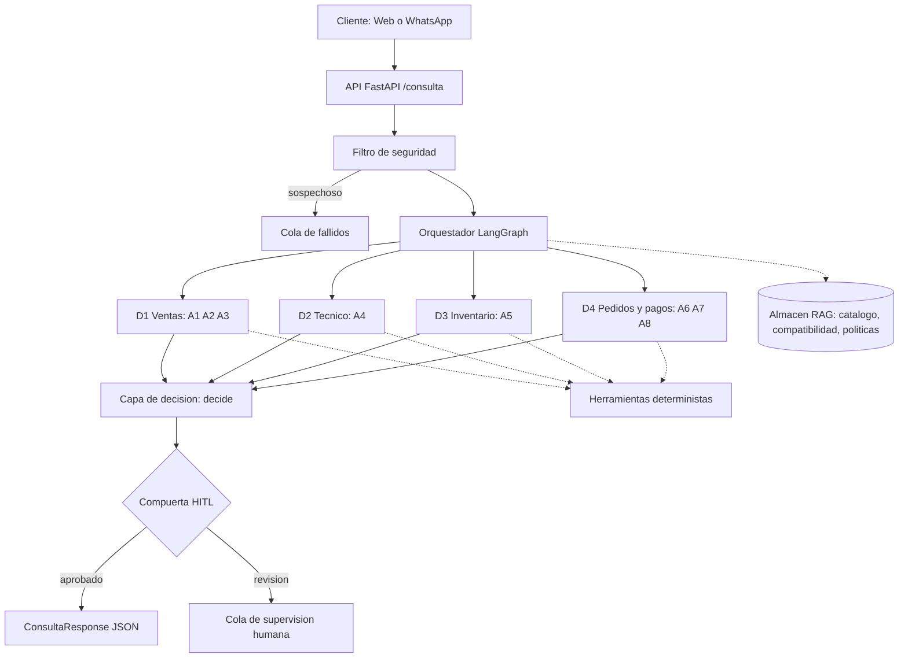
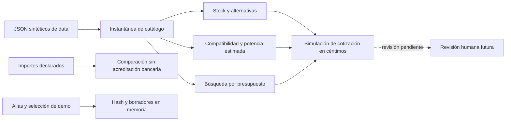
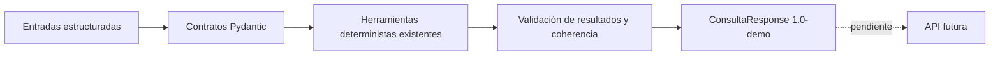
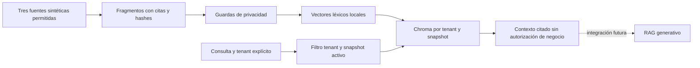
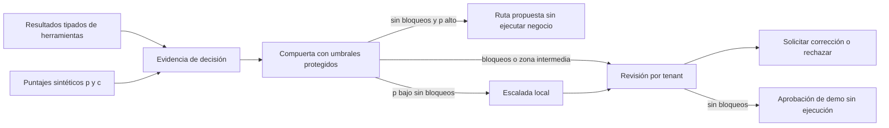
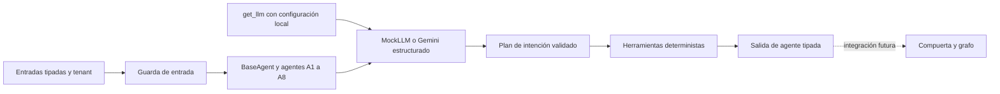

# Arquitectura de Veltri Tecnologic

Diagrama inicial por capas. Se refina a medida que se implementa cada fase.

## Estado tras FASE 1
El diagrama anterior es el diseño futuro, sin cambio de capas. Solo existen
datos sintéticos en data/ y pruebas de integridad; no hay RAG ni flujos operativos.
Contrato y limitaciones: docs/datos.md.

## Estado tras FASE 2
Herramientas deterministas locales implementadas; los demás bloques del diagrama
inicial siguen siendo diseño futuro. No hay llamadas al modelo ni servicios.

Contratos y límites en docs/herramientas.md. No existe conexión automática entre
pagos y pedidos; ningún borrador se confirma por coincidencia de montos.

## Estado tras FASE 3
Contratos estrictos entre llamadores futuros y herramientas. Sin cambios de capas
ni API implementada. El diagrama inicial sigue describiendo el sistema previsto.

Los modelos no ejecutan agentes ni conceden autorizaciones. Contratos y límites
en docs/esquemas.md; el motor de decisión y la revisión humana quedan pendientes.

## Estado tras FASE 4
Capa local de recuperación para el futuro RAG. Sin LLM generativo ni cambios en
agentes, grafo o API. Las herramientas deterministas siguen siendo la autoridad
para validar cálculos y stock de demostración.

La autorización del tenant y el filtro anti injection conversacional siguen
pendientes del backend. Guardas y límites: docs/conocimiento.md.

## Estado tras FASE 5
Compuerta y bandeja local implementadas sobre resultados estructurados. El diseño
inicial sigue siendo futuro para agentes, grafo, filtro conversacional y API.

Bandeja en memoria con resoluciones idempotentes; no sustituye autenticación ni
un registro de auditoría durable. Contratos y supuestos: docs/decision_hitl.md.

## Estado tras FASE 6
Ocho agentes independientes y fábrica cognitiva implementados. Los nodos de los
diagramas por agente son diseño para la próxima fase; no hay grafo ni API.

A7/A8 comparten un registro de borradores por tenant; nunca confirman ventas.
No se usan puntuaciones reales para autorizar negocio ni se calcula con LLM.
Contratos, pruebas y límites: docs/agentes.md y docs/agentes/.
