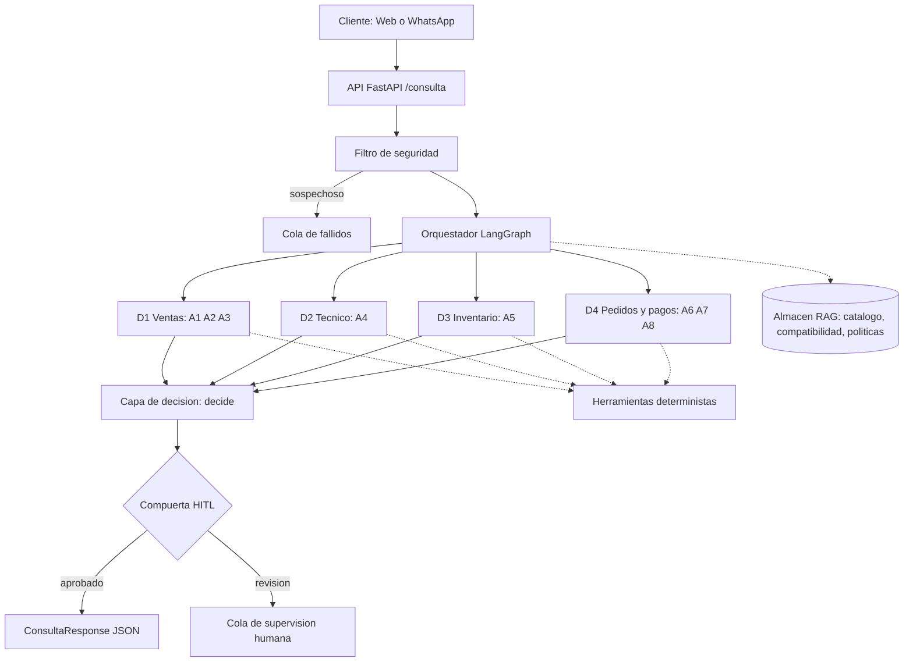
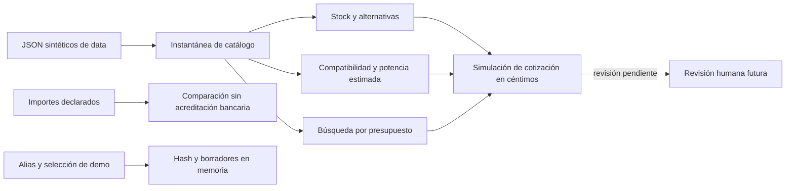
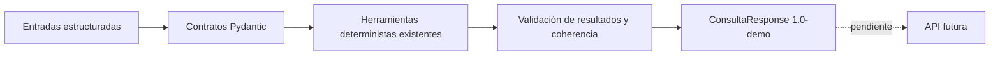

# Arquitectura de Veltri Tecnologic

Diagrama inicial por capas. Se refina a medida que se implementa cada fase.

## Estado tras FASE 1
El diagrama anterior es el diseño futuro, sin cambio de capas. Solo existen
datos sintéticos en data/ y pruebas de integridad; no hay RAG ni flujos operativos.
Contrato y limitaciones: docs/datos.md.

## Estado tras FASE 2
Herramientas deterministas locales implementadas; los demás bloques del diagrama
inicial siguen siendo diseño futuro. No hay llamadas al modelo ni servicios.

Contratos y límites en docs/herramientas.md. No existe conexión automática entre
pagos y pedidos; ningún borrador se confirma por coincidencia de montos.

## Estado tras FASE 3
Contratos estrictos entre llamadores futuros y herramientas. Sin cambios de capas
ni API implementada. El diagrama inicial sigue describiendo el sistema previsto.

Los modelos no ejecutan agentes ni conceden autorizaciones. Contratos y límites
en docs/esquemas.md; el motor de decisión y la revisión humana quedan pendientes.
