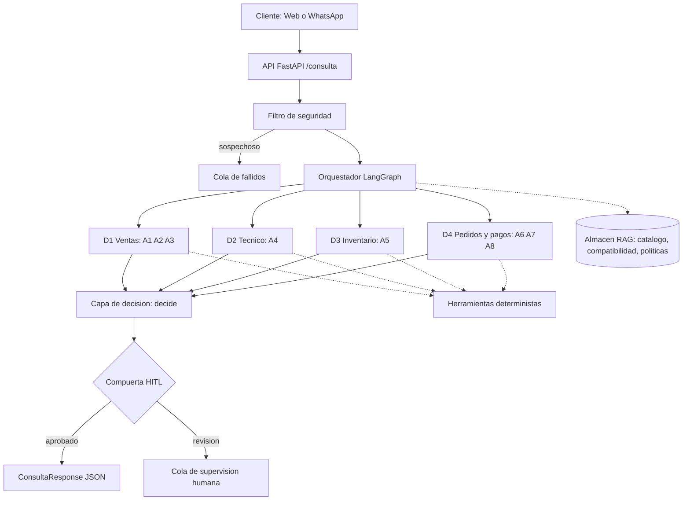
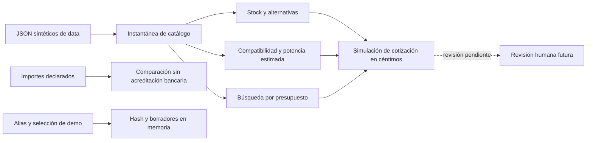
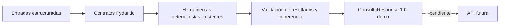
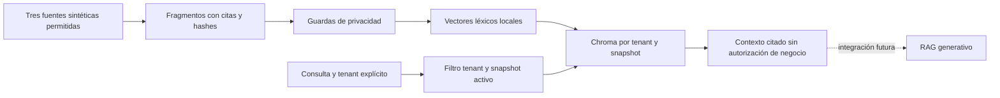
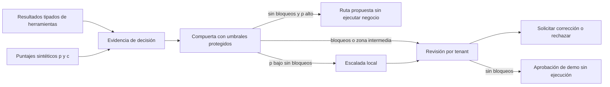
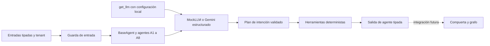
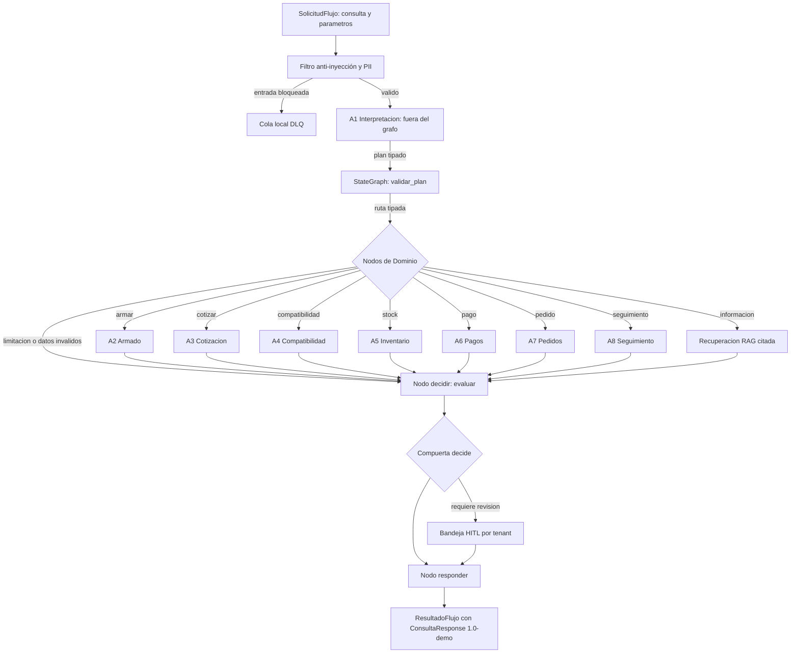
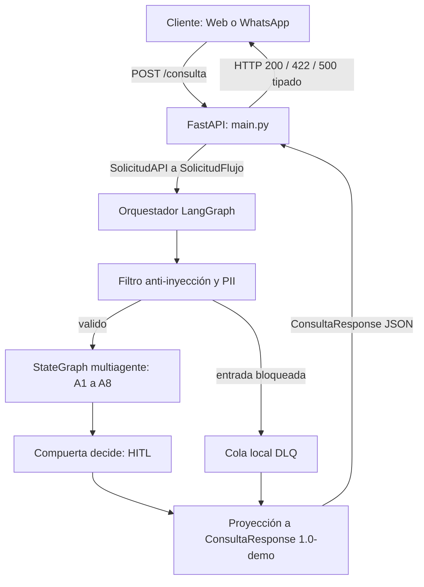
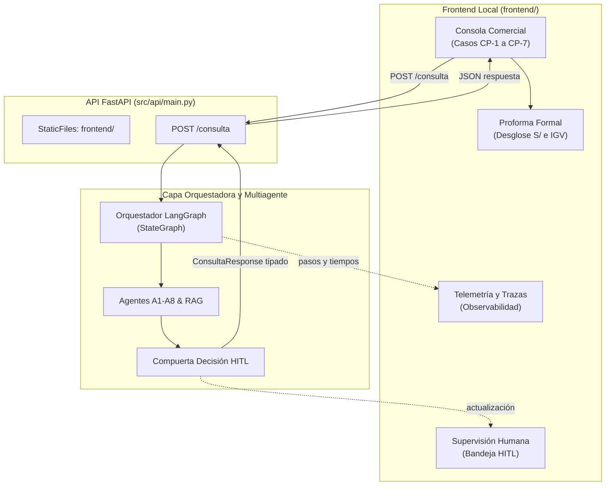

# Arquitectura de Veltri Tecnologic

Diagrama inicial por capas. Se refina a medida que se implementa cada fase.

## Estado tras FASE 1
El diagrama anterior es el diseño futuro, sin cambio de capas. Solo existen
datos sintéticos en data/ y pruebas de integridad; no hay RAG ni flujos operativos.
Contrato y limitaciones: docs/datos.md.

## Estado tras FASE 2
Herramientas deterministas locales implementadas; los demás bloques del diagrama
inicial siguen siendo diseño futuro. No hay llamadas al modelo ni servicios.

Contratos y límites en docs/herramientas.md. No existe conexión automática entre
pagos y pedidos; ningún borrador se confirma por coincidencia de montos.

## Estado tras FASE 3
Contratos estrictos entre llamadores futuros y herramientas. Sin cambios de capas
ni API implementada. El diagrama inicial sigue describiendo el sistema previsto.

Los modelos no ejecutan agentes ni conceden autorizaciones. Contratos y límites
en docs/esquemas.md; el motor de decisión y la revisión humana quedan pendientes.

## Estado tras FASE 4
Capa local de recuperación para el futuro RAG. Sin LLM generativo ni cambios en
agentes, grafo o API. Las herramientas deterministas siguen siendo la autoridad
para validar cálculos y stock de demostración.

La autorización del tenant y el filtro anti injection conversacional siguen
pendientes del backend. Guardas y límites: docs/conocimiento.md.

## Estado tras FASE 5
Compuerta y bandeja local implementadas sobre resultados estructurados. El diseño
inicial sigue siendo futuro para agentes, grafo, filtro conversacional y API.

Bandeja en memoria con resoluciones idempotentes; no sustituye autenticación ni
un registro de auditoría durable. Contratos y supuestos: docs/decision_hitl.md.

## Estado tras FASE 6
Ocho agentes independientes y fábrica cognitiva implementados. Los nodos de los
diagramas por agente son diseño para la próxima fase; no hay grafo ni API.

A7/A8 comparten un registro de borradores por tenant; nunca confirman ventas.
No se usan puntuaciones reales para autorizar negocio ni se calcula con LLM.
Contratos, pruebas y límites: docs/agentes.md y docs/agentes/.

## Estado tras FASE 7
Orquestador LangGraph acotado con seguridad previa, rutas tipadas y compuerta HITL.
Los mensajes bloqueados van a DLQ local sin guardar texto libre; el grafo opera sobre
rutas tipadas sin memoria conversacional ni checkpoints. La API y la interfaz quedan
para las siguientes fases.

Detalles de contratos, privacidad, flujo y pruebas en docs/grafo.md.

## Estado tras FASE 8
API FastAPI (`src/api/main.py`) implementada con el endpoint `/consulta` y contrato
estricto `ConsultaResponse`. La API actúa como la fachada HTTP pública para clientes
Web y WhatsApp, sin dependencias CDN (`docs_url=None`, `redoc_url=None`) y garantizando
que todo error (422, 404, 500) devuelva siempre un JSON estructurado tipado.

Detalles de endpoints, formatos y manejo de errores en docs/api.md.

## Estado tras FASE 9
Interfaz web local (`frontend/`) servida estáticamente en la raíz por FastAPI (`src/api/main.py`),
diseñada bajo estándares WCAG AA, sin CDN y sin emojis (reemplazados por iconos SVG locales).
La UI integra la Consola Comercial con botones rápidos para los casos dorados CP-1 a CP-7,
proforma formal en Soles (`S/`), supervisión de la bandeja HITL en tiempo real y telemetría de
los pasos del grafo.

Detalles de maquetación, tokens de diseño y componentes en docs/interfaz.md.

