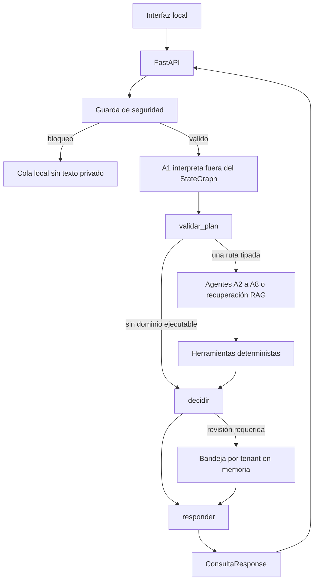
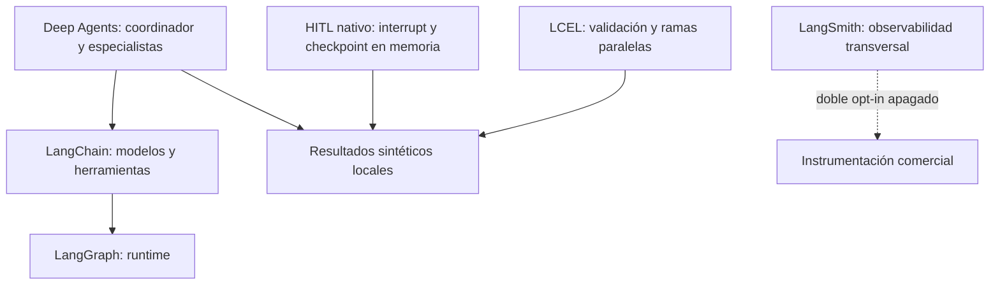

# Arquitectura actual de Veltri Tecnologic

## Flujo comercial

FastAPI sirve la interfaz local y expone POST /consulta y GET /catalogo. El sistema valida la entrada antes del modelo y de LangGraph. Los cálculos y las reglas de compatibilidad están en herramientas deterministas; el modelo se obtiene exclusivamente con get_llm().



El dibujo es una vista de componentes. El StateGraph compilado tiene 11 nodos operativos, 13 vértices con START/END y 20 aristas. El grafo exacto puede inspeccionarse en `src/graph/workflow.py` y en el JSON de la [demo académica](#verificación-y-herramientas-de-mantenimiento); las rutas seleccionan un único dominio. A1 y la seguridad no cuentan como nodos del grafo.

## Responsabilidades y datos

| Agente y dominio | Entrada | Herramienta y resultado tipado |
|---|---|---|
| A1 Interpretación, D1 | `ConsultaRequest` | Propone la intención en `PlanModelo`, dentro de `SalidaAgente[None]`. Opera antes del grafo y sin herramientas de negocio. |
| A2 Armado, D1 | `EntradaArmado` | `armar` busca dentro del rango explícito y devuelve `ResultadoArmado`. |
| A3 Cotización, D1 | `EntradaCotizacion` | `cotizar` evalúa la selección explícita y devuelve `ResultadoCotizacion`. |
| A4 Compatibilidad, D2 | `EntradaSeleccion` | `validar_configuracion` devuelve `ResultadoTecnico`. |
| A5 Inventario, D3 | `EntradaSeleccion` | `comprobar_stock` y `alternativas` producen `ResultadoInventario`. |
| A6 Pagos, D4 | `EntradaPago` | `comparar_pago` compara importes y devuelve `ResultadoPago`. |
| A7 Pedidos, D4 | `EntradaPedido` | El registro por tenant guarda un borrador idempotente, con confirmación explícita, y devuelve `ResultadoPedido`. |
| A8 Seguimiento, D4 | `EntradaSeguimiento` | El mismo registro consulta un borrador del tenant y devuelve `EstadoBorrador` si existe. |

A1–A8 heredan de `BaseAgent` y devuelven `SalidaAgente` tipada. Cada agente usa su prompt y recibe datos validados. A1 propone la intención. Los parámetros comerciales proceden de la entrada tipada del llamador. La salida del modelo no puede cambiar el tenant, cantidades, precios, stock, evidencia o estado de pago.

- `src/tools/` calcula precios en céntimos, stock, compatibilidad y hashes idempotentes. Los pagos no se acreditan con un proveedor externo.
- `src/schemas/` valida contratos; `src/core/decision.py` aplica invariantes y umbrales protegidos.
- `src/knowledge/` recupera solo catálogo, compatibilidad y políticas sintéticos, con tenant y citas explícitos. `chroma_db/` es almacenamiento persistente y no se limpia como residuo.
- `src/core/hitl.py` conserva una bandeja local; resolverla no reanuda el grafo ni confirma operaciones comerciales.

La identidad de tenant requiere autorización de producción; el aislamiento por claves no equivale por sí solo a autenticación. No hay aprobación comercial real ni conciliación bancaria. Precios y existencias son ejemplos.

## Demostraciones académicas separadas



`src/academic/` demuestra LCEL, HITL nativo y Deep Agents reales con respuestas programadas de MockLLM. No reemplaza A1–A8 ni se expone por HTTP. Los checkpoints académicos no sobreviven al proceso y las decisiones de demo no conceden permisos comerciales.

En la demo de semana 10, `create_deep_agent` conecta al coordinador con `write_todos` y `task`. Los especialistas DA-Catalogo (D3) y DA-Revision (D4) trabajan con evidencia sintética. La fase 2 de semana 11 añade lectura y escritura en el estado virtual del grafo y prompts específicos por rol.

Los BPMN [AS-IS](bpmn_as_is.bpmn) y [TO-BE](bpmn_to_be.bpmn) documentan el proceso. El TO-BE encadena A2 → A4 → A5 → A3, mientras que el grafo comercial selecciona un único dominio por consulta.

## Contratos y datos

`src/schemas/` contiene los modelos Pydantic estrictos; `python scripts/exportar_esquemas.py` genera los 35 JSON Schema de intercambio en `docs/contratos/`. La API y los tests consumen los modelos Python. Los modelos rechazan campos extra y coerciones de bool/float/string a enteros. Los validadores comprueban relaciones entre campos que JSON Schema por sí solo no garantiza. Revalidar después de transformar diccionarios: `frozen=True` no congela profundamente listas y mapas.

`ConsultaResponse` versión `1.0-demo` utiliza estados completado, revision_humana, bloqueado y error. Conserva intención, mensaje, motivos, fuentes, flags HITL/proforma/aprobación y resultado opcional acorde al dominio. Error/bloqueo no deben incluir resultados comerciales. `ErrorValidacion` publica códigos y campos permitidos; no excepciones crudas. Ocultar entradas en repr de Pydantic no sanea logs ni model_dump.

`data/catalogo.json` contiene 84 SKUs sintéticos: sku, nombre, categoría, precio_centimos positivo, stock entero no negativo y especificaciones por categoría. PEN usa 100 céntimos por sol. Las unidades técnicas son W, mm, GB y MT/s. Un kit RAM cuenta como una unidad del catálogo. No hay mediciones ni datos reales de tienda; CPU-AMD-5500 tiene stock cero.

`compatibilidad.json` declara sockets, chipsets, RAM, refrigeración, montaje, interfaz SSD y conectores. Las relaciones CPU/placa requieren verificar BIOS y fabricante. El margen de potencia propuesto usa reserva de 100 W y 25 %, con redondeo entero; no certifica transitorios ni rendimiento. `politicas.md` diferencia propuestas de reglas definidas. No se inventan porcentajes de cuello de botella ni FPS.

## Herramientas y configuración

`Catalogo` devuelve copias y valida identidad, moneda, precio y stock. `comprobar_stock` informa faltantes; `alternativas` propone misma categoría/plataforma sin reservar ni aprobar un reemplazo. `validar_configuracion` exige una unidad de ocho categorías, incluida GPU y refrigeración, y comprueba socket, chipset, RAM, SSD, conectores y montaje. Ausencia de conflictos no acredita soporte real de fabricante.

`cotizar` calcula líneas y total en céntimos, stock, validación técnica y bloqueos; no añade IGV, montaje ni envío. `armar` busca una selección compatible dentro de límites inclusivos: con máximo elige el mayor total admisible; sin máximo, el menor que cumple el mínimo. Es una regla de demo, no optimización de rendimiento. Empates por SKU; sin solución devuelve cotización nula y mínimo de catálogo si existe, no mínimo del mercado.

`comparar_pago` compara importes sin convertir monedas: siempre no_conciliado. Los borradores usan SHA-256 de cliente|productos|cantidad|canal, SKUs ordenados, arrays JSON compactos y sin timestamps. Alias demo_ y tenant explícitos; A7/A8 comparten registro en memoria. No hay confirmación, reserva, cobro o despacho.

`get_llm()` es la única fábrica. Configuración del proceso prevalece sobre `.env`; USE_MOCK_LLM=1 por defecto, proveedor gemini. El modo real requiere modelo y clave locales; la fachada comercial lo retiene pendiente de calibración. MockLLM consume fixtures tipados sin inferencia ni fallback inventado. El conector Gemini usa JSON Schema, store=False y no streaming; su compatibilidad se prueba con transporte simulado, no con una cuenta externa.

## Arquitectura de prompts

`src/core/prompts.py` compone doce bloques en orden fijo. Centraliza la jerarquía de confianza,
el manejo de entradas no confiables y la privacidad. `src/agents/prompts.py` aplica las reglas de
planificación comercial. Cada agente define su misión, contexto, herramientas que ejecuta el
código, proceso, límites y condiciones de revisión. A1 incluye ejemplos de clasificación ambigua
y A6 ejemplifica el tratamiento de importes iguales y discrepantes.

Los agentes comerciales emiten un único `PlanModelo` con `accion`, `p` y `c`. Los agentes A2–A8
validan la acción de su dominio antes de ejecutar herramientas deterministas. LangGraph conserva
el control de la revisión humana. El conector Gemini coloca el prompt en `system_instruction` y
los datos en un objeto JSON aparte. Sigue usando el contrato Pydantic y se verifica con transporte
simulado. La guarda previa al modelo continúa activa.

En la [demo académica de semana 11](agentes/deep-agents-semana11.md), los tres roles reciben los
doce bloques como instrucciones de sistema. El adaptador admite solo las herramientas programadas
para cada rol y separa el hallazgo delegado como datos estructurados. La salida
`SalidaAcademica` mantiene la revisión requerida y ausencia de efecto comercial.

## Decisión y revisión

SolicitudDecision exige opción, p/c finitos en [0,1], origen prueba_no_calibrada y evidencia discriminada del dominio. La compuerta revalida y calcula bloqueos/hash. Un bloqueo fuerza revisión cualquiera sea p. Sin bloqueo, p >= TAU_AUTO propone ejecutar, TAU_REV <= p < TAU_AUTO propone revisión y p < TAU_REV escala. Los umbrales solo se leen del archivo protegido; c no introduce otro umbral. Puntajes son fixtures, no probabilidades calibradas.

ResultadoDecision registra motivos, fuentes, huella y accion_ejecutada=false. BandejaRevision recalcula al encolar; huella y tenant identifican revisión idempotente. Devuelve copias. Estados pendiente/escalada y finales aprobada_demo/rechazada/correccion_solicitada. Aprobar_demo no admite bloqueos ni escalados y nunca ejecuta negocio. Misma resolución repetida es idempotente; otra resolución final se rechaza. Corregir exige nueva evaluación, no borrar evidencia. Revisor demo_ no autentica una persona. Persistencia y auditoría duraderas están pendientes.

## Recuperación documental

`src/knowledge/` lee solo catálogo, compatibilidad y políticas. Fragmenta por SKU, relación o bloque y conserva fuente/hash. Vectorización léxica SHA-256 a 256 dimensiones, sin embeddings remotos; colisiones y cobertura limitada son posibles. Chroma usa colección por hash del tenant, filtro tenant/snapshot y bloqueo local filelock. No equivale a autenticación multiusuario.

La ingesta valida antes de escribir, publica snapshot nuevo tras completar lotes y conserva el anterior si falla. Reingesta idéntica es idempotente; limpia obsoletos solo del tenant correspondiente. No hay transacción entre fuente e índice. `Almacen.buscar` devuelve hasta 20 candidatos con citas/hash/distancia; SKU exacto tiene prioridad y sin coincidencia devuelve vacío. Distancia no es confianza. Revalidar precios/stock con las herramientas porque el índice puede quedar antiguo.

No indexar mensajes, pedidos, pagos, claves o datos personales. La guarda por patrones es limitada, no anonimización exhaustiva. La ingesta y las consultas requieren tenant explícito. Comando de reconstrucción: `python -m src.knowledge.ingesta --tenant IDENTIFICADOR`; usar `--ruta` nueva para pruebas sin tocar almacenamiento persistente.

## API e interfaz local

`src/api/main.py` expone POST /consulta con SolicitudAPI plana o anidada y respuesta ConsultaResponse. GET /catalogo entrega inventario; `/` sirve `frontend/index.html`. La guarda antiinyección/PII precede al modelo/grafo; DLQ conserva evento técnico sin eco del mensaje. Validación 422, ruta 404 y fallo interno 500 usan errores tipados sin trazas privadas.

La SPA usa HTML, CSS y JavaScript locales: tokens.css y styles.css para presentación, icons.js para SVG, api.js para peticiones y app.js para conversación/catálogo. No hay CDN ni fuentes remotas. La UI muestra ejemplos y proforma visual, pero no prueba aprobación técnica ni conciliación bancaria. Los objetivos de accesibilidad o el desglose de IGV visible no se presentan como certificaciones de cumplimiento; las diferencias comerciales con BPMN siguen pendientes.

Comandos de instalación y servidor están en el README principal; `python scripts/verificar.py` verifica calidad, estructura, dependencias, pruebas y secretos. Los casos CP-1 a CP-7 tienen pruebas de herramientas, flujo y API; la línea base sigue vacía y protegida. El CP-1 requiere revisión por evidencia sintética, no debe afirmarse como venta automáticamente aprobada.

## Extensión académica de semana 11 (fase 2)

La demostración `src/academic/deep_agents_semana11.py` conserva los roles académicos existentes. El coordinador planifica, delega a Catálogo, escribe y lee `/hallazgos.json` en el estado virtual y entrega el hallazgo a Revisión para contrastarlo. La demo se ejecuta al margen de la API comercial. Véase el [diagrama y las pruebas de integración](agentes/deep-agents-semana11.md). El estado dura una ejecución y el modelo sigue siendo simulado.


## Controles de autonomía

`LimitesAutonomia` valida una configuración inmutable por perfil. Los llamadores de confianza
pueden pasar `limites=` a `Orquestador` o `ejecutar_semana11`. El mensaje, los argumentos de
herramienta y el estado del grafo carecen de acceso a esta configuración.

| Límite | Comercial | Académico |
|---|---:|---:|
| Pasos operativos totales | 4 | 32 |
| Llamadas al modelo | 2 | 14 |
| Despachos de herramientas | 91 | 12 |
| Niveles de delegación | 0 | 1 |
| Plazo de ejecución | 10 s | 10 s |
| Presupuesto de tokens | 8.192 | 32.000 |
| Salida máxima por llamada | 128 | 128 |

El DAG comercial usa como máximo cuatro nodos y un plan de A1 más un plan de dominio.
El techo de herramientas permite una consulta de stock y hasta 90 búsquedas de alternativas,
el máximo de elementos del contrato de selección. La demo normal usa 21 pasos, 12 llamadas
al modelo y 9 herramientas. Sus límites dejan margen sin habilitar un tercer especialista.
Los 128 tokens de salida cubren planes JSON breves o llamadas programadas. Ambos grafos retienen
el tope nativo de recursión. El contador común mide nodos comerciales y pasos académicos de
modelo o herramienta, incluidos los de los especialistas.

El presupuesto se comparte por ejecución y reserva entrada y salida antes de cada inferencia.
MockLLM calcula unidades simuladas a partir de bytes UTF-8 de mensajes y fixtures. Gemini carga
el uso informado, incluidos tokens adicionales si están disponibles, y conserva una estimación
conservadora cuando faltan métricas. El conector aplica el máximo de salida, limita el timeout
al tiempo restante y desactiva reintentos. El proveedor conserva el control del cómputo en curso.
El plazo local se comprueba en cada frontera operativa y durante la búsqueda de armado. Acota
la espera por el bloqueo de Chroma. El tiempo observado puede superar el plazo si una llamada
síncrona o nativa ya iniciada tarda en devolver el control.

El adaptador académico restringe herramientas por rol antes del despacho y valida el destino,
la descripción delegada y la ruta virtual. Solo admite los dos especialistas, una vez cada uno,
y `/hallazgos.json`. Los resultados se revalidan antes de reutilizarlos. Una interrupción
académica devuelve evidencia, plan y memoria parciales validados durante la ejecución.
La fachada comercial conserva la última salida tipada del grafo y deriva el corte a la bandeja
del tenant sin nuevas llamadas al modelo ni a herramientas de negocio.

Los contadores y motivos cerrados de las últimas 256 ejecuciones se conservan en memoria
y pueden registrarse en el logger local `veltri.recursos`. Incluyen tiempo y revisión, sin
prompts, identificadores, datos personales ni resultados de negocio. Son métricas para
análisis posterior; no constituyen medición de costo de un proveedor.

## Observabilidad segura

`src/core/observabilidad.py` y `src/core/diagnostico_http.py` implementan la instrumentación y el transporte. La configuración predeterminada mantiene la instrumentación apagada. No existe un control HTTP para activarla.

- La instrumentación exige `VELTRI_TRACING_ENABLED=1` y `VELTRI_TRACING_SYNTHETIC_ONLY=1`. Un envío externo requiere también `VELTRI_TRACING_ALLOW_EXTERNAL=1`, MockLLM, la validación del destino oficial, una clave local y el proyecto `veltri-semana10-demo`.
- Mantén `LANGSMITH_TRACING` y `LANGCHAIN_TRACING_V2` en `false`. Solo se permiten UUID aleatorios, nombres cerrados, parentesco, tiempos y metadatos sintéticos constantes. Los inputs y outputs están vacíos.
- El transporte conserva el primer fallo y bloquea llamadas posteriores, redirecciones y reintentos. Registra método, ruta saneada, estado, categoría, correlación sintética y etapa.
- `python scripts/demo_observabilidad.py` ejecuta el modo local sin envío. El lanzador remoto `scripts/langsmith_segundo_intento.py` está protegido por un [registro de un solo uso](evidencias/semana10-fase43/ejecucion-unica.json) ya consumido. Consérvalo en su ruta y nunca lo reinicies. El registro se conserva por integridad histórica. La operación vigente usa exclusivamente instrumentos locales y transportes simulados.
- El primer intento histórico recibió HTTP 400. El segundo registró nueve POST y nueve PATCH con HTTP 202 y se detuvo al recibir HTTP 403 en la lectura. La persistencia, el identificador y el árbol remotos siguen sin verificar.

## Verificación y herramientas de mantenimiento

- `python scripts/verificar.py` verifica sintaxis, referencias e imports estáticos, dependencias, Ruff, pytest y secretos. El tipado con `--mypy` es opcional. Los imports dinámicos se comprueban con pruebas de ejecución.
- `python scripts/instalar_hooks.py` instala el hook de protección de archivos críticos y escaneo de secretos. `python scripts/escanear_secretos.py` también se puede ejecutar por separado.
- `python scripts/demo_academica.py` ejecuta las demos de semana 10 con MockLLM y emite, entre otros resultados, el JSON del grafo comercial. Usa un directorio temporal por defecto. Si se indica `--salida`, la ruta debe ser nueva.
- La demo de semana 11 se ejecuta con `python -m src.academic.deep_agents_semana11`. Las demos y la verificación local emplean fixtures y transporte simulado.

## Especificaciones y trazabilidad SDD

La especificación normativa de esta fase es la aceptación observable de cada fila.
El flujo de cambio es definir el requisito y su criterio, diseñar el cambio en el componente
responsable, dividirlo en tareas de contrato, implementación y pruebas, ejecutar primero las
pruebas relacionadas y luego `python scripts/verificar.py`. Cierra la tarea cuando el criterio
y sus pruebas coincidan. Los diez invariantes de `AGENTS.md` tienen prioridad.

La columna **Pruebas** identifica evidencia mínima por requisito mediante identificadores pytest.
Los demás casos de cada módulo ejercitan el mismo ámbito, incluidos errores, fronteras y entradas
parametrizadas. **Resultado** indica cómo se decide en cada revisión: `pytest` exige que las
pruebas enlazadas se recolecten y que la suite integral finalice sin fallos ni omisiones.
Las brechas se registran debajo de la matriz con el alcance que aún falta acreditar.

| ID | Requisito | Especificación de aceptación | Componente | Código | Pruebas | Resultado |
|---|---|---|---|---|---|---|
| A1 | Interpretar intención | Clasifica en PlanModelo; desconocida es explícita y faltantes no se infieren | Interpretación, D1 | `src/agents/d1_ventas/a1_interpretacion.py::A1Interpretacion` | `tests/test_agentes.py::test_a1_desconocida_es_tipo_explicito`, `tests/test_flujo.py::test_modelo_no_puede_inventar_parametros_ni_tenant` | pytest |
| A2 | Armar por rango | La cotización es determinista y queda dentro del rango, o informa que no hay solución | Armado, D1 | `src/agents/d1_ventas/a2_armado.py::A2Armado`, `src/tools/armador.py::armar` | `tests/test_herramientas.py::test_cp7_rangos_sin_promesas_imposibles`, `tests/test_agentes.py::test_a2_limite_insuficiente_no_inventa_pc`, `tests/test_flujo.py::test_cp4_rtx_insuficiente_no_genera_proforma`, `tests/test_api.py::test_cp1_cotizacion_gaming_valida` | pytest |
| A3 | Cotizar la selección | Suma cantidades y precios del catálogo en céntimos; bloquea el exceso de presupuesto | Cotización, D1 | `src/agents/d1_ventas/a3_cotizacion.py::A3Cotizacion` | `tests/test_agentes.py::test_a3_total_exactamente_de_herramienta_y_bloqueo_presupuesto` | pytest |
| A4 | Validar compatibilidad | Un socket incompatible impide aprobación aunque el puntaje sea alto | Compatibilidad, D2 | `src/agents/d2_tecnico/a4_compatibilidad.py::A4Compatibilidad` | `tests/test_agentes.py::test_a4_no_aprueba_socket_incompatible`, `tests/test_flujo.py::test_socket_incompatible_no_lo_autoriza_p_alta` | pytest |
| A5 | Consultar existencias | Reporta SKU faltante, fuente, alternativas y revisión; con stock la consulta se completa | Inventario, D3 | `src/agents/d3_inventario/a5_inventario.py::A5Inventario` | `tests/test_agentes.py::test_a5_cp3_fuente_sku_alternativas_y_revision`, `tests/test_flujo.py::test_stock_disponible_completa_consulta_sin_autorizar_venta` | pytest |
| A6 | Comparar pagos | Importes iguales o discrepantes permanecen sin conciliar | Pagos, D4 | `src/agents/d4_pedidos/a6_pagos.py::A6Pagos`, `src/tools/pagos.py::comparar_pago` | `tests/test_herramientas.py::test_pago_nunca_se_acredita_solo_por_importe`, `tests/test_flujo.py::test_cp5_comparacion_no_acredita_pago` | pytest |
| A7 | Crear borrador idempotente | Exige confirmación tipada; repetir la clave SHA-256 mantiene un borrador | Pedidos, D4 | `src/agents/d4_pedidos/a7_pedidos.py::A7Pedidos`, `src/tools/registro.py::RegistroPorTenant` | `tests/test_agentes.py::test_a7_exige_confirmacion_tipada`, `tests/test_api.py::test_cp6_pedido_idempotente_sha256` | pytest |
| A8 | Consultar borrador | Recupera por clave y tenant; un tenant ajeno no recupera el borrador | Seguimiento, D4 | `src/agents/d4_pedidos/a8_seguimiento.py::A8Seguimiento` | `tests/test_agentes.py::test_a7_a8_idempotencia_y_aislamiento`, `tests/test_flujo.py::test_cp6_pedido_idempotente_y_seguimiento_aislado` | pytest |
| DA-COORD | Planificar y coordinar | Actualiza el plan, delega a Catálogo y luego a Revisión y emite SalidaAcademica sin efecto comercial | DA-CoordinadorAcademico | `src/academic/deep_agents_semana11.py::AdaptadorMemoria` | `tests/test_deep_agents_semana11.py::test_cuatro_pilares_en_framework_real` | pytest |
| DA-CAT | Leer fixture sintético | La auditoría registra una consulta exitosa al fixture por el rol de Catálogo | DA-Catalogo | `src/academic/deep_agents_semana11.py::_especialista`, `src/tools/evidencia_academica.py::revisar_fixture_sintetico` | `tests/test_deep_agents_semana11.py::test_cuatro_pilares_en_framework_real` | pytest |
| DA-REV | Contrastar el hallazgo | Recibe JSON separado de las instrucciones, consulta el fixture y deja revisión requerida | DA-Revision | `src/academic/deep_agents_semana11.py::AdaptadorEvidencia` | `tests/test_deep_agents_semana11.py::test_cuatro_pilares_en_framework_real` | pytest |
| DA-MEM | Verificar memoria virtual | Escribe y lee el artefacto durante la ejecución; rechaza adulteraciones y aísla ejecuciones | Memoria Deep Agents | `src/academic/memoria_semana11.py::verificar_lectura`, `src/academic/memoria_semana11.py::verificar_archivo` | `tests/test_memoria_semana11.py::test_lectura_debe_contener_evidencia`, `tests/test_memoria_semana11.py::test_rechaza_claves_duplicadas_en_evidencia`, `tests/test_deep_agents_semana11.py::test_dos_ejecuciones_sin_colision_de_archivos` | pytest |
| DA-CTRL | Restringir herramientas y delegación | Rechaza rutas, destinos, argumentos y herramientas ajenos al rol antes de ejecutar | Middleware académico | `src/academic/controles_semana11.py::ControlesHerramientas` | `tests/test_autonomia_semana11.py::test_middleware_rechaza_llamadas_antes_del_despacho`, `tests/test_prompts_semana11.py::test_el_adaptador_rechaza_herramienta_fuera_del_rol` | pytest |
| DA-LEG | Preservar demostraciones previas | LCEL, HITL nativo y Deep Agents de semana 10 se ejecutan con fixtures; la CLI conserva los originales | Demos de semana 10 | `src/academic/lcel.py::crear_pipeline`, `src/academic/hitl.py::crear_grafo`, `scripts/demo_academica.py::ejecutar_demo` | `tests/test_academico.py::test_lcel_composicion_real`, `tests/test_academico.py::test_hitl_interrupcion_y_reanudacion`, `tests/test_academico.py::test_deepagents_plan_y_delegacion`, `tests/test_scripts_cli.py::test_demo_cli_real_sin_alterar_evidencia` | pytest |
| GRAFO | Orquestar un solo dominio | El grafo real conserva el DAG tipado, sin memoria persistente ni rutas entre dominios | LangGraph comercial | `src/graph/workflow.py::crear_grafo`, `src/graph/nodes.py::validar_plan` | `tests/test_trazabilidad_sdd.py::test_grafo_comercial_conserva_la_topologia_especificada`, `tests/test_flujo.py::test_intencion_desconocida_no_se_enruta_por_texto`, `tests/test_flujo.py::test_grafo_sin_mensaje_checkpointer_ni_envio_de_trazas` | pytest |
| PROMPTS | Aplicar doce bloques separados de los datos | Los 11 roles conservan los bloques; el transporte simulado separa el sistema de los datos y la demo recibe sus instrucciones | Sistema de prompts | `src/core/prompts.py::componer_prompt`, `src/agents/prompts.py::prompt_plan` | `tests/test_prompts_semana11.py::test_prompts_comerciales`, `tests/test_prompts_semana11.py::test_prompts_academicos`, `tests/test_llm.py::test_conector_real_con_sdk_y_transporte_simulado`, `tests/test_deep_agents_semana11.py::test_cuatro_pilares_en_framework_real` | pytest |
| AUT-LIM | Acotar pasos, llamadas y delegación | Los topes cortan antes del siguiente despacho; una delegación cíclica o un reinicio se rechazan | Presupuesto compartido | `src/core/autonomia.py::Presupuesto`, `src/core/autonomia.py::controlar_ejecucion` | `tests/test_autonomia_semana11.py::test_cortes_reales_en_el_grafo`, `tests/test_autonomia_semana11.py::test_delegacion_comparte_presupuesto_y_detecta_ciclos`, `tests/test_autonomia_semana11.py::test_el_subagente_no_puede_reiniciar_el_presupuesto` | pytest |
| AUT-TOK | Reservar y liquidar tokens | Se limita salida y se separan contadores simulados, estimados y reportados por el transporte de prueba | Fábrica y presupuesto | `src/core/llm.py::GeminiLLM`, `src/core/autonomia.py::Presupuesto` | `tests/test_autonomia_semana11.py::test_llamada_real_solo_simulada_reserva_y_cuenta_uso`, `tests/test_autonomia_semana11.py::test_salida_fuera_de_presupuesto_corta_sin_entregar_el_plan` | pytest |
| AUT-TIME | Aplicar plazo cooperativo | Con reloj simulado vencido se impiden nuevas inferencias y herramientas | Presupuesto temporal | `src/core/autonomia.py::Presupuesto.segundos_restantes`, `src/tools/armador.py::armar` | `tests/test_autonomia_semana11.py::test_plazo_con_reloj_simulado` | pytest |
| AUT-HITL | Cortar con evidencia parcial | Conserva memoria verificada o la salida tipada disponible, informa motivo y deriva a revisión cuando corresponde | Orquestadores | `src/graph/workflow.py::Orquestador._interrumpir`, `src/academic/deep_agents_semana11.py::_parcial` | `tests/test_autonomia_semana11.py::test_conserva_solo_evidencia_validada_y_no_llama_despues_del_corte`, `tests/test_autonomia_semana11.py::test_flujo_comercial_escala_en_el_tenant_y_conserva_el_resultado_si_existe`, `tests/test_api.py::test_limite_de_tokens_respeta_el_contrato_y_no_activa_el_fallback` | pytest |
| RAG | Recuperar citas del corpus local | Requiere tenant; excluye registros ajenos, fuentes arbitrarias y resultados sin coincidencia | Vectorización e índice Chroma | `src/knowledge/documentos.py::construir_documentos`, `src/knowledge/almacen.py::Almacen.buscar`, `src/graph/nodes.py::recuperar` | `tests/test_conocimiento.py::test_ingesta_y_busqueda_sin_red`, `tests/test_conocimiento.py::test_tenant_obligatorio_en_todas_las_operaciones`, `tests/test_conocimiento.py::test_filtro_metadata_excluye_registro_ajeno_en_coleccion`, `tests/test_flujo.py::test_rag_informativo_cita_tenant_y_no_genera_respuesta_sin_fuente` | pytest |
| SEC-INPUT | Bloquear inyección y PII reconocibles | La entrada conocida se bloquea antes del modelo y el grafo; la DLQ evita el eco de datos | Guarda y DLQ | `src/core/seguridad.py::validar_entrada_modelo`, `src/graph/workflow.py::Orquestador.consultar` | `tests/test_flujo.py::test_cp2_bloqueo_previo_sin_grafo_modelo_o_datos_personales`, `tests/test_api.py::test_cp2_datos_personales_bloqueados`, `tests/test_autonomia_semana11.py::test_instruccion_de_reinicio_del_presupuesto_se_bloquea_antes_de_inferir` | pytest |
| SEC-DATOS | Proteger datos y secretos | Ingesta y trazas prueban rechazo o ausencia de datos canario; se enmascaran secretos detectados | Privacidad y auditoría | `scripts/escanear_secretos.py::escanear`, `src/core/observabilidad.py::span`, `src/core/diagnostico_http.py::TransporteDiagnostico` | `tests/test_conocimiento.py::test_rechaza_pii_sin_exponer_valor`, `tests/test_observabilidad.py::test_payload_sdk_final_sin_entorno_ni_canarios`, `tests/test_diagnostico_http.py::test_ruta_query_y_destino_no_filtran`, `tests/test_escaner_secretos.py::test_detecta_token_langsmith_sin_revelarlo`, `tests/test_invariantes.py::test_gitignore_protege_env` | pytest |
| HITL | Aplicar invariantes sobre el puntaje | Stock, socket, presupuesto y pago fuerzan revisión y la bandeja impide autoaprobación o acceso ajeno | Compuerta y bandeja | `src/core/decision.py::decide`, `src/core/hitl.py::BandejaRevision` | `tests/test_decision_hitl.py::test_stock_agotado_siempre_exige_revision`, `tests/test_decision_hitl.py::test_socket_incompatible_con_probabilidad_alta`, `tests/test_decision_hitl.py::test_presupuesto_excedido_no_lo_autoriza_el_puntaje`, `tests/test_decision_hitl.py::test_pago_no_conciliado_aunque_coincida`, `tests/test_decision_hitl.py::test_resolver_no_puede_actuar_sobre_otro_tenant` | pytest |
| API | Mantener contratos estructurados | POST /consulta entrega ConsultaResponse incluso en errores; el esquema rechaza combinaciones incoherentes | FastAPI y Pydantic | `src/api/main.py::crear_app`, `src/schemas/consulta.py::ConsultaResponse` | `tests/test_api.py::test_formato_anidado_consulta`, `tests/test_api.py::test_error_validacion_json_malformado_retorna_422`, `tests/test_api.py::test_fallo_interno_retorna_500_con_consulta_response`, `tests/test_esquemas.py::test_sobre_no_oculta_revision_fuentes_o_intencion` | pytest |
| CAT | Mantener catálogo y consulta libre local | Los SKUs y referencias técnicas son válidos y GET /catalogo lista los productos | Datos y herramienta de consulta | `src/tools/catalogo.py::Catalogo`, `src/tools/consulta_comercial.py::atender_consulta_comercial` | `tests/test_datos.py::test_identificadores_y_cobertura`, `tests/test_datos.py::test_referencias_cpu_placa_completas_sin_duplicados`, `tests/test_consulta_comercial.py::test_api_catalogo_endpoint`, `tests/test_consulta_comercial.py::test_api_consulta_libre_cotizacion_3500_arma_pc` | pytest |
| REC | Acotar trabajo y medir recursos locales | Se cuentan pasos, modelos, herramientas, delegaciones, tiempo y revisiones sin guardar prompts; se retienen hasta 256 muestras | Presupuesto y observabilidad | `src/core/autonomia.py::Presupuesto.metricas`, `src/core/observabilidad.py::recursos_recientes` | `tests/test_autonomia_semana11.py::test_demo_normal_registra_recursos_sin_datos_ni_tokens_reales`, `tests/test_trazabilidad_sdd.py::test_ventana_de_recursos_acotada_y_aislada` | pytest |
| LOCAL | Operar con fixtures y sin servicios externos | El mock es predeterminado, el orquestador bloquea el modelo remoto, las trazas no conectan por defecto y los adaptadores históricos se prueban simulados | Configuración y operación | `src/config.py::cargar_configuracion`, `src/core/llm.py::get_llm`, `scripts/langsmith_segundo_intento.py::lanzar` | `tests/test_invariantes.py::test_solo_core_llm_instancia_modelos`, `tests/test_llm.py::test_configuracion_mock_por_defecto_y_entorno_prevalece`, `tests/test_flujo.py::test_modo_real_no_hace_consultas_sin_calibracion`, `tests/test_observabilidad.py::test_activada_sin_permiso_externo_no_construye_cliente`, `tests/test_langsmith_lanzador.py::test_falta_confirmacion_no_consume_ni_conecta` | pytest |
| SDD | Mantener trazabilidad verificable | Todos los IDs obligatorios enlazan símbolos válidos y casos recolectados; el verificador exige ejecución sin omitidos | Verificación local y CI | `scripts/verificar.py::comprobar_estructura`, `scripts/verificar.py::_ejecutar_pytest` | `tests/test_trazabilidad_sdd.py::test_matriz_cubre_requisitos_componentes_y_pruebas`, `tests/test_verificador.py::test_import_eliminado_detectado_sin_ejecutar`, `tests/test_verificador.py::test_pytest_rechaza_resultado_omitido` | pytest |

### Brechas y discrepancias

| Referencia | Estado y evidencia |
|---|---|
| CP-1 / A2–A4 | La expectativa histórica de aprobación técnica contradice el alcance actual. La cotización sintética dentro del presupuesto exige HITL por evidencia de fabricante pendiente. La prueba HTTP verifica ese comportamiento y los datos históricos conservan su expectativa original. |
| CP-4 / A2 | El mínimo que puede informar la demo procede del catálogo sintético. El mínimo del mercado queda fuera del alcance probado. |
| CP-6 / A7 | La solicitud histórica menciona despacho. La prueba acredita idempotencia de un borrador, con confirmación explícita y revisión. El despacho queda fuera del alcance. |
| GRAFO / BPMN TO-BE | El BPMN compone varios dominios en secuencia. El DAG vigente ejecuta como máximo uno por ruta; el TO-BE sigue como propuesta. |
| AUT-TIME, REC | Se verifica el límite cooperativo y el registro de contadores. Preempción de código nativo, objetivos de CPU/RAM/disco y benchmarks reproducibles quedan sin acreditar. |
| RAG, SEC-INPUT, PROMPTS | Se verifica partición por tenant, patrones conocidos y prompts con MockLLM. Autenticación, detección exhaustiva de PII y resistencia comparativa de modelos se mantienen fuera de esta fase. |
| HITL, LOCAL | La bandeja comercial es en memoria. Los adaptadores externos y el registro de LangSmith se conservan como legado; la operación prevista es local. |

## Archivo histórico de la semana 10

Los 42 archivos originales de entrega y evidencias están versionados en el commit [0cb71a7](https://github.com/alessandrorr1007-debug/veltri/tree/0cb71a796b151c01bf1f6b081f124af610575c71/docs). El archivo conserva el Word, el generador, las figuras, la procedencia y los registros de pruebas y ejecución. El registro operativo de LangSmith también permanece en el árbol activo.

Con Git y el historial disponible, exporta los originales a un ZIP separado del árbol activo:

```sh
git archive --format=zip --output=veltri-semana10.zip 0cb71a796b151c01bf1f6b081f124af610575c71 docs/entrega-semana10 docs/evidencias
```

Para reproducir el Word, extrae una copia completa de ese commit a otro directorio y usa allí sus dependencias fijadas y su generador. Conserva el informe original por separado.
