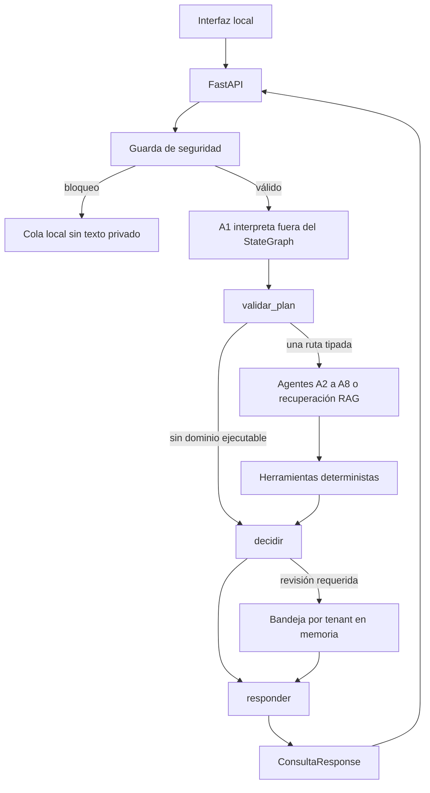
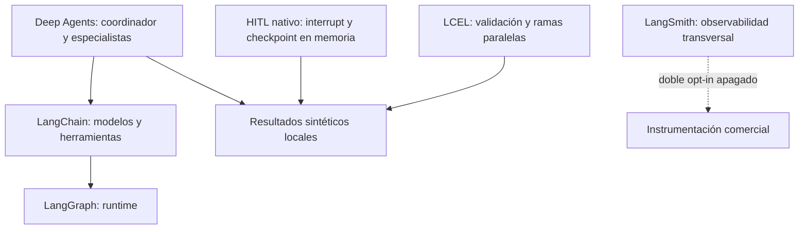

# Arquitectura actual de Veltri Tecnologic

## Flujo comercial

FastAPI sirve la interfaz local y expone POST /consulta y GET /catalogo. El sistema valida la entrada antes del modelo y de LangGraph. Los cálculos y las reglas de compatibilidad están en herramientas deterministas; el modelo se obtiene exclusivamente con get_llm().

El dibujo es una vista de componentes. El StateGraph compilado tiene 11 nodos operativos, 13 vértices con START/END y 20 aristas. El grafo exacto puede inspeccionarse en `src/graph/workflow.py` y en el JSON original del expediente; las rutas seleccionan un único dominio. A1 y la seguridad no cuentan como nodos del grafo.

## Responsabilidades y datos

- D1: A1 interpreta, A2 arma por presupuesto y A3 cotiza.
- D2: A4 valida compatibilidad; D3: A5 consulta inventario.
- D4: A6 compara importes, A7 registra borradores y A8 consulta su estado.
- `src/tools/` calcula precios en céntimos, stock, compatibilidad y hashes idempotentes. Los pagos no se acreditan con un proveedor externo.
- `src/schemas/` valida contratos; `src/core/decision.py` aplica invariantes y umbrales protegidos.
- `src/knowledge/` recupera solo catálogo, compatibilidad y políticas sintéticos, con tenant y citas explícitos. `chroma_db/` es almacenamiento persistente y no se limpia como residuo.
- `src/core/hitl.py` conserva una bandeja local; resolverla no reanuda el grafo ni confirma operaciones comerciales.

La identidad de tenant requiere autorización de producción; el aislamiento por claves no equivale por sí solo a autenticación. No hay aprobación comercial real ni conciliación bancaria. Precios y existencias son ejemplos.

## Demostraciones académicas separadas

`src/academic/` demuestra LCEL, HITL nativo y Deep Agents reales con respuestas programadas de MockLLM. No reemplaza A1–A8 ni se expone por HTTP. Los checkpoints académicos no sobreviven al proceso y las decisiones de demo no conceden permisos comerciales.

LangSmith usa metadatos permitidos y cuerpos vacíos. Los dos opt-in están apagados; la traza existente sigue sin acreditación visual. Guía única: [observabilidad.md](observabilidad.md).

## Mantenimiento y presentación

Los contratos, herramientas, RAG y puntos de entrada se documentan en las secciones siguientes.
El [índice de entrega](README.md) reúne el Word corregido y evidencias originales. BPMN TO-BE tiene compatibilidad parcial: su secuencia A2 → A4 → A5 → A3 no equivale al selector de una rama del grafo. No se modificó el BPMN para ocultar diferencias.

## Contratos y datos

`src/schemas/` contiene los modelos Pydantic estrictos; `docs/contratos/` conserva 35 JSON Schema de intercambio exportados por `scripts/exportar_esquemas.py`. Los modelos rechazan campos extra y coerciones de bool/float/string a enteros. Los validadores comprueban relaciones entre campos que JSON Schema por sí solo no garantiza. Revalidar después de transformar diccionarios: `frozen=True` no congela profundamente listas y mapas.

`ConsultaResponse` versión `1.0-demo` utiliza estados completado, revision_humana, bloqueado y error. Conserva intención, mensaje, motivos, fuentes, flags HITL/proforma/aprobación y resultado opcional acorde al dominio. Error/bloqueo no deben incluir resultados comerciales. `ErrorValidacion` publica códigos y campos permitidos; no excepciones crudas. Ocultar entradas en repr de Pydantic no sanea logs ni model_dump.

`data/catalogo.json` contiene 84 SKUs sintéticos: sku, nombre, categoría, precio_centimos positivo, stock entero no negativo y especificaciones por categoría. PEN usa 100 céntimos por sol. Las unidades técnicas son W, mm, GB y MT/s. Un kit RAM cuenta como una unidad del catálogo. No hay mediciones ni datos reales de tienda; CPU-AMD-5500 tiene stock cero.

`compatibilidad.json` declara sockets, chipsets, RAM, refrigeración, montaje, interfaz SSD y conectores. Las relaciones CPU/placa requieren verificar BIOS y fabricante. El margen de potencia propuesto usa reserva de 100 W y 25 %, con redondeo entero; no certifica transitorios ni rendimiento. `politicas.md` diferencia propuestas de reglas definidas. No se inventan porcentajes de cuello de botella ni FPS.

## Herramientas y configuración

`Catalogo` devuelve copias y valida identidad, moneda, precio y stock. `comprobar_stock` informa faltantes; `alternativas` propone misma categoría/plataforma sin reservar ni aprobar un reemplazo. `validar_configuracion` exige una unidad de ocho categorías, incluida GPU y refrigeración, y comprueba socket, chipset, RAM, SSD, conectores y montaje. Ausencia de conflictos no acredita soporte real de fabricante.

`cotizar` calcula líneas y total en céntimos, stock, validación técnica y bloqueos; no añade IGV, montaje ni envío. `armar` busca una selección compatible dentro de límites inclusivos: con máximo elige el mayor total admisible; sin máximo, el menor que cumple el mínimo. Es una regla de demo, no optimización de rendimiento. Empates por SKU; sin solución devuelve cotización nula y mínimo de catálogo si existe, no mínimo del mercado.

`comparar_pago` compara importes sin convertir monedas: siempre no_conciliado. Los borradores usan SHA-256 de cliente|productos|cantidad|canal, SKUs ordenados, arrays JSON compactos y sin timestamps. Alias demo_ y tenant explícitos; A7/A8 comparten registro en memoria. No hay confirmación, reserva, cobro o despacho.

`get_llm()` es la única fábrica. Configuración del proceso prevalece sobre `.env`; USE_MOCK_LLM=1 por defecto, proveedor gemini. El modo real requiere modelo y clave locales; la fachada comercial lo retiene pendiente de calibración. MockLLM consume fixtures tipados sin inferencia ni fallback inventado. El conector Gemini usa JSON Schema, store=False y no streaming; su compatibilidad se prueba con transporte simulado, no con una cuenta externa.

## Decisión y revisión

SolicitudDecision exige opción, p/c finitos en [0,1], origen prueba_no_calibrada y evidencia discriminada del dominio. La compuerta revalida y calcula bloqueos/hash. Un bloqueo fuerza revisión cualquiera sea p. Sin bloqueo, p >= TAU_AUTO propone ejecutar, TAU_REV <= p < TAU_AUTO propone revisión y p < TAU_REV escala. Los umbrales solo se leen del archivo protegido; c no introduce otro umbral. Puntajes son fixtures, no probabilidades calibradas.

ResultadoDecision registra motivos, fuentes, huella y accion_ejecutada=false. BandejaRevision recalcula al encolar; huella y tenant identifican revisión idempotente. Devuelve copias. Estados pendiente/escalada y finales aprobada_demo/rechazada/correccion_solicitada. Aprobar_demo no admite bloqueos ni escalados y nunca ejecuta negocio. Misma resolución repetida es idempotente; otra resolución final se rechaza. Corregir exige nueva evaluación, no borrar evidencia. Revisor demo_ no autentica una persona. Persistencia y auditoría duraderas están pendientes.

## Recuperación documental

`src/knowledge/` lee solo catálogo, compatibilidad y políticas. Fragmenta por SKU, relación o bloque y conserva fuente/hash. Vectorización léxica SHA-256 a 256 dimensiones, sin embeddings remotos; colisiones y cobertura limitada son posibles. Chroma usa colección por hash del tenant, filtro tenant/snapshot y bloqueo local filelock. No equivale a autenticación multiusuario.

La ingesta valida antes de escribir, publica snapshot nuevo tras completar lotes y conserva el anterior si falla. Reingesta idéntica es idempotente; limpia obsoletos solo del tenant correspondiente. No hay transacción entre fuente e índice. `Almacen.buscar` devuelve hasta 20 candidatos con citas/hash/distancia; SKU exacto tiene prioridad y sin coincidencia devuelve vacío. Distancia no es confianza. Revalidar precios/stock con las herramientas porque el índice puede quedar antiguo.

No indexar mensajes, pedidos, pagos, claves o datos personales. La guarda por patrones es limitada, no anonimización exhaustiva. La ingesta y las consultas requieren tenant explícito. Comando de reconstrucción: `python -m src.knowledge.ingesta --tenant IDENTIFICADOR`; usar `--ruta` nueva para pruebas sin tocar almacenamiento persistente.

## API e interfaz local

`src/api/main.py` expone POST /consulta con SolicitudAPI plana o anidada y respuesta ConsultaResponse. GET /catalogo entrega inventario; `/` sirve `frontend/index.html`. La guarda antiinyección/PII precede al modelo/grafo; DLQ conserva evento técnico sin eco del mensaje. Validación 422, ruta 404 y fallo interno 500 usan errores tipados sin trazas privadas.

La SPA usa HTML, CSS y JavaScript locales: tokens.css y styles.css para presentación, icons.js para SVG, api.js para peticiones y app.js para conversación/catálogo. No hay CDN ni fuentes remotas. La UI muestra ejemplos y proforma visual, pero no prueba aprobación técnica ni conciliación bancaria. Los objetivos de accesibilidad o el desglose de IGV visible no se presentan como certificaciones de cumplimiento; las diferencias comerciales con BPMN siguen pendientes.

Comandos de instalación y servidor están en el README principal; `python scripts/verificar.py` verifica calidad, estructura, dependencias, pruebas y secretos. Los casos CP-1 a CP-7 tienen pruebas de herramientas, flujo y API; la línea base sigue vacía y protegida. El CP-1 requiere revisión por evidencia sintética, no debe afirmarse como venta automáticamente aprobada.
