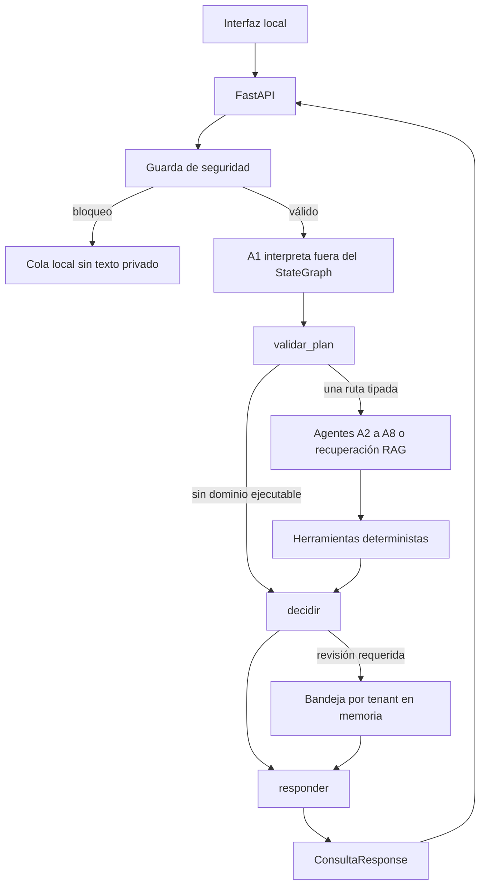
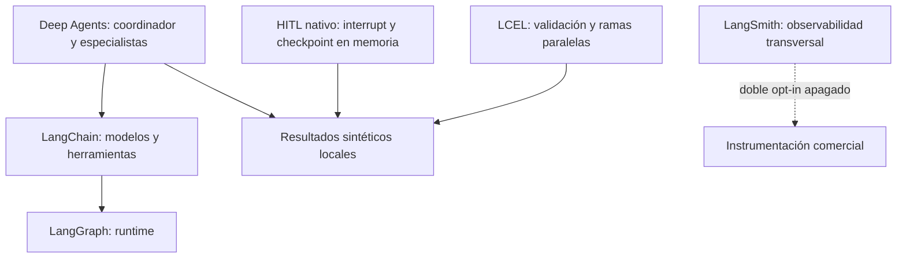

# Arquitectura actual de Veltri Tecnologic

## Flujo comercial

FastAPI sirve la interfaz local y expone POST /consulta y GET /catalogo. El sistema valida la entrada antes del modelo y de LangGraph. Los cálculos y las reglas de compatibilidad están en herramientas deterministas; el modelo se obtiene exclusivamente con get_llm().



El dibujo es una vista de componentes. El StateGraph compilado tiene 11 nodos operativos, 13 vértices con START/END y 20 aristas. El grafo exacto puede inspeccionarse en `src/graph/workflow.py` y en el JSON de la [demo académica](#verificación-y-herramientas-de-mantenimiento); las rutas seleccionan un único dominio. A1 y la seguridad no cuentan como nodos del grafo.

## Responsabilidades y datos

| Agente y dominio | Entrada | Herramienta y resultado tipado |
|---|---|---|
| A1 Interpretación, D1 | `ConsultaRequest` | Propone la intención en `PlanModelo`, dentro de `SalidaAgente[None]`. Opera antes del grafo y sin herramientas de negocio. |
| A2 Armado, D1 | `EntradaArmado` | `armar` busca dentro del rango explícito y devuelve `ResultadoArmado`. |
| A3 Cotización, D1 | `EntradaCotizacion` | `cotizar` evalúa la selección explícita y devuelve `ResultadoCotizacion`. |
| A4 Compatibilidad, D2 | `EntradaSeleccion` | `validar_configuracion` devuelve `ResultadoTecnico`. |
| A5 Inventario, D3 | `EntradaSeleccion` | `comprobar_stock` y `alternativas` producen `ResultadoInventario`. |
| A6 Pagos, D4 | `EntradaPago` | `comparar_pago` compara importes y devuelve `ResultadoPago`. |
| A7 Pedidos, D4 | `EntradaPedido` | El registro por tenant guarda un borrador idempotente, con confirmación explícita, y devuelve `ResultadoPedido`. |
| A8 Seguimiento, D4 | `EntradaSeguimiento` | El mismo registro consulta un borrador del tenant y devuelve `EstadoBorrador` si existe. |

A1–A8 heredan de `BaseAgent` y devuelven `SalidaAgente` tipada. Cada agente usa su prompt y recibe datos validados. A1 propone la intención. Los parámetros comerciales proceden de la entrada tipada del llamador. La salida del modelo no puede cambiar el tenant, cantidades, precios, stock, evidencia o estado de pago.

- `src/tools/` calcula precios en céntimos, stock, compatibilidad y hashes idempotentes. Los pagos no se acreditan con un proveedor externo.
- `src/schemas/` valida contratos; `src/core/decision.py` aplica invariantes y umbrales protegidos.
- `src/knowledge/` recupera solo catálogo, compatibilidad y políticas sintéticos, con tenant y citas explícitos. `chroma_db/` es almacenamiento persistente y no se limpia como residuo.
- `src/core/hitl.py` conserva una bandeja local; resolverla no reanuda el grafo ni confirma operaciones comerciales.

La identidad de tenant requiere autorización de producción; el aislamiento por claves no equivale por sí solo a autenticación. No hay aprobación comercial real ni conciliación bancaria. Precios y existencias son ejemplos.

## Demostraciones académicas separadas



`src/academic/` demuestra LCEL, HITL nativo y Deep Agents reales con respuestas programadas de MockLLM. No reemplaza A1–A8 ni se expone por HTTP. Los checkpoints académicos no sobreviven al proceso y las decisiones de demo no conceden permisos comerciales.

En la demo de semana 10, `create_deep_agent` conecta al coordinador con `write_todos` y `task`. Los especialistas DA-Catalogo (D3) y DA-Revision (D4) trabajan con evidencia sintética. La fase 2 de semana 11 añade lectura y escritura en el estado virtual del grafo y prompts específicos por rol.

Los BPMN [AS-IS](bpmn_as_is.bpmn) y [TO-BE](bpmn_to_be.bpmn) documentan el proceso. El TO-BE encadena A2 → A4 → A5 → A3, mientras que el grafo comercial selecciona un único dominio por consulta.

## Contratos y datos

`src/schemas/` contiene los modelos Pydantic estrictos; `python scripts/exportar_esquemas.py` genera los 35 JSON Schema de intercambio en `docs/contratos/`. La API y los tests consumen los modelos Python. Los modelos rechazan campos extra y coerciones de bool/float/string a enteros. Los validadores comprueban relaciones entre campos que JSON Schema por sí solo no garantiza. Revalidar después de transformar diccionarios: `frozen=True` no congela profundamente listas y mapas.

`ConsultaResponse` versión `1.0-demo` utiliza estados completado, revision_humana, bloqueado y error. Conserva intención, mensaje, motivos, fuentes, flags HITL/proforma/aprobación y resultado opcional acorde al dominio. Error/bloqueo no deben incluir resultados comerciales. `ErrorValidacion` publica códigos y campos permitidos; no excepciones crudas. Ocultar entradas en repr de Pydantic no sanea logs ni model_dump.

`data/catalogo.json` contiene 84 SKUs sintéticos: sku, nombre, categoría, precio_centimos positivo, stock entero no negativo y especificaciones por categoría. PEN usa 100 céntimos por sol. Las unidades técnicas son W, mm, GB y MT/s. Un kit RAM cuenta como una unidad del catálogo. No hay mediciones ni datos reales de tienda; CPU-AMD-5500 tiene stock cero.

`compatibilidad.json` declara sockets, chipsets, RAM, refrigeración, montaje, interfaz SSD y conectores. Las relaciones CPU/placa requieren verificar BIOS y fabricante. El margen de potencia propuesto usa reserva de 100 W y 25 %, con redondeo entero; no certifica transitorios ni rendimiento. `politicas.md` diferencia propuestas de reglas definidas. No se inventan porcentajes de cuello de botella ni FPS.

## Herramientas y configuración

`Catalogo` devuelve copias y valida identidad, moneda, precio y stock. `comprobar_stock` informa faltantes; `alternativas` propone misma categoría/plataforma sin reservar ni aprobar un reemplazo. `validar_configuracion` exige una unidad de ocho categorías, incluida GPU y refrigeración, y comprueba socket, chipset, RAM, SSD, conectores y montaje. Ausencia de conflictos no acredita soporte real de fabricante.

`cotizar` calcula líneas y total en céntimos, stock, validación técnica y bloqueos; no añade IGV, montaje ni envío. `armar` busca una selección compatible dentro de límites inclusivos: con máximo elige el mayor total admisible; sin máximo, el menor que cumple el mínimo. Es una regla de demo, no optimización de rendimiento. Empates por SKU; sin solución devuelve cotización nula y mínimo de catálogo si existe, no mínimo del mercado.

`comparar_pago` compara importes sin convertir monedas: siempre no_conciliado. Los borradores usan SHA-256 de cliente|productos|cantidad|canal, SKUs ordenados, arrays JSON compactos y sin timestamps. Alias demo_ y tenant explícitos; A7/A8 comparten registro en memoria. No hay confirmación, reserva, cobro o despacho.

`get_llm()` es la única fábrica. Configuración del proceso prevalece sobre `.env`; USE_MOCK_LLM=1 por defecto, proveedor gemini. El modo real requiere modelo y clave locales; la fachada comercial lo retiene pendiente de calibración. MockLLM consume fixtures tipados sin inferencia ni fallback inventado. El conector Gemini usa JSON Schema, store=False y no streaming; su compatibilidad se prueba con transporte simulado, no con una cuenta externa.

## Arquitectura de prompts

`src/core/prompts.py` compone doce bloques en orden fijo. Centraliza la jerarquía de confianza,
el manejo de entradas no confiables y la privacidad. `src/agents/prompts.py` aplica las reglas de
planificación comercial. Cada agente define su misión, contexto, herramientas que ejecuta el
código, proceso, límites y condiciones de revisión. A1 incluye ejemplos de clasificación ambigua
y A6 ejemplifica el tratamiento de importes iguales y discrepantes.

Los agentes comerciales emiten un único `PlanModelo` con `accion`, `p` y `c`. Los agentes A2–A8
validan la acción de su dominio antes de ejecutar herramientas deterministas. LangGraph conserva
el control de la revisión humana. El conector Gemini coloca el prompt en `system_instruction` y
los datos en un objeto JSON aparte. Sigue usando el contrato Pydantic y se verifica con transporte
simulado. La guarda previa al modelo continúa activa.

En la [demo académica de semana 11](agentes/deep-agents-semana11.md), los tres roles reciben los
doce bloques como instrucciones de sistema. El adaptador admite solo las herramientas programadas
para cada rol y separa el hallazgo delegado como datos estructurados. La salida
`SalidaAcademica` mantiene la revisión requerida y ausencia de efecto comercial.

## Decisión y revisión

SolicitudDecision exige opción, p/c finitos en [0,1], origen prueba_no_calibrada y evidencia discriminada del dominio. La compuerta revalida y calcula bloqueos/hash. Un bloqueo fuerza revisión cualquiera sea p. Sin bloqueo, p >= TAU_AUTO propone ejecutar, TAU_REV <= p < TAU_AUTO propone revisión y p < TAU_REV escala. Los umbrales solo se leen del archivo protegido; c no introduce otro umbral. Puntajes son fixtures, no probabilidades calibradas.

ResultadoDecision registra motivos, fuentes, huella y accion_ejecutada=false. BandejaRevision recalcula al encolar; huella y tenant identifican revisión idempotente. Devuelve copias. Estados pendiente/escalada y finales aprobada_demo/rechazada/correccion_solicitada. Aprobar_demo no admite bloqueos ni escalados y nunca ejecuta negocio. Misma resolución repetida es idempotente; otra resolución final se rechaza. Corregir exige nueva evaluación, no borrar evidencia. Revisor demo_ no autentica una persona. Persistencia y auditoría duraderas están pendientes.

## Recuperación documental

`src/knowledge/` lee solo catálogo, compatibilidad y políticas. Fragmenta por SKU, relación o bloque y conserva fuente/hash. Vectorización léxica SHA-256 a 256 dimensiones, sin embeddings remotos; colisiones y cobertura limitada son posibles. Chroma usa colección por hash del tenant, filtro tenant/snapshot y bloqueo local filelock. No equivale a autenticación multiusuario.

La ingesta valida antes de escribir, publica snapshot nuevo tras completar lotes y conserva el anterior si falla. Reingesta idéntica es idempotente; limpia obsoletos solo del tenant correspondiente. No hay transacción entre fuente e índice. `Almacen.buscar` devuelve hasta 20 candidatos con citas/hash/distancia; SKU exacto tiene prioridad y sin coincidencia devuelve vacío. Distancia no es confianza. Revalidar precios/stock con las herramientas porque el índice puede quedar antiguo.

No indexar mensajes, pedidos, pagos, claves o datos personales. La guarda por patrones es limitada, no anonimización exhaustiva. La ingesta y las consultas requieren tenant explícito. Comando de reconstrucción: `python -m src.knowledge.ingesta --tenant IDENTIFICADOR`; usar `--ruta` nueva para pruebas sin tocar almacenamiento persistente.

## API e interfaz local

`src/api/main.py` expone POST /consulta con SolicitudAPI plana o anidada y respuesta ConsultaResponse. GET /catalogo entrega inventario; `/` sirve `frontend/index.html`. La guarda antiinyección/PII precede al modelo/grafo; DLQ conserva evento técnico sin eco del mensaje. Validación 422, ruta 404 y fallo interno 500 usan errores tipados sin trazas privadas.

La SPA usa HTML, CSS y JavaScript locales: tokens.css y styles.css para presentación, icons.js para SVG, api.js para peticiones y app.js para conversación/catálogo. No hay CDN ni fuentes remotas. La UI muestra ejemplos y proforma visual, pero no prueba aprobación técnica ni conciliación bancaria. Los objetivos de accesibilidad o el desglose de IGV visible no se presentan como certificaciones de cumplimiento; las diferencias comerciales con BPMN siguen pendientes.

Comandos de instalación y servidor están en el README principal; `python scripts/verificar.py` verifica calidad, estructura, dependencias, pruebas y secretos. Los casos CP-1 a CP-7 tienen pruebas de herramientas, flujo y API; la línea base sigue vacía y protegida. El CP-1 requiere revisión por evidencia sintética, no debe afirmarse como venta automáticamente aprobada.

## Extensión académica de semana 11 (fase 2)

La demostración `src/academic/deep_agents_semana11.py` conserva los roles académicos existentes. El coordinador planifica, delega a Catálogo, escribe y lee `/hallazgos.json` en el estado virtual y entrega el hallazgo a Revisión para contrastarlo. El flujo no modifica la API ni el grafo comercial. Véase el [diagrama y las pruebas de integración](agentes/deep-agents-semana11.md). El estado dura una ejecución y el modelo sigue siendo simulado.


## Observabilidad segura

`src/core/observabilidad.py` y `src/core/diagnostico_http.py` implementan la instrumentación y el transporte. La configuración predeterminada mantiene la instrumentación apagada. No existe un control HTTP para activarla.

- La instrumentación exige `VELTRI_TRACING_ENABLED=1` y `VELTRI_TRACING_SYNTHETIC_ONLY=1`. Un envío externo requiere también `VELTRI_TRACING_ALLOW_EXTERNAL=1`, MockLLM, la validación del destino oficial, una clave local y el proyecto `veltri-semana10-demo`.
- Mantén `LANGSMITH_TRACING` y `LANGCHAIN_TRACING_V2` en `false`. Solo se permiten UUID aleatorios, nombres cerrados, parentesco, tiempos y metadatos sintéticos constantes. Los inputs y outputs están vacíos.
- El transporte conserva el primer fallo y bloquea llamadas posteriores, redirecciones y reintentos. Registra método, ruta saneada, estado, categoría, correlación sintética y etapa.
- `python scripts/demo_observabilidad.py` ejecuta el modo local sin envío. El lanzador remoto `scripts/langsmith_segundo_intento.py` está protegido por un [registro de un solo uso](evidencias/semana10-fase43/ejecucion-unica.json) ya consumido. Consérvalo en su ruta y nunca lo reinicies. Cualquier envío remoto requiere autorización humana nueva y específica.
- El primer intento histórico recibió HTTP 400. El segundo registró nueve POST y nueve PATCH con HTTP 202 y se detuvo al recibir HTTP 403 en la lectura. La persistencia, el identificador y el árbol remotos siguen sin verificar.

## Verificación y herramientas de mantenimiento

- `python scripts/verificar.py` verifica sintaxis, referencias e imports estáticos, dependencias, Ruff, pytest y secretos. El tipado con `--mypy` es opcional. Los imports dinámicos se comprueban con pruebas de ejecución.
- `python scripts/instalar_hooks.py` instala el hook de protección de archivos críticos y escaneo de secretos. `python scripts/escanear_secretos.py` también se puede ejecutar por separado.
- `python scripts/demo_academica.py` ejecuta las demos de semana 10 con MockLLM y emite, entre otros resultados, el JSON del grafo comercial. Usa un directorio temporal por defecto. Si se indica `--salida`, la ruta debe ser nueva.
- La demo de semana 11 se ejecuta con `python -m src.academic.deep_agents_semana11`. Las demos y la verificación local emplean fixtures y transporte simulado.

## Archivo histórico de la semana 10

Los 42 archivos originales de entrega y evidencias están versionados en el commit [0cb71a7](https://github.com/alessandrorr1007-debug/veltri/tree/0cb71a796b151c01bf1f6b081f124af610575c71/docs). El archivo conserva el Word, el generador, las figuras, la procedencia y los registros de pruebas y ejecución. El registro operativo de LangSmith también permanece en el árbol activo.

Con Git y el historial disponible, exporta los originales a un ZIP separado del árbol activo:

```sh
git archive --format=zip --output=veltri-semana10.zip 0cb71a796b151c01bf1f6b081f124af610575c71 docs/entrega-semana10 docs/evidencias
```

Para reproducir el Word, extrae una copia completa de ese commit a otro directorio y usa allí sus dependencias fijadas y su generador. Conserva el informe original por separado.
