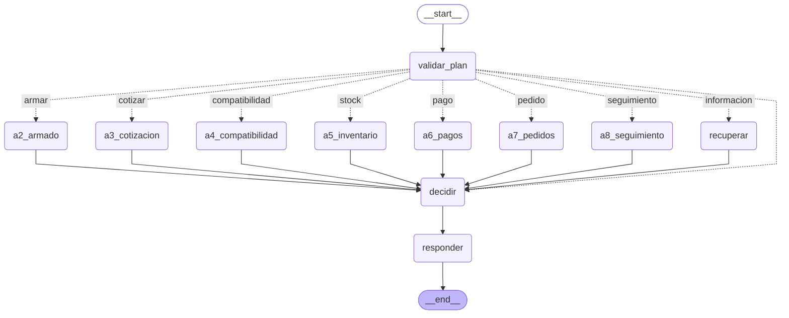
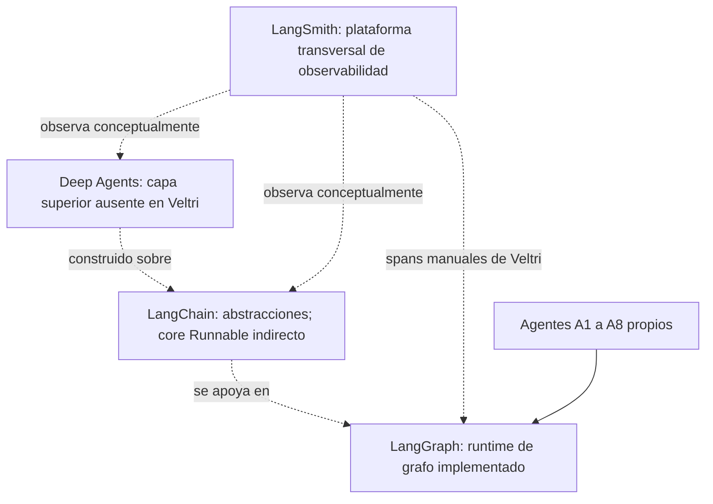

# Auditoría final de los cinco requisitos de Semana 10

Fecha: 31/10/2026, America/Lima. Enunciado confirmado por el usuario/profesor.
Se inspeccionó el árbol local actual, no solo el commit histórico 591670b. Contiene
cambios sin commit de fases previas; no se revirtieron. Esta auditoría cambia solo
documentación. No instala paquetes, implementa funciones, publica ni genera Word.

La entrega completa todavía no está acreditada: hay análisis técnico demostrable
para LCEL y LangGraph/HITL, falta la verificación visual/remota de LangSmith y no
existen Deep Agents del framework. Se completó la explicación documental de las
tres capas del stack y LangSmith transversal, reflejando su adopción desigual.

Matriz íntegra con siete columnas: [matriz-cumplimiento.json](evidencias/auditoria-final-semana10/matriz-cumplimiento.json).
El panel de auditoría junto al chat presenta esa matriz y sus comparaciones.

## Matriz de cumplimiento

### 1. Identificar términos LCEL

- **Estado actual:** Identificación documental acreditable; uso LCEL limitado y capturas pendientes.
- **Evidencia:** Grafo compilado es Runnable; llamada invoke real; auditoría AST sin cadenas LCEL explícitas.
- **Archivos y líneas:** src/graph/workflow.py:28, :53, :123; src/agents/base.py:42; src/core/llm.py:20; src/schemas/base.py:15.
- **Capturas necesarias:** invoke y grafo Runnable; prompts propios y Pydantic rotulados como componentes no LCEL.
- **Trabajo pendiente:** Capturas auténticas del código; no existe una composición prompt | model | parser propia.
- **Acción recomendada:** Presentar los términos presentes y las ausencias; no agregar cadenas solo para aparentar cumplimiento.

### 2. LangGraph, HITL y BPMN

- **Estado actual:** Implementado y documentado; compatibilidad parcial. Paquete visual aún incompleto.
- **Evidencia:** 14 vértices incluidos START/END, 12 nodos operativos y 20 aristas compiladas; bandeja y resoluciones sintéticas desde código.
- **Archivos y líneas:** src/graph/workflow.py:28; src/graph/state.py:21; src/graph/nodes.py:70, :93, :205, :217; src/core/hitl.py:27, :62; docs/bpmn_to_be.bpmn.
- **Capturas necesarias:** Grafo compilado, BPMN original en modelador y registro antes/después HITL; no pantalla de aprobación inexistente.
- **Trabajo pendiente:** Capturar diagramas y revisión; no hay interrupt, checkpoints o aprobación web autenticada.
- **Acción recomendada:** Explicar discrepancias por actividad. HITL propio ≠ reanudación nativa; BPMN no es motor ejecutado.

### 3. Ejecución monitoreada en LangSmith

- **Estado actual:** NO acreditado con las evidencias actuales.
- **Evidencia:** Segundo intento: 9 POST y 9 PATCH HTTP 202; primer GET 403; run_id_verificado=null; 0 spans cotejados remotamente.
- **Archivos y líneas:** docs/evidencias/semana10-fase43/ejecucion-unica.json:1; src/core/observabilidad.py:37; scripts/langsmith_segundo_intento.py.
- **Capturas necesarias:** Proyecto y raíz consulta; run_id/duración; árbol de nueve spans; metadata sintética e inputs/outputs vacíos.
- **Trabajo pendiente:** Verificar la traza existente. HTTP 202 acredita aceptación para ingestión, no persistencia completa.
- **Acción recomendada:** Revisión manual del panel o lectura autenticada expresamente autorizada; no otra demo. No se accedió a la cuenta en esta auditoría.

### 4. Deep Agents generados

- **Estado actual:** NO implementado: 0 Deep Agents del framework; 8 agentes personalizados.
- **Evidencia:** deepagents ausente de distribuciones/módulos; sin create_deep_agent ni middleware/subagentes Deep Agents. A1–A8 heredan BaseAgent.
- **Archivos y líneas:** src/agents/base.py:21; src/agents/d1_ventas/a1_interpretacion.py:8; demás clases en agentes-personalizados.json; src/graph/nodes.py:47.
- **Capturas necesarias:** Metadatos de paquetes y clases BaseAgent. Rotular claramente ausencia de Deep Agents.
- **Trabajo pendiente:** No existen planificación, filesystem/contexto, delegación o memoria proporcionados por Deep Agents.
- **Acción recomendada:** Reportar ausencia como brecha de implementación. Si el curso exige generarlos, pedir autorización separada; no instalar ni renombrar A1–A8.

### 5. Cuatro componentes/capas del ecosistema

- **Estado actual:** Documentación completada conforme al enunciado confirmado; adopción técnica desigual.
- **Evidencia:** Deep Agents ausente; LangChain presente indirectamente como langchain-core/Runnable; LangGraph real; LangSmith instrumentado y pendiente de verificación.
- **Archivos y líneas:** src/graph/workflow.py:7, :30, :123; src/agents/base.py:21; src/core/llm.py:20; src/core/observabilidad.py:37; paquetes-instalados.json.
- **Capturas necesarias:** Diagrama de tres capas y observabilidad transversal; código y versiones por componente.
- **Trabajo pendiente:** No describir el stack completo como implementado; Deep Agents ausente y LangSmith aún no acreditado.
- **Acción recomendada:** Sustituir la clasificación provisional Build/Test/Deploy/Monitor por Deep Agents → LangChain → LangGraph, con LangSmith transversal.

## 1. Componentes LCEL: definición, uso y evidencia

- **Runnable:** Interfaz de ejecución/composición común de langchain-core. Grafo compilado: isinstance(..., Runnable)=True; implementación heredada, no Runnable custom. Fuente: src/graph/workflow.py:53; grafo-compilado.json.

- **invoke:** Invocación síncrona de un Runnable. Se ejecuta sobre el grafo con estado tipado y callbacks vacíos. Fuente: src/graph/workflow.py:123.

- **StateGraph.compile:** Compila nodos/aristas a runtime invocable. Componente LangGraph compatible con Runnable; no equivale a cadena LCEL explícita. Fuente: src/graph/workflow.py:30, :53.

- **Prompt:** Instrucciones del agente. Strings de cada clase; no ChatPromptTemplate ni PromptTemplate LangChain. Fuente: src/agents/base.py:26; src/agents/d1_ventas/a2_armado.py:15.

- **Modelo:** Proveedor de interpretación de intención. Protocolo Modelo.generar y MockLLM/GeminiLLM propios; no BaseChatModel ni modelo Runnable LangChain. Fuente: src/core/llm.py:20, :28, :51, :87.

- **Parser / validación:** Validación de JSON y contratos. Pydantic model_validate y model_validate_json propios; no parsers LCEL. Fuente: src/schemas/base.py:15; src/core/llm.py:82; src/agents/base.py:37.

- **Herramientas:** Funciones deterministas invocadas por agentes. Llamadas Python directas mediante _ejecutar; no @tool/Tool como composición LCEL. Fuente: src/agents/base.py:53; src/agents/d3_inventario/a5_inventario.py:21.

- **RunnableSequence / Parallel / operador |:** Composición de Runnables. No se encontró composición LCEL propia ni esas clases usadas en src. Fuente: inspeccion-ast.json; alcance src/**/*.py.

- **PlanModelo:** Acción y puntuaciones estructuradas. Selección de una ruta comercial; no plan Deep Agents ni motor de planificación multi paso. Fuente: src/schemas/agentes.py:32; src/graph/nodes.py:70.

El paquete principal langchain no está instalado. Sí está langchain-core 1.6.12,
dependencia de LangGraph; se verificó isinstance(grafo_compilado, Runnable), no solo
la presencia textual de invoke. No hay importaciones de LangChain en el código
propio del runtime ni create_agent. Requisitos declarados no equivalen a paquetes
instalados o componentes utilizados. Los protocolos de modelo y validación propios
se muestran como tales, sin atribuirlos a LCEL.

## 2. Grafo real y mecanismos HITL

Diagrama obtenido de get_graph().draw_mermaid() sobre el grafo compilado actual.
No se invocó el modelo ni se hizo una consulta comercial para generarlo. Los archivos
grafo-compilado.json y .mmd registran 14 vértices (12 nodos operativos + START/END)
y 20 aristas. El SVG previo se reutiliza tras comprobar estructura idéntica.
Una arista en el diagrama no demuestra que cada rama haya sido ejecutada en esta auditoría.

Seguridad y A1 se ejecutan antes de invoke y fuera del StateGraph. El estado tipado
EstadoFlujo contiene ruta, plan, evidencia, decisión y respuesta; no texto libre del
mensaje. validar_plan selecciona una sola rama por enum o deriva directamente a
decidir. recuperar es una rama alternativa de conocimiento con tenant explícito.

evaluar llama decide, encola si requiere revisión, y responder devuelve JSON también
para los casos retenidos. BandejaRevision almacena revisiones en memoria, aisladas
por tenant; resolver admite aprobar_demo, rechazar o solicitar_correccion. Una
aprobación demo con evidencia bloqueada es rechazada. Las resoluciones no ejecutan
negocio. El ejemplo antes/después conservado es de revisor sintético por código,
no de una persona autenticada en una pantalla de supervisión.

No hay checkpointer en el objeto compilado ni llamadas interrupt/Command en src.
No existe pausa/reanudación nativa ni recuperación persistente tras reiniciar.

### Comparación con cada parte relevante del TO-BE

- **Seguridad y DLQ — Task_Filtro_Seguridad / Task_Registrar_DLQ:** Validación previa al modelo/grafo; entrada prohibida genera DLQ. Coincidencia funcional; filtro bloquea PII, no prometer anonimización universal. Fuente: workflow.py:102; core/seguridad.py; core/dlq.py.

- **A1 — Task_A1_Interpretacion:** Clase A1 produce PlanModelo; ejecutada fuera de StateGraph. Compatible en propósito; no representarla como nodo compilado. Fuente: workflow.py:122; a1_interpretacion.py:8.

- **Enrutador — Gateway_Enrutador_Dominio (inclusiveGateway):** Conditional edges eligen una ruta por enum; decisión directa si faltan parámetros o puntuación. Parcial: gateway inclusivo puede representar varias ramas, runtime selecciona una. Fuente: workflow.py:50; nodes.py:70.

- **Ventas/técnico — A2 → A4 → A5 → A3:** Nodos alternativos a2_armado, a3_cotizacion, a4_compatibilidad, a5_inventario; A2 llama herramientas propias. No existe esa secuencia de cuatro agentes en un recorrido; cálculos internos no son invocaciones de A4/A5/A3. Fuente: workflow.py:37; nodes.py:93.

- **Compatibilidad/potencia — Task_A4_Compatibilidad_TDP:** Reglas deterministas de socket/RAM/potencia; datos sintéticos y pendientes de fabricante/BIOS. Coincidencia parcial, no aprobación técnica de hardware real. Fuente: tools/hardware.py; agents/d2_tecnico/a4_compatibilidad.py:10.

- **Cotización/IGV — Task_A3_Cotizacion_Formal con IGV 18%:** Backend suma importes; política fiscal pendiente y UI descompone total/1.18. Discrepancia ya detectada; no se corrigió IGV ni se editó BPMN. Fuente: docs/bpmn_to_be.bpmn:117; frontend/js/app.js:257; data/politicas.md:24.

- **Pagos — Task_A6_Conciliar_Pago:** Comparación de importes; pago permanece no_conciliado. No acreditar conciliación bancaria real. Fuente: agents/d4_pedidos/a6_pagos.py:9; tools/pagos.py.

- **Pedidos y A8 — Task_A7_Idempotencia_SHA256; A8 ausente:** Borradores idempotentes y consulta del tenant mediante A8. A7 parcial respecto a pedido/despacho real; A8 no modelado en TO-BE. Fuente: agents/d4_pedidos/a7_pedidos.py:10; a8_seguimiento.py:8.

- **RAG — Task_RAG_Recuperar_Politicas:** Nodo recuperar con tenant explícito; requiere almacén. Compatible en función; sin almacén se registra limitación, no recuperación ficticia. Fuente: nodes.py:175; knowledge/almacen.py.

- **Decisión y HITL — Task_Compuerta_Decide / Task_Supervisar_HITL_Humano:** decide + bandeja en memoria + resolver demo; respuesta revision_humana. Parcial: sin revisor autenticado, persistencia, pausa/reanudación o ejecución de negocio tras resolver. Fuente: nodes.py:205; core/hitl.py:27, :62.

- **Respuesta — Task_Proyectar_ConsultaResponse / fin retenido:** responder produce contrato también para HITL. BPMN deriva retenidos a un fin separado; API sí devuelve JSON para revisión. Fuente: nodes.py:217; workflow.py:132.

- **Ejecución y SLA — isExecutable=true; fin <1.5s:** Se ejecuta LangGraph/FastAPI, no motor BPMN; no benchmark del objetivo. Bandera XML y nombre de evento no prueban ejecución BPMN o latencia garantizada. Fuente: docs/bpmn_to_be.bpmn:22; :169.

El XML isExecutable=true no acredita un motor BPMN ejecutándose. La secuencia de
cuatro agentes del BPMN no puede presentarse como el recorrido real del StateGraph.
No se modificó el BPMN, IGV, pagos ni las demás discrepancias para ocultarlas.

## 3. LangSmith: qué está demostrado y qué no

La evidencia guardada en Fase 4.3 demuestra nueve altas y nueve cierres HTTP 202,
seguidos de un primer GET 403. run_id_verificado es null y spans_verificados está
vacío. No hay duración remota ni árbol cotejado con el servicio. La categoría
permisos del diagnóstico no prueba qué permiso de la credencial causó el rechazo.

Los JSON locales prueban instrumentación y aceptación para ingestión; no sustituyen
la lectura autenticada o el panel mostrando la traza completa. No se deduce que la
traza no exista. Se puede intentar cerrar esta brecha revisando la ejecución ya
enviada, sin generar otra demo. Buscar raíz consulta, proyecto veltri-semana10-demo,
31/10/2026 de 09:39:46 a 09:40:03 America/Lima. Capturar ID, duración, árbol de nueve
spans, metadata MockLLM e inputs/outputs vacíos; cotejar el resultado comercial local.

No se hizo revisión web de la cuenta en esta auditoría ni nuevas solicitudes a
LangSmith. Las restricciones anteriores de Computer Use no se eludieron. El usuario
puede revisar manualmente el panel o autorizar específicamente una revisión de
lectura con acceso apropiado; si el navegador sigue bloqueado, obtener las capturas
manualmente. No repetir el envío para solucionar un permiso de lectura.

## 4. Deep Agents y relación con A1–A8

- **Paquete deepagents:** No instalado ni módulo local encontrado.

- **create_deep_agent:** Sin importación ni llamada en src; no constructor Deep Agents.

- **Delegación/subagentes:** No SubAgentMiddleware ni tool task de Deep Agents; A1–A8 son ramas del orquestador.

- **Planificación:** PlanModelo es intención/puntuaciones, no lista de tareas Deep Agents; armador.py es cálculo determinista.

- **Contexto:** EstadoFlujo y contexto comercial propios; sin filesystem ni compresión del harness Deep Agents.

- **Memoria:** Bandeja/borradores en memoria, RAG Chroma y contexto explícito; ninguno es memoria Deep Agents.

- **Relación A1–A8/framework:** Ocho clases BaseAgent propias, sin herencia/importación del framework ni delegación autónoma entre ellas.

### Clases personalizadas reales

- **A1Interpretacion** — Interpretación: intención estructurada; sin herramientas comerciales. [Código](D:/Proyectos/veltri-orquestador/src/agents/d1_ventas/a1_interpretacion.py:8). Hereda BaseAgent; no es Deep Agent.

- **A2Armado** — Armado: herramienta determinista armar según presupuesto. [Código](D:/Proyectos/veltri-orquestador/src/agents/d1_ventas/a2_armado.py:10). Hereda BaseAgent; no es Deep Agent.

- **A3Cotizacion** — Cotización: herramienta cotizar en céntimos. [Código](D:/Proyectos/veltri-orquestador/src/agents/d1_ventas/a3_cotizacion.py:10). Hereda BaseAgent; no es Deep Agent.

- **A4Compatibilidad** — Compatibilidad: validar_configuracion sobre datos sintéticos. [Código](D:/Proyectos/veltri-orquestador/src/agents/d2_tecnico/a4_compatibilidad.py:10). Hereda BaseAgent; no es Deep Agent.

- **A5Inventario** — Inventario: comprobar_stock y alternativas. [Código](D:/Proyectos/veltri-orquestador/src/agents/d3_inventario/a5_inventario.py:9). Hereda BaseAgent; no es Deep Agent.

- **A6Pagos** — Pagos: comparar_pago; no concilia cuentas reales. [Código](D:/Proyectos/veltri-orquestador/src/agents/d4_pedidos/a6_pagos.py:9). Hereda BaseAgent; no es Deep Agent.

- **A7Pedidos** — Pedidos: registra borradores demo idempotentes. [Código](D:/Proyectos/veltri-orquestador/src/agents/d4_pedidos/a7_pedidos.py:10). Hereda BaseAgent; no es Deep Agent.

- **A8Seguimiento** — Seguimiento: consulta borrador del tenant. [Código](D:/Proyectos/veltri-orquestador/src/agents/d4_pedidos/a8_seguimiento.py:8). Hereda BaseAgent; no es Deep Agent.

Las clases no se llaman entre sí como subagentes delegados. Servicios.agente crea
instancias para la rama seleccionada; A1 entrega un plan y el orquestador invoca
el dominio correspondiente. PlanModelo modela intención y puntuaciones, no un plan
de tareas Deep Agents. El contexto comercial del llamador, Chroma RAG, borradores
y bandeja son mecanismos propios, no memoria ni gestión de contexto de Deep Agents.

La evidencia de 24 casos de Fase 3 acredita agentes personalizados con MockLLM,
no Deep Agents ni inferencia Gemini. Si el profesor exige generarlos, esta es una
brecha de implementación que requiere autorización independiente. La auditoría de
ausencia queda completada; el requisito de Deep Agents generados no está cumplido.

## 5. Tres capas del stack y observabilidad transversal

- **Deep Agents:** Capa de mayor nivel sobre LangChain/LangGraph: planificación, contexto mediante filesystem, subagentes y memoria. No instalada ni implementada; ninguna función de runtime del proyecto pertenece al framework. Fuente: paquetes-instalados.json; inspeccion-ast.json.

- **LangChain:** Capa de abstracciones y componentes de agentes/modelos/herramientas; LCEL compone Runnables. langchain no instalado; langchain-core 1.6.12 sí por dependencias del grafo. El modelo y herramientas propios no se transforman por ello en cadenas LangChain. Fuente: src/core/llm.py:20; src/agents/base.py:21; workflow.py:123.

- **LangGraph:** Capa de orquestación/runtime de grafos con estado. langgraph 1.2.16: StateGraph, rutas tipadas y Runnable compilado. No utiliza su persistencia o interrupciones nativas. Fuente: src/graph/workflow.py:28; src/graph/state.py:21.

- **LangSmith:** Plataforma transversal de trazado, evaluación y observabilidad, no cuarta capa de ejecución debajo de LangGraph. langsmith 0.14.11; spans manuales opt-in; 18 escrituras aceptadas y lectura 403. Sin traza completa verificada. Fuente: src/core/observabilidad.py:37; docs/evidencias/semana10-fase43/ejecucion-unica.json.

Este es un esquema conceptual de ubicación, no una afirmación de que Deep Agents
o agentes LangChain estén implementados. Deep Agents no está instalado; LangChain
se utiliza indirectamente a través de langchain-core/Runnable. LangGraph es la
capa concreta implementada. LangSmith es transversal: no constituye una cuarta
capa de ejecución debajo de LangGraph, ni un nodo de negocio del grafo.

Build/Test/Deploy/Monitor queda descartado como respuesta al enunciado confirmado;
describe un ciclo de trabajo, no estas capas. Tampoco se confunden con D1–D4 de
negocio ni con frontend/API/datos de la arquitectura de aplicación.

## Fuentes y evidencia verificable

- [Deep Agents, documentación oficial](https://docs.langchain.com/oss/python/deepagents/overview).
- [LangChain, documentación oficial](https://docs.langchain.com/oss/python/langchain/overview).
- [LangGraph, documentación oficial](https://docs.langchain.com/oss/python/langgraph/overview).
- [LangSmith Observability](https://docs.langchain.com/langsmith/observability).
- Paquetes y módulos del .venv local: evidencias/auditoria-final-semana10/paquetes-instalados.json.
- Imports, clases y llamadas de src/**/*.py: evidencias/auditoria-final-semana10/inspeccion-ast.json.
- Grafo, lista de aristas, XML BPMN inspeccionado y matriz: misma carpeta.
- Logs, resultado y registro de autorización de Fase 4.3: docs/evidencias/semana10-fase43/.
- Evidencia local HITL y 24 agentes: docs/evidencias/semana10-fase4/registros/; se conserva su fecha original.

## Prioridades sin alterar el alcance

1. Verificar la traza existente y obtener capturas auténticas; no hacer otra demostración.
2. Presentar la ausencia de Deep Agents y acordar si se requiere implementación posterior.
3. Capturar código LCEL/Runnable y los diagramas y resoluciones reales para R1/R2.
4. Usar las capas correctas en el material académico; el mapeo documental ya está completo.
5. Preparar el Word solo bajo autorización posterior; no fabricar paneles, permisos o resultados.

Resumen para video:
Auditamos el código y distinguimos agentes personalizados de los Deep Agents ausentes.
Documentamos el grafo real, el HITL limitado y las tres capas con observabilidad transversal.
Faltan verificar la traza existente y completar capturas auténticas antes de cerrar la entrega.

## Verificación de cierre

`python scripts/verificar.py`: **456 aprobadas, 0 fallos, 0 errores y 0 omitidas**, dos advertencias de dependencias. Ruff y escaneo de secretos OK. Pytest: 39.31 s. [Salida real](evidencias/auditoria-final-semana10/verificar.log). 6 procesos de auditoría/pruebas con guarda de red y cero intentos externos. La consulta de documentación pública no envió trazas ni accedió a la cuenta LangSmith. No se hicieron commits ni instalaciones.
