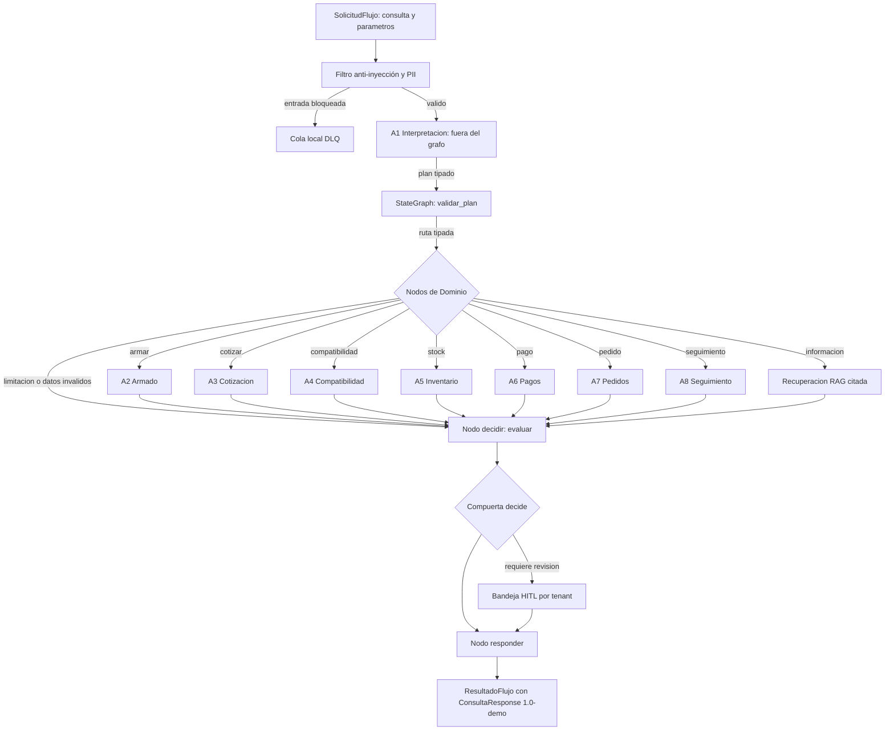

# Orquestador LangGraph — FASE 7

Integración local de los ocho agentes (A1 a A8) mediante un grafo acotado (StateGraph)
con filtro de seguridad previo, rutas tipadas, cola DLQ y compuerta HITL. No hay API
ni interfaz de usuario en esta fase; las peticiones se procesan localmente mediante la
fachada `Orquestador`.

## Arquitectura del flujo



## Seguridad previa y cola DLQ (CP-2)
1. **Guarda antes del grafo**: `validar_entrada_modelo` (`src/core/seguridad.py`) evalúa
   el mensaje de texto libre antes de invocar a A1 o ingresar al grafo LangGraph.
2. **Cola de fallidos mínima (`src/core/dlq.py`)**: Si se detecta un patrón de inyección o
   datos personales (DNI, correo, teléfono), se registra un `EventoBloqueado` con un ID
   aleatorio SHA-256 (`uuid4`), `tenant_id` y `codigo="entrada_bloqueada"`.
3. **Privacidad estricta**: El texto del mensaje no se registra en la DLQ, ni en memoria,
   ni en logs ni en trazas. La respuesta pública devuelve `status="bloqueado"`,
   `archivado_en_dlq=true` y `genera_proforma=false`.

## Estado tipado y aislamiento de trazas
1. **Sin texto libre**: `EstadoFlujo` (`src/graph/state.py`) no almacena cadenas de texto
   libre del usuario (`mensaje` o `consulta`). Solo contiene `tenant_id`, `plan` (Pydantic),
   `parametros` (uniones tipadas discriminadas por `tipo`), rutas y resultados estructurados.
2. **Sin memoria conversacional ni checkpointer**: El grafo no usa `checkpointer` ni persiste
   estado entre ejecuciones. Cada consulta es atómica e independiente.
3. **Trazas desactivadas**: La ejecución se envuelve con `tracing_context(enabled=False)` de
   LangSmith para evitar cualquier intento de conexión de red o envío de telemetría fuera
   del entorno local.

## Rutas tipadas y limitaciones explícitas
1. **Validación del plan**: `validar_plan` comprueba el puntaje inicial y valida que la
   `accion` propuesta por A1 corresponda exactamente con los `parametros` tipados enviados
   por el llamador.
2. **Evidencia de limitación (`EvidenciaLimitacion`)**: Si faltan parámetros requeridos,
   la intención no corresponde, o no existe una configuración en catálogo dentro del rango
   presupuestario (CP-4), el sistema genera una evidencia de tipo `"limitacion"` con motivos
   controlados (`parametros_requeridos`, `sin_configuracion_en_rango`, etc.).
3. **Revisión obligatoria**: La compuerta `decide()` clasifica cualquier limitación como
   un bloqueo de negocio, forzando `hitl_requerido=true` y encolando en la `BandejaRevision`
   del tenant, sin intentar "adivinar" ni completar datos por cuenta propia.

## Dominios y RAG informativo
1. **Nodos de agente (A2 a A8)**: Invocan a cada agente con los parámetros tipados del
   llamador, ejecutando las herramientas deterministas correspondientes (`catalogo.py`,
   `inventario.py`, `hardware.py`, `cotizacion.py`, `armador.py`, `pagos.py`, `pedidos.py`,
   `registro.py`).
2. **Nodo `recuperar`**: Para consultas informativas sobre políticas, stock, compatibilidad o
   pagos, recupera fragmentos indexados en ChromaDB utilizando el tenant explícito y
   emite `CitaRecuperada` con fuente, referencia y hashes, sin pasar fragmentos libres al modelo.
3. **Nodo `responder`**: Proyecta los resultados estructurados a `ConsultaResponse 1.0-demo`,
   garantizando coherencia entre flags de negocio, fuentes, motivos y bandejas de revisión.

## Verificación de casos dorados (CP-1 a CP-7)
En `tests/test_flujo.py` se validan los escenarios dorados de extremo a extremo:
- **CP-1**: Cotización gaming dentro de presupuesto S/ 3,500; respeta el límite y requiere
  revisión por verificación técnica pendiente de fabricante.
- **CP-2**: Intento de inyección de prompt o fuga de PII; bloqueado antes del grafo y
  archivado en DLQ sin eco del mensaje.
- **CP-3**: Consulta con componente sin stock (Ryzen 5 5500); enruta a revisión humana,
  cita `data/catalogo.json` e incluye alternativas disponibles.
- **CP-4**: Solicitud con presupuesto insuficiente (RTX por S/ 1,200); no genera proforma,
  reporta el mínimo real de catálogo y encola en revisión por `sin_configuracion_en_rango`.
- **CP-5**: Pagos declarados con monto discordante o exacto; clasificados como `no_conciliado`,
  sin acreditar operaciones bancarias y forzando HITL.
- **CP-6**: Confirmación de pedido idempotente; el segundo envío detecta duplicado mediante
  hash SHA-256 (`cliente|productos|cantidad|canal`) y no crea registros adicionales.
- **CP-7**: Armador determinista por rangos; ninguna configuración supera el tope presupuestario
  ni inventa piezas fuera de catálogo.

## Comandos de verificación
```powershell
.\.venv\Scripts\python -m pip install -r requirements-fase7.txt
.\.venv\Scripts\python -m pytest tests/test_flujo.py -q
.\.venv\Scripts\python scripts/verificar.py
```
